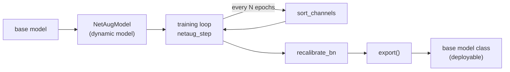

# torchnetaug

[繁體中文](README.md) | **English**

A pure-PyTorch implementation of [Network Augmentation (NetAug)](https://arxiv.org/abs/2110.08890) (Cai et al., ICLR 2022).

> **Project finished (2026-11-23).** The implementation matches the paper, but NetAug gave no significant gain in the CIFAR experiments of this project. See [summary.en.md](summary.en.md).

## Key points

1. **How NetAug works**: the usual problem of small models is underfitting. During training, NetAug puts the base model inside wider networks that share its weights, and trains them together. Deployment uses only the base model, so the inference cost does not change.
2. **Works with any plain PyTorch model**: `torch.fx` analyzes the channel structure automatically (residuals, concat, depthwise). Tests cover torchvision ResNet, MobileNetV2/V3, ShuffleNetV2, EfficientNet and MnasNet.
3. **Sorting does not change the function**: sorting works per channel group. The two sides of a residual use the same permutation.
4. **Export to the original class**: `export()` returns your original model class. The deployment side does not need this package.
5. **One-line change to the training loop**: replace `loss.backward()` with `netaug_step(...)`. Depth augmentation (`depth=`) is optional.



For design and correctness, see [design.en.md](docs/design.en.md). For experiments, see [experiments.en.md](docs/experiments.en.md). For terms, see [glossary.md](docs/glossary.md).

## Installation

Requires Python 3.10 or later and PyTorch 2.4 or later.

```bash
uv sync            # development environment (includes pytest, torchvision)
pip install -e .   # or install only the package
```

## Quick start

```python
import random
import torch
import torch.nn as nn
import torchvision
from torchnetaug import NetAugModel, netaug_step, recalibrate_bn

# 1. Base model
tiny = torchvision.models.mobilenet_v2(width_mult=0.35, num_classes=10)

# 2. Wrap: the smallest width multiplier must be 1.0 (the original width)
example = torch.randn(2, 3, 32, 32)
model = NetAugModel(tiny, example, width_mults=(1.0, 2.0, 3.0))

optimizer = torch.optim.SGD(model.parameters(), lr=0.05, momentum=0.9)
criterion = nn.CrossEntropyLoss()
rng = random.Random(0)                      # random numbers for sampling augmented networks
fake_loader = [(torch.randn(8, 3, 32, 32), torch.randint(0, 10, (8,))) for _ in range(3)]

# 3. Train: each step = base loss + alpha × augmented loss
for epoch in range(2):
    model.train()
    for images, labels in fake_loader:
        base_loss, aug_loss = netaug_step(model, images, labels, criterion, alpha=1.0, generator=rng)
        optimizer.step()
        optimizer.zero_grad()

# 4. Before evaluation or export, re-estimate the BN statistics at base width
recalibrate_bn(model, [images for images, _ in fake_loader])

# 5. Export: returns a torchvision MobileNetV2 with the same shapes as tiny
deploy = model.export().eval()
assert type(deploy) is torchvision.models.MobileNetV2

# 6. Save and load as usual; this package is not needed
import os, tempfile
path = os.path.join(tempfile.mkdtemp(), "tiny_netaug.pt")
torch.save(deploy.state_dict(), path)
fresh = torchvision.models.mobilenet_v2(width_mult=0.35, num_classes=10)
fresh.load_state_dict(torch.load(path))
```

## API

### `NetAugModel`

The wrapper copies the model and replaces the augmentable layers with dynamic layers. The original weights go into the leading part. So in base mode, the output equals the output of the original model.

```python
model = NetAugModel(
    tiny,                     # base model (not modified)
    example,                  # example input, on the same device as the model
    width_mults=(1.0, 2.0, 3.0),
    update_bn_in_aug=False,   # default: augmented networks do not update BN running statistics
)
print(model.graph.summary())  # size of each channel group, and why it is fixed

tiny.eval(); model.eval()
with torch.no_grad():
    assert torch.allclose(model(example), tiny(example), atol=1e-5)
```

| Attribute | Meaning |
|---|---|
| `model.model` | The dynamic model (a copy of the original model, with some layers replaced by dynamic layers) |
| `model.graph` | The channel analysis result, a `ChannelGraph` |
| `model.base_sizes` / `model.max_sizes` / `model.choices` | The original width, max width and width choices of each group |
| `model.active_sizes` / `model.mode` | The current width and mode (`"base"`, `"max"`, `"random"`, `"custom"`) |
| `model.base_depths` / `model.max_depths` / `model.active_depths` | The number of extra blocks at each depth point |

### Composing your own network

Use ordinary `torch.nn` layers and write `__init__` and `forward` as usual. You do not need to write code for sorting or width switching. Do not pass a model that already contains dynamic layers (such as `DynamicConv2d`). Such a model gives a `TypeError`.

```python
class Branches(nn.Module):
    """Two branches concatenated along the channel dimension."""
    def __init__(self, c_in, c):
        super().__init__()
        self.a = nn.Sequential(nn.Conv2d(c_in, c, 1, bias=False), nn.BatchNorm2d(c), nn.ReLU())
        self.b = nn.Sequential(nn.Conv2d(c_in, c, 3, padding=1, bias=False), nn.BatchNorm2d(c), nn.ReLU())

    def forward(self, x):
        return torch.cat([self.a(x), self.b(x)], dim=1)


class SepResidual(nn.Module):
    """depthwise + pointwise, plus a residual."""
    def __init__(self, c):
        super().__init__()
        self.dw = nn.Conv2d(c, c, 3, padding=1, groups=c, bias=False)
        self.bn1 = nn.BatchNorm2d(c)
        self.pw = nn.Conv2d(c, c, 1, bias=False)
        self.bn2 = nn.BatchNorm2d(c)

    def forward(self, x):
        return x + self.bn2(self.pw(torch.relu(self.bn1(self.dw(x)))))


class MyNet(nn.Module):
    def __init__(self, num_classes=10):
        super().__init__()
        self.stem = nn.Sequential(nn.Conv2d(3, 16, 3, padding=1, bias=False), nn.BatchNorm2d(16), nn.ReLU())
        self.branches = Branches(16, 12)        # 24 output channels = 12 + 12
        self.blocks = nn.Sequential(SepResidual(24), SepResidual(24))
        self.head = nn.Linear(24, num_classes)

    def forward(self, x):
        x = self.blocks(self.branches(self.stem(x)))
        return self.head(x.mean((2, 3)))


mine = MyNet()
my_model = NetAugModel(mine, example, width_mults=(1.0, 2.0))
my_model.sort_channels()          # concat segments, both residual sides and depthwise get consistent permutations automatically
assert type(my_model.export()) is MyNet
```

### Depth augmentation (`depth=`)

Depth augmentation adds `k` extra blocks after a chosen block. An augmented network runs a random number `0..k` of them, starting from the first. The base model runs none of them. The method follows the elastic depth of Once-for-All. For the theory, see [design.en.md Section 7](docs/design.en.md#7-depth-augmentation).

```python
res = torchvision.models.resnet18(num_classes=10)
deep = NetAugModel(res, example, width_mults=(1.0, 2.0), depth={"layer1": 1, "layer3": 2})
print(deep.max_depths)            # {'layer1.1': 1, 'layer3.1': 2}

deep.set_random(rng)              # sample width and depth together
deep.set_depths({"layer3.1": 2})  # change only the depth
deep.set_base()                   # the original ResNet-18
assert type(deep.export()) is type(res)
```

- The key is a module path. When the path points to a container whose class is exactly `nn.Sequential`, it means the last block of that container. A subclass of `nn.Sequential` (such as `Conv2dNormActivation`) counts as one block. A module with no parameters (such as a lone ReLU) cannot be repeated.
- The block must keep the shape of its input and run only once per forward. Otherwise, you get a `ValueError`.

### Switching width

```python
model.set_base()                             # base model (use this for evaluation and export)
model.set_max()                              # max-width network
model.set_random(rng)                        # each group samples its own width
model.set_random(rng, granularity="global")  # the whole model samples one multiplier
model.set_width(1.5)                         # multiply all augmentable groups by 1.5
n_params = model.num_active_params()         # number of parameters used at the current width and depth
model.set_sizes(model.base_sizes)            # set the width of each group by hand
assert model.mode == "custom"

model.set_base()
with model.mode_ctx("max"):                  # temporary switch; restored on exit
    wide_out = model(example)
assert model.mode == "base"

state = model.state()                        # (width, depth, mode); set_state(state) restores it
```

For multi-GPU training, give each process a `random.Random` with the **same seed**. Then all GPUs sample the same augmented network.

### `netaug_step`

It only does the forward and backward passes. You call `optimizer.step()`, so gradient accumulation, gradient clipping and learning-rate schedules do not change. At the end, the model returns to base mode. For mixed precision or a custom forward, use the `forward=` and `backward=` arguments. It unwraps the `.module` of `DistributedDataParallel` automatically (DDP is not tested yet).

```python
base_loss, aug_loss = netaug_step(
    model, images, labels, criterion,
    alpha=1.0,          # weight of the augmented loss (the paper uses 1.0)
    augment=True,       # False: train only the base model
    generator=rng,
    granularity="group",
)
optimizer.step()
optimizer.zero_grad()
```

### `sort_channels`

Between epochs, this moves the important channels to the front. Pass the optimizer, and its state (such as momentum) is reordered too. Models in `extra_models` (such as an EMA model) get the same permutations. Sorting does not change the output of the max-width network. It does change the output of the base model, so continue training after sorting. Do not sort right before export. For the theory, see [design.en.md Section 5](docs/design.en.md#5-channel-sorting).

```python
import copy

ema = copy.deepcopy(model)
perms = model.sort_channels(optimizer=optimizer, extra_models=[ema])   # {group index: permutation}
```

### `recalibrate_bn`

By default, it re-estimates the running statistics of all BN layers in base mode. Then it restores the width and depth. A batch can be `(inputs, targets)` or a single tensor. For other formats, use `forward=`. Use training data with data augmentation turned off.

To evaluate other widths or depths, set them with `sizes=` or `depths=`. All widths share the BN buffers, so recalibrate on a **copy**:

```python
calib = [images for images, _ in fake_loader]
recalibrate_bn(model, calib, num_batches=100)

for mult in (1.0, 2.0, 3.0):
    sub = copy.deepcopy(model)
    sub.set_width(mult)
    recalibrate_bn(sub, calib, sizes=sub.active_sizes)
    sub.eval()
    with torch.no_grad():
        logits = sub(example)

deep_eval = copy.deepcopy(deep)
recalibrate_bn(deep_eval, calib, depths=deep_eval.max_depths)   # BN layers of extra blocks get statistics only here
```

### `export`

It returns a copy of the original class, on the same device and dtype as `model`. You can use `torch.save`, `torch.compile` or convert it to ONNX as usual (see `tests/test_onnx.py`). `export(sizes, depths)` exports other widths or depths, and the result is still a plain PyTorch model. Before export, recalibrate BN at that width.

```python
deploy = model.export().eval()
assert type(deploy) is type(tiny)

wide = copy.deepcopy(model)
wide.set_width(2.0)
recalibrate_bn(wide, calib, sizes=list(wide.active_sizes))
deploy_x2 = wide.export(wide.active_sizes).eval()   # 2× wide

deploy_deep = deep_eval.export(deep_eval.base_sizes, deep_eval.max_depths).eval()
assert not any(type(m).__module__.startswith("torchnetaug") for m in deploy_deep.modules())
```

### `analyze` and `ChannelGraph`

`analyze()` only returns the channel analysis result. When `torch.fx` cannot trace the model (`TraceError`), you can build a `ChannelGraph` by hand and pass it to `NetAugModel(graph=...)`. When you set it by hand, the two sides of a residual must use the same group index. For the definition of `LayerRole`, see [design.en.md Section 2](docs/design.en.md#2-channel-groups).

```python
from torchnetaug import analyze, ChannelGraph, LayerRole

graph = analyze(tiny, example)
print(len(graph.free_groups()), "/", graph.num_groups, "groups can be augmented")

net = nn.Sequential(
    nn.Conv2d(3, 8, 3, padding=1), nn.BatchNorm2d(8), nn.ReLU(),
    nn.Conv2d(8, 16, 3, padding=1), nn.BatchNorm2d(16), nn.ReLU(),
    nn.AdaptiveAvgPool2d(1), nn.Flatten(), nn.Linear(16, 10),
)
manual = ChannelGraph(
    group_sizes=[3, 8, 16, 10],              # group 0 input, 1, 2, 3 output
    group_fixed=[True, False, False, True],  # input and output are fixed
    layers={
        "0": LayerRole("dense", in_groups=(0,), out_group=1),
        "1": LayerRole("member", in_groups=(1,)),   # BN
        "3": LayerRole("dense", in_groups=(1,), out_group=2),
        "4": LayerRole("member", in_groups=(2,)),
        "8": LayerRole("dense", in_groups=(2,), out_group=3),
    },
)
auto = analyze(net, torch.randn(1, 3, 16, 16))
assert (auto.group_sizes, auto.group_fixed, auto.layers) == (manual.group_sizes, manual.group_fixed, manual.layers)

wrapped = NetAugModel(net, graph=manual, width_mults=(1.0, 2.0))
print(wrapped.max_sizes)   # [3, 16, 32, 10]
```

## Supported scope

| Item | Description |
|---|---|
| Augmented | `nn.Conv2d` (normal and depthwise), `nn.Linear`, BatchNorm, and the common operations between them |
| Not augmented | Grouped convolution, GroupNorm/LayerNorm, channel shuffle, `Conv1d`/`Conv3d`, and others. The related channels keep their original width, and the model is still correct (for the full list, see [design.en.md Section 2.2](docs/design.en.md#22-whitelist-analysis)) |
| Memory | The max-width network has about `max(width_mults)²` times the parameters of the base model, for example about 9 times for `(1.0, 2.0, 3.0)` |

## Tests

```bash
uv run pytest
```

The 471 tests compare against plain PyTorch models. They check base mode, every width, the gradient of one step (Eq. 2 of the paper), sorting and export. See [design.en.md Section 9](docs/design.en.md#9-correctness-verification).

## Citation and references

If you use torchnetaug in your research, please cite the original paper:

```bibtex
@inproceedings{cai2022network,
    title={Network Augmentation for Tiny Deep Learning},
    author={Han Cai and Chuang Gan and Ji Lin and Song Han},
    booktitle={International Conference on Learning Representations},
    year={2022},
    url={https://openreview.net/forum?id=TYw3-OlrRm-}
}
```

- Paper: <https://arxiv.org/abs/2110.08890>. A local copy is in [docs/reference/papers/](docs/reference/papers/).
- Official implementation: <https://github.com/mit-han-lab/tinyml/tree/master/netaug> (MIT license). This package follows its design, but the code is written independently.
- Summary of the paper and the official implementation: [docs/reference/netaug_paper.md](docs/reference/netaug_paper.md).
- CIFAR-10: Alex Krizhevsky. *Learning Multiple Layers of Features from Tiny Images*. Technical report, University of Toronto, 2009.

## License

The code is under the MIT license. See [LICENSE](LICENSE). The paper PDFs in [docs/reference/papers/](docs/reference/papers/) belong to their original authors and are under the CC BY-NC-SA 4.0 license. They are not included in the package.
