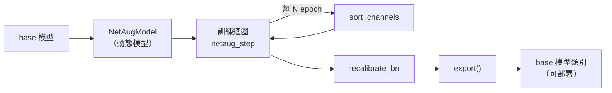

# torchnetaug

**繁體中文** | [English](README.en.md)

以純 PyTorch 實作 [Network Augmentation（NetAug）](https://arxiv.org/abs/2110.08890)（Cai et al., ICLR 2022）。

> **專案已結束（2026-11-24）。** 實作符合論文，但在本專案的 CIFAR 實驗中沒有顯著效果。見 [summary.md](summary.md)。

## 重點

1. **NetAug 的做法**：小模型的問題通常是欠擬合。NetAug 在訓練時把 base 模型放進共用權重的較寬網路一起訓練。部署時只用 base 模型，推論成本不變。
2. **任何普通 PyTorch 模型都能用**：`torch.fx` 自動分析通道結構（殘差、concat、depthwise）。測試涵蓋 torchvision 的 ResNet、MobileNetV2/V3、ShuffleNetV2、EfficientNet、MnasNet。
3. **排序不改變函數**：以通道群組為單位排序，殘差兩邊用同一個排列。
4. **匯出原始類別**：`export()` 回傳你原本的模型類別，部署端不需要本套件。
5. **訓練迴圈只改一行**：把 `loss.backward()` 換成 `netaug_step(...)`。另可選用深度增強（`depth=`）。



設計與正確性見 [design.md](docs/design.md)，實驗見 [experiments.md](docs/experiments.md)，術語見 [glossary.md](docs/glossary.md)。

## 安裝

需要 Python 3.10 以上、PyTorch 2.4 以上。

```bash
uv sync            # 開發環境（含 pytest、torchvision）
pip install -e .   # 或只安裝套件
```

## 快速開始

```python
import random
import torch
import torch.nn as nn
import torchvision
from torchnetaug import NetAugModel, netaug_step, recalibrate_bn

# 1. base 模型
tiny = torchvision.models.mobilenet_v2(width_mult=0.35, num_classes=10)

# 2. 包裝：寬度倍數的最小值必須是 1.0（原始寬度）
example = torch.randn(2, 3, 32, 32)
model = NetAugModel(tiny, example, width_mults=(1.0, 2.0, 3.0))

optimizer = torch.optim.SGD(model.parameters(), lr=0.05, momentum=0.9)
criterion = nn.CrossEntropyLoss()
rng = random.Random(0)                      # 抽樣增強網路用的亂數
fake_loader = [(torch.randn(8, 3, 32, 32), torch.randint(0, 10, (8,))) for _ in range(3)]

# 3. 訓練：每一步 = base loss + alpha × 增強 loss
for epoch in range(2):
    model.train()
    for images, labels in fake_loader:
        base_loss, aug_loss = netaug_step(model, images, labels, criterion, alpha=1.0, generator=rng)
        optimizer.step()
        optimizer.zero_grad()

# 4. 評估或匯出前，在 base 寬度下重新估計 BN 統計值
recalibrate_bn(model, [images for images, _ in fake_loader])

# 5. 匯出：回傳 torchvision 的 MobileNetV2，形狀和 tiny 相同
deploy = model.export().eval()
assert type(deploy) is torchvision.models.MobileNetV2

# 6. 照一般方式存檔與載入，不需要本套件
import os, tempfile
path = os.path.join(tempfile.mkdtemp(), "tiny_netaug.pt")
torch.save(deploy.state_dict(), path)
fresh = torchvision.models.mobilenet_v2(width_mult=0.35, num_classes=10)
fresh.load_state_dict(torch.load(path))
```

## API

### `NetAugModel`

複製模型，把可增強的層換成動態層，原始權重放在前段。所以 base 模式的輸出等於原始模型。

```python
model = NetAugModel(
    tiny,                     # base 模型（不會被修改）
    example,                  # 範例輸入，和模型在同一個裝置上
    width_mults=(1.0, 2.0, 3.0),
    update_bn_in_aug=False,   # 預設：增強網路不更新 BN running 統計值
)
print(model.graph.summary())  # 每個通道群組的大小，以及固定的原因

tiny.eval(); model.eval()
with torch.no_grad():
    assert torch.allclose(model(example), tiny(example), atol=1e-5)
```

| 屬性 | 意義 |
|---|---|
| `model.model` | 動態模型（原始模型的副本，部分層換成動態層） |
| `model.graph` | 通道分析結果 `ChannelGraph` |
| `model.base_sizes` / `model.max_sizes` / `model.choices` | 每個群組的原始寬度、最大寬度、可選寬度 |
| `model.active_sizes` / `model.mode` | 目前的寬度與模式（`"base"`、`"max"`、`"random"`、`"custom"`） |
| `model.base_depths` / `model.max_depths` / `model.active_depths` | 每個深度增強點的額外 block 數 |

### 自行組合網路

用普通的 `torch.nn` 層照常寫 `__init__` 與 `forward` 即可，不需要寫排序或寬度切換的程式碼。不要傳入已含動態層（如 `DynamicConv2d`）的模型，否則會得到 `TypeError`。

```python
class Branches(nn.Module):
    """兩條分支在通道維度 concat。"""
    def __init__(self, c_in, c):
        super().__init__()
        self.a = nn.Sequential(nn.Conv2d(c_in, c, 1, bias=False), nn.BatchNorm2d(c), nn.ReLU())
        self.b = nn.Sequential(nn.Conv2d(c_in, c, 3, padding=1, bias=False), nn.BatchNorm2d(c), nn.ReLU())

    def forward(self, x):
        return torch.cat([self.a(x), self.b(x)], dim=1)


class SepResidual(nn.Module):
    """depthwise + pointwise，加上殘差。"""
    def __init__(self, c):
        super().__init__()
        self.dw = nn.Conv2d(c, c, 3, padding=1, groups=c, bias=False)
        self.bn1 = nn.BatchNorm2d(c)
        self.pw = nn.Conv2d(c, c, 1, bias=False)
        self.bn2 = nn.BatchNorm2d(c)

    def forward(self, x):
        return x + self.bn2(self.pw(torch.relu(self.bn1(self.dw(x)))))


class MyNet(nn.Module):
    def __init__(self, num_classes=10):
        super().__init__()
        self.stem = nn.Sequential(nn.Conv2d(3, 16, 3, padding=1, bias=False), nn.BatchNorm2d(16), nn.ReLU())
        self.branches = Branches(16, 12)        # 輸出 24 通道 = 12 + 12
        self.blocks = nn.Sequential(SepResidual(24), SepResidual(24))
        self.head = nn.Linear(24, num_classes)

    def forward(self, x):
        x = self.blocks(self.branches(self.stem(x)))
        return self.head(x.mean((2, 3)))


mine = MyNet()
my_model = NetAugModel(mine, example, width_mults=(1.0, 2.0))
my_model.sort_channels()          # concat 兩段、殘差兩邊、depthwise 自動用一致的排列
assert type(my_model.export()) is MyNet
```

### 深度增強（`depth=`）

在指定的 block 後加 `k` 個額外 block。增強網路隨機執行前 `0..k` 個，base 模型一個都不執行。做法參考 Once-for-All 的彈性深度，原理見 [design.md 第 7 節](docs/design.md#7-深度增強)。

```python
res = torchvision.models.resnet18(num_classes=10)
deep = NetAugModel(res, example, width_mults=(1.0, 2.0), depth={"layer1": 1, "layer3": 2})
print(deep.max_depths)            # {'layer1.1': 1, 'layer3.1': 2}

deep.set_random(rng)              # 同時抽寬度與深度
deep.set_depths({"layer3.1": 2})  # 只改深度
deep.set_base()                   # 原始 ResNet-18
assert type(deep.export()) is type(res)
```

- 鍵是模組路徑。路徑指向類別正好是 `nn.Sequential` 的容器時，代表它的最後一個 block；`nn.Sequential` 的子類別（如 `Conv2dNormActivation`）視為一個 block。沒有參數的模組（如單獨的 ReLU）不能重複。
- 該 block 必須保持輸入形狀，而且每次 forward 只執行一次，否則會得到 `ValueError`。

### 切換寬度

```python
model.set_base()                             # base 模型（評估、匯出都用這個）
model.set_max()                              # 最大寬度網路
model.set_random(rng)                        # 每個群組各自抽寬度
model.set_random(rng, granularity="global")  # 整個模型抽同一個倍數
model.set_width(1.5)                         # 所有可增強群組乘 1.5
n_params = model.num_active_params()         # 目前寬度與深度用到的參數量
model.set_sizes(model.base_sizes)            # 手動指定每個群組的寬度
assert model.mode == "custom"

model.set_base()
with model.mode_ctx("max"):                  # 暫時切換，離開時還原
    wide_out = model(example)
assert model.mode == "base"

state = model.state()                        # (寬度, 深度, 模式)；用 set_state(state) 還原
```

多 GPU 訓練時，每個 process 用**相同種子**的 `random.Random`，各 GPU 才會抽到同一個增強網路。

### `netaug_step`

只做 forward 與 backward，`optimizer.step()` 由你呼叫，所以梯度累積、裁剪、學習率排程都不變。結束時回到 base 模式。混合精度與自訂 forward 用 `forward=`、`backward=` 參數。它會自動解開 `DistributedDataParallel` 的 `.module`（DDP 尚未實測）。

```python
base_loss, aug_loss = netaug_step(
    model, images, labels, criterion,
    alpha=1.0,          # 增強 loss 的權重（論文用 1.0）
    augment=True,       # False：只訓練 base 模型
    generator=rng,
    granularity="group",
)
optimizer.step()
optimizer.zero_grad()
```

### `sort_channels`

在 epoch 之間把重要的通道移到前段。傳入 optimizer，momentum 等狀態會一起重排；`extra_models` 中的模型（如 EMA）套用同一組排列。排序不改變最大寬度網路的輸出，但會改變 base 模型的輸出，所以排序後要繼續訓練，不要在匯出前一刻才排序。原理見 [design.md 第 5 節](docs/design.md#5-通道排序)。

```python
import copy

ema = copy.deepcopy(model)
perms = model.sort_channels(optimizer=optimizer, extra_models=[ema])   # {群組編號: 排列}
```

`scope=` 選擇要排序的群組：`"all"`（預設）、`"inner"`（只排 block 內的群組，對應官方實作的範圍）、`"closed"`，或群組編號的集合。`group_kinds()` 回傳每個群組的類別與所在的 block。類別與 block 的判定見 [design.md 第 5.2 節](docs/design.md#52-群組類別與排序範圍)，和官方實作的逐項對照見 [official_diff.md](docs/official_diff.md)。

```python
from collections import Counter

kinds = model.group_kinds()                     # {群組編號: GroupInfo}
print(Counter(info.kind for info in kinds.values()))
perms = model.sort_channels(optimizer=optimizer, extra_models=[ema], scope="inner")
assert set(perms) == {g for g, info in kinds.items() if info.kind == "inner"}
```

### `recalibrate_bn`

預設在 base 模式下重新估計所有 BN 的 running 統計值，結束後還原寬度與深度。批次可以是 `(inputs, targets)` 或單一張量，其他格式用 `forward=`。建議使用關掉資料增強的訓練資料。

評估其他寬度或深度時，用 `sizes=` 或 `depths=` 指定。所有寬度共用 BN 緩衝區，所以要在**副本**上校正：

```python
calib = [images for images, _ in fake_loader]
recalibrate_bn(model, calib, num_batches=100)

for mult in (1.0, 2.0, 3.0):
    sub = copy.deepcopy(model)
    sub.set_width(mult)
    recalibrate_bn(sub, calib, sizes=sub.active_sizes)
    sub.eval()
    with torch.no_grad():
        logits = sub(example)

deep_eval = copy.deepcopy(deep)
recalibrate_bn(deep_eval, calib, depths=deep_eval.max_depths)   # 額外 block 的 BN 只在這裡得到統計值
```

### `export`

回傳原始類別的副本，裝置與 dtype 和 `model` 相同，可以照常 `torch.save`、`torch.compile` 或轉 ONNX（見 `tests/test_onnx.py`）。`export(sizes, depths)` 匯出其他寬度或深度，結果仍是普通 PyTorch 模型；匯出前先在那個寬度下重新校正 BN。

```python
deploy = model.export().eval()
assert type(deploy) is type(tiny)

wide = copy.deepcopy(model)
wide.set_width(2.0)
recalibrate_bn(wide, calib, sizes=list(wide.active_sizes))
deploy_x2 = wide.export(wide.active_sizes).eval()   # 2 倍寬

deploy_deep = deep_eval.export(deep_eval.base_sizes, deep_eval.max_depths).eval()
assert not any(type(m).__module__.startswith("torchnetaug") for m in deploy_deep.modules())
```

### `analyze` 與 `ChannelGraph`

`analyze()` 只回傳通道分析結果。模型無法被 `torch.fx` 追蹤（`TraceError`）時，可以手動建立 `ChannelGraph` 傳給 `NetAugModel(graph=...)`。手動指定時，殘差兩邊必須用同一個群組編號。`LayerRole` 的定義見 [design.md 第 2 節](docs/design.md#2-通道群組)。

```python
from torchnetaug import analyze, ChannelGraph, LayerRole

graph = analyze(tiny, example)
print(len(graph.free_groups()), "/", graph.num_groups, "groups can be augmented")

net = nn.Sequential(
    nn.Conv2d(3, 8, 3, padding=1), nn.BatchNorm2d(8), nn.ReLU(),
    nn.Conv2d(8, 16, 3, padding=1), nn.BatchNorm2d(16), nn.ReLU(),
    nn.AdaptiveAvgPool2d(1), nn.Flatten(), nn.Linear(16, 10),
)
manual = ChannelGraph(
    group_sizes=[3, 8, 16, 10],              # 群組 0 輸入、1、2、3 輸出
    group_fixed=[True, False, False, True],  # 輸入與輸出固定
    layers={
        "0": LayerRole("dense", in_groups=(0,), out_group=1),
        "1": LayerRole("member", in_groups=(1,)),   # BN
        "3": LayerRole("dense", in_groups=(1,), out_group=2),
        "4": LayerRole("member", in_groups=(2,)),
        "8": LayerRole("dense", in_groups=(2,), out_group=3),
    },
)
auto = analyze(net, torch.randn(1, 3, 16, 16))
assert (auto.group_sizes, auto.group_fixed, auto.layers) == (manual.group_sizes, manual.group_fixed, manual.layers)

wrapped = NetAugModel(net, graph=manual, width_mults=(1.0, 2.0))
print(wrapped.max_sizes)   # [3, 16, 32, 10]
```

## 支援範圍

| 項目 | 說明 |
|---|---|
| 會被增強 | `nn.Conv2d`（一般與 depthwise）、`nn.Linear`、BatchNorm，以及它們之間的常見運算 |
| 不會被增強 | 分組卷積、GroupNorm/LayerNorm、channel shuffle、`Conv1d`/`Conv3d` 等。對應通道維持原寬度，模型仍然正確（完整清單見 [design.md 第 2.2 節](docs/design.md#22-白名單分析)） |
| 記憶體 | 最大寬度網路的參數量約為 base 模型的 `max(width_mults)²` 倍，例如 `(1.0, 2.0, 3.0)` 約 9 倍 |

## 測試

```bash
uv run pytest
```

609 個測試以普通 PyTorch 模型為基準，檢查 base 模式、每個寬度、一步的梯度（論文 Eq. 2）、排序與匯出。見 [design.md 第 9 節](docs/design.md#9-正確性驗證)。

## 引用與參考資料

如果你在研究中使用 torchnetaug，請引用原論文：

```bibtex
@inproceedings{cai2022network,
    title={Network Augmentation for Tiny Deep Learning},
    author={Han Cai and Chuang Gan and Ji Lin and Song Han},
    booktitle={International Conference on Learning Representations},
    year={2022},
    url={https://openreview.net/forum?id=TYw3-OlrRm-}
}
```

- 論文：<https://arxiv.org/abs/2110.08890>。本地副本在 [docs/reference/papers/](docs/reference/papers/)。
- 官方實作：<https://github.com/mit-han-lab/tinyml/tree/master/netaug>（MIT 授權）。本套件參考了它的設計，但程式碼獨立撰寫。
- 論文與官方實作的整理：[docs/reference/netaug_paper.md](docs/reference/netaug_paper.md)。
- CIFAR-10：Alex Krizhevsky. *Learning Multiple Layers of Features from Tiny Images*. Technical report, University of Toronto, 2009.

## 授權

程式碼採用 MIT 授權，見 [LICENSE](LICENSE)。[docs/reference/papers/](docs/reference/papers/) 中的論文 PDF 屬於原作者，採用 CC BY-NC-SA 4.0 授權，不包含在套件中。
