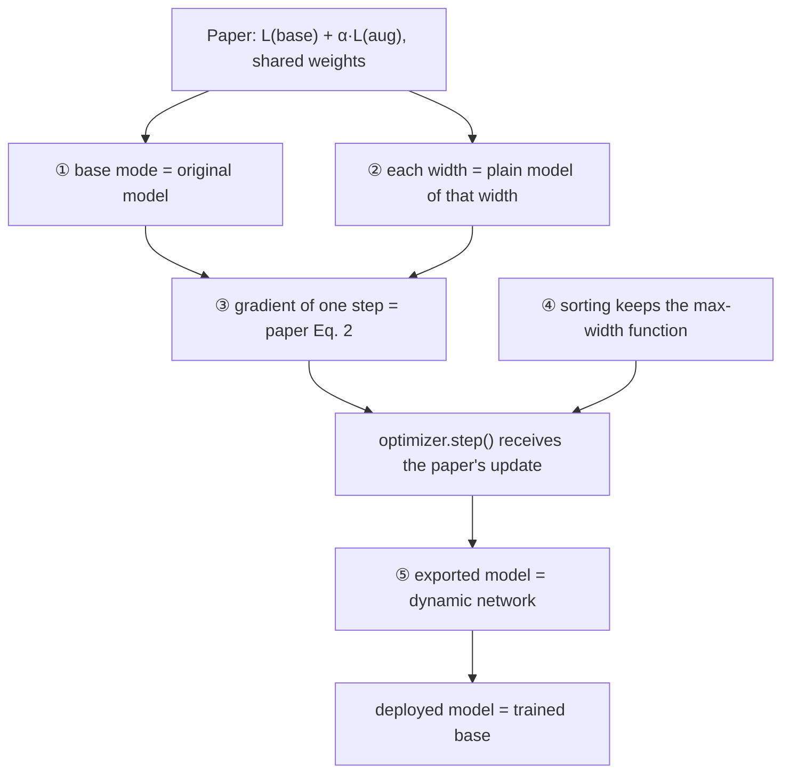

# torchnetaug code design

[繁體中文](design.md) | **English**

This document describes the internal design of `torchnetaug` and why it is correct. For usage, see the [README](../README.en.md). For experiment results, see [experiments.en.md](experiments.en.md). For terms, see [glossary.md](glossary.md). `tests/test_docs.py` runs the Python examples in this document.

## 1. Overview

During training, NetAug embeds the tiny model (base) in wider networks and trains them together. All widths share one set of weights, and the base uses the first channels of each channel group. After training, only the base is exported.

```text
original model ──► analyze() ──► ChannelGraph ──► NetAugModel ──► export() ──► tiny model of the original class
                   (torch.fx)     (channel groups)  (max-width dynamic model)
                                                     │
                                   netaug_step ──────┤  base loss + alpha × aug loss
                                   recalibrate_bn    │  re-estimate BN statistics before eval or export
                                   sort_channels ────┘  sort channels by importance
```

| File | Content |
|---|---|
| `graph.py` | `analyze()`, `ChannelGraph`, `LayerRole`, `TraceError`: find the channel groups |
| `layers.py` | `DynamicConv2d`, `DynamicLinear`, `DynamicBatchNorm`: store weights at max width and slice at run time |
| `depth.py` | `DepthStack`, `tie_channels`: depth augmentation |
| `netaug.py` | `NetAugModel`: build the max-width model, switch width and depth, sort, export |
| `train.py` | `netaug_step()`, `recalibrate_bn()` |

## 2. Channel groups

A **channel group** is a set of channels that must have the same width and the same order. Examples: the output of a dense layer and the inputs of all layers that read it; the two sides of a residual addition `x + f(x)` (so the outputs of all blocks in one ResNet stage are one group); the input and output of BN and of a depthwise conv.

Each group has a size (the base width), a fixed flag, and width choices `round(size × m)` with `m` from `width_mults`. A fixed group is not widened and not sorted. Model inputs, model outputs, and places that cannot be analyzed safely are fixed.

Each dynamic layer has a `LayerRole`:

| `kind` | Layer | Meaning |
|---|---|---|
| `"dense"` | `nn.Conv2d` (`groups=1`), `nn.Linear` | The output channels are `out_group`; the input channels belong to `in_groups` in order |
| `"member"` | `nn.BatchNorm*`, depthwise `nn.Conv2d` | Input equals output and belongs to `in_groups` |

### 2.1 Concat and segments

`torch.cat(..., dim=1)` does not merge groups. It makes a **segment list**, with one segment for each concatenated group:

```python
import torch
import torch.nn as nn
from torchnetaug import analyze


class DenseLike(nn.Module):
    def __init__(self):
        super().__init__()
        self.stem = nn.Conv2d(3, 6, 3, padding=1)
        self.c1 = nn.Conv2d(6, 4, 3, padding=1)
        self.bn = nn.BatchNorm2d(10)
        self.head = nn.Linear(10, 5)

    def forward(self, x):
        x0 = torch.relu(self.stem(x))
        x1 = torch.relu(self.c1(x0))
        y = self.bn(torch.cat([x0, x1], dim=1))  # 10 = 6 + 4 channels, two segments
        return self.head(y.mean([2, 3]))


graph = analyze(DenseLike(), torch.randn(1, 3, 16, 16))
roles = graph.layers
stem_g, c1_g = roles["stem"].out_group, roles["c1"].out_group
assert roles["bn"].in_groups == (stem_g, c1_g)    # BN reads two segments
assert roles["head"].in_groups == (stem_g, c1_g)  # Linear reads the same two segments
print(graph.summary())
```

In the max-width weights, the offset of a segment is the sum of the **max** widths of the segments before it. At run time each segment uses only its first `active` channels:

```text
input dimension of head.weight (max width 18 + 12 = 30)
┌──── stem segment: offset 0, max 18 ────┬──── c1 segment: offset 18, max 12 ────┐
│ ■■■■■■ (base 6) □□□□□□□□□□□□           │ ■■■■ (base 4) □□□□□□□□                │
└────────────────────────────────────────┴───────────────────────────────────────┘
indices in base mode = [0..5] ∪ [18..21]
```

### 2.2 Whitelist analysis

`analyze()` traces the model with `torch.fx.symbolic_trace`, gets shapes with `ShapeProp`, and applies rules node by node. **Only whitelist operations let channels pass through.** Any other operation fixes the groups it touches. An unknown operation only makes the augmentable part smaller; it never makes the model compute a wrong result.

| Category | Operations | Handling |
|---|---|---|
| Dense layers | `nn.Conv2d` (`groups=1`), `nn.Linear` (2D input) | The output starts a new group |
| Member layers | `nn.BatchNorm1d/2d/3d`, depthwise `nn.Conv2d` | Keeps the input group (`nn.SyncBatchNorm` is fixed) |
| Element-wise | ReLU, SiLU, GELU, Hardswish, Sigmoid, Tanh, Dropout, Identity, `clamp`, and others (modules, `F.*`, `torch.*`, method calls) | Pass through; `clamp` with per-channel tensor bounds is fixed |
| Spatial | MaxPool, AvgPool, Adaptive*Pool, Upsample, `F.interpolate`, `stochastic_depth` | Pass through |
| Add, multiply | `+`, `-`, `*`, `/`, `torch.add`, and others | Merge the groups of both sides; a 1-channel tensor broadcasts over channels and its group is fixed at 1 |
| Concat | `torch.cat` | `dim=1` concatenates segment lists; `dim>=2` merges groups |
| Reshape | `flatten`, `view`, `reshape`, `squeeze`, `nn.Flatten` | Pass through when dims 0 and 1 are kept at any width; otherwise fixed |
| Reduce | `mean`, `sum`, `amax` | Pass through when dims 0 and 1 are not reduced |
| Metadata | `x.size()`, `x.dim()`, `x.shape` | Ignored |

Common reasons for a fixed group: modules that are not listed, such as GroupNorm, LayerNorm and PReLU; an `nn.Parameter` used directly in an operation (such as layer scale); grouped convolution with `1 < groups < C`; a module called more than once; channel shuffle, `transpose`, `chunk`, channel slicing; residual sides with different segment structures; `Conv1d`, `Conv3d`, transposed convolution. `graph.summary()` lists why each group is fixed:

```python
class WithGroupNorm(nn.Module):
    def __init__(self):
        super().__init__()
        self.c1 = nn.Conv2d(3, 8, 3, padding=1)
        self.gn = nn.GroupNorm(2, 8)          # not on the whitelist
        self.c2 = nn.Conv2d(8, 6, 1)
        self.fc = nn.Linear(6, 4)

    def forward(self, x):
        x = torch.relu(self.gn(self.c1(x)))
        return self.fc(torch.relu(self.c2(x)).mean([2, 3]))


g = analyze(WithGroupNorm(), torch.randn(1, 3, 16, 16))
assert g.group_fixed[g.layers["c1"].out_group]       # read by GroupNorm → fixed
assert not g.group_fixed[g.layers["c2"].out_group]   # still augmentable
print(g.summary())
```

If tracing fails (for example, an `if` that depends on the data), `analyze()` raises `TraceError`. Then pass a custom `torch.fx.Tracer` or build a `ChannelGraph` by hand.

## 3. Dynamic layers

`NetAugModel` copies the original model and replaces the layers in `ChannelGraph.layers` with dynamic layers. The weights are allocated at max width. The original weights are copied to the base positions. The other positions use the PyTorch default initialization (BN weight 1, bias 0). So in base mode the output **equals** the original model.

| Attribute | Meaning |
|---|---|
| `active_out` | Number of output channels of a dense layer; always the first channels |
| `in_segments` | `((offset, active), ...)`: each segment takes `active` channels from `offset`; one segment with `offset=0` uses `narrow`, otherwise `index_select` |

`DynamicBatchNorm.update_stats`: in base mode the running statistics update normally. In an augmented network (default `update_bn_in_aug=False`), BN normalizes with batch statistics but does not update the running statistics, so the base is not polluted.

```python
import torchvision
from torchnetaug import NetAugModel, DynamicConv2d

tiny = torchvision.models.mobilenet_v2(width_mult=0.35, num_classes=10).eval()
x = torch.randn(2, 3, 32, 32)
aug = NetAugModel(tiny, x, width_mults=(1.0, 2.0, 3.0)).eval()

conv = aug.model.features[0][0]
assert isinstance(conv, DynamicConv2d)
print(conv.weight.shape, conv.active_out, conv.in_segments)  # stored at max width; base uses the first part

with torch.no_grad():
    assert torch.allclose(aug(x), tiny(x), atol=1e-5)  # base mode equals the original model
```

## 4. Width control

`set_sizes(sizes)` sets the width of each group and updates all dynamic layers. `set_base()`, `set_max()` and `set_random(generator, granularity)` are built on it. With `granularity="group"` each free group samples its own width; with `"global"` the whole model samples one multiplier. Sampling per group matches the granularity of the official implementation: one ResNet stage is one group, and the expand channels of MobileNetV2 are separate groups.

```python
import random

rng = random.Random(0)
aug.set_random(rng)
for g, size in enumerate(aug.active_sizes):
    assert size in aug.choices[g]
aug.set_base()
```

## 5. Channel sorting

The base always uses the first channels. Sorting moves the most important channels of each group to the front.

**The problem in the reference implementation.** `netaug/` sorts per module: each module permutes only its own outputs (`dim=0`), not the inputs of the downstream layers (`dim=1`), and the two sides of a residual use different permutations. Each sort changes the network function (see Section 3.4 of [reference/netaug_reference_impl.md](reference/netaug_reference_impl.md)).

**This package: one permutation per group.** A residual has already merged its two sides into one group, so both sides always use the same permutation. For each free group:

1. Importance (`channel_importance()`): the L1 norm of the weights of all dense readers on the matching input segment. If there is no dense reader, the output weights of the producer are used. The precision is at least float32.
2. `perm = argsort(importance, descending=True, stable=True)`.
3. Apply `perm` to every tensor that carries this group:

| Tensor | Dim | Position |
|---|---|---|
| `weight`, `bias` of the producer | 0 | first channels |
| Member layers (BN parameters and running statistics, depthwise conv) | 0 | segment offset |
| `weight` of the readers | 1 | segment offset |
| Optimizer state with the same shape (momentum, `exp_avg`, ...) | same as parameter | same as parameter |
| Tensors with the same names in `extra_models` (such as EMA) | same | same |

Both ends of every channel path use the same permutation, so **the max-width network function does not change**. Only the channels that smaller widths keep change.

```python
aug.eval()
aug.set_max()
with torch.no_grad():
    before = aug(x)
perms = aug.sort_channels()            # {group index: permutation}
with torch.no_grad():
    after = aug(x)
assert torch.allclose(before, after, atol=1e-4)  # max-width output does not change

for g, imp in aug.channel_importance().items():   # importance decreases after sorting
    assert torch.all(imp[:-1] >= imp[1:] * (1 - 1e-5))
aug.set_base()
```

Sorting **does** change the base output, so run it periodically during training and keep training afterwards. A Dropout mask in training mode acts on channels, so turn Dropout off for exact comparisons.

### 5.1 Proof of correctness

**Notation.** Each tensor `t` has a segment list `spec(t) = (g1, …, gk)`, and segment i has offset `off_i`. Group `g` has max width `n_g` and active width `k_g ≤ n_g`.

**Lemma S (channel independence).** If output channel `c` of `f` depends only on input channel `c`, then `f(x[:, I]) = f(x)[:, I]` for any index sequence `I` (a permutation or a subset). Every element-wise, pooling, upsampling, reshape and reduce operation on the whitelist must satisfy S. `tests/test_whitelist_lemmas.py` generates cases from the whitelist and checks both permutations and subsets. It also checks the weight lemma of the dynamic layers, `layer(x[:, P_in]; W[P_out][:, P_in]) = layer(x; W)[:, P_out]`. The test fails when an operation is added to the whitelist without a case.

**Theorem 1 (every width is a plain network).** Fix `k_g`. Keep only the channels `S(spec) = ∪_i (off_i + [0, k_gi))` of each tensor and the matching weight rows and columns. The result is a plain tiny network `N_k`, and the dynamic model at width `k` outputs the same as `N_k`. Proof by induction in topological order: a dense layer outputs its first `k_g` channels, and the weight columns it reads match the input segments one to one; member layers and whitelist operations follow from Lemma S; the two sides of an add or multiply were merged into one group by union-find; `cat(dim=1)` is exactly the segments in order; other operations have fixed groups. ∎ `export(sizes)` builds `N_k`.

**Corollary.** With `k = base`, `N_base` is the original network.

**Theorem 2 (sorting keeps the max-width function).** Choose a permutation `P_g` for each free group and the identity for fixed groups. After all tensors are permuted as in the table above, each tensor `t` of the max-width network becomes `t[:, Π(spec(t))]`, where `Π` is the block permutation of the segments' `P_gi`. The model output belongs to a fixed group, so it does not change. Proof by induction in topological order: for a dense layer, `W' = W[P_out][:, Π_in]` gives `y'[o] = y[P_out(o)]`; BN and depthwise conv move their parameters per channel (batch statistics in training mode are also per channel); both sides of an add are one group; the `Π` of `cat` is the block composition; other operations have fixed groups. ∎

**Theorem 3 (optimizer state).** SGD and Adam update element-wise, so "permute, then step" equals "step, then permute".

**Not covered.** The analysis code itself (union-find and the whitelist rules) is not formally verified; tests support it. In floating point, a different summation order gives a relative error of about `1e-6` (float32) or `1e-12` (float64). `torch.fx` records only the path that the example input takes.

## 6. Export

`export()` switches to base mode, takes the active slices of the dynamic layers, and loads them into **a copy of the original model**. So it returns the original class with the same shapes, and the deployment side does not need this package.

```python
small = aug.export().eval()
assert type(small) is type(tiny)
assert {k: v.shape for k, v in small.state_dict().items()} == {k: v.shape for k, v in tiny.state_dict().items()}
with torch.no_grad():
    assert torch.allclose(small(x), aug(x), atol=1e-5)  # aug is already in base mode
```

`export(sizes)` exports any width (`N_k`). It keeps the original structure and `forward`, and replaces each widened layer with a plain layer of the same class and the active size. The new layer keeps the dtype, device, `.training` flag and `requires_grad` of the original layer.

```python
aug.set_width(2.0)
sizes = list(aug.active_sizes)
wide = aug.export(sizes).eval()
aug.eval()
with torch.no_grad():
    assert torch.allclose(wide(x), aug(x), atol=1e-5)
assert sum(p.numel() for p in wide.parameters()) == aug.num_active_params()
assert not any(type(m).__module__.startswith("torchnetaug") for m in wide.modules())
aug.set_base()
```

## 7. Depth augmentation

The paper and the official code augment only width. This package follows the elastic depth of Once-for-All (Cai et al., ICLR 2020): the base is the original network, and an augmented network runs `0..k` extra blocks after chosen blocks.

`NetAugModel(..., depth={path: k})` replaces each chosen block with a `DepthStack` before tracing:

```text
DepthStack.forward(x):
    y = block(x)
    for i in range(active):              # active = 0 gives block(x)
        y = tie_channels(extra[i](y), y)
    return y
```

- Before building, the block is run once to check that it is called once and that its output shape equals its input shape.
- Each extra block is a copy with re-initialized weights. If setting its last BN to zero makes the copy an identity function (a residual block), the zeros are kept, also for channels added by widening. Otherwise (a non-residual block) the normal initialization is used. If the example output is close to 0, a positive probe input decides.
- During tracing `active` is at its max, so the analysis sees all extra blocks. A copy of the original model is kept for `export()`.

**Why `tie_channels`.** During tracing, the layer `L` after the block is recorded as reading the output of the last extra block, but in base mode `L` reads the output of the block itself. In a residual block the addition merges the two into one group. A non-residual block makes a new group: sorting then gives the two groups different permutations, and the network function changes without an error. `tie_channels(x, ref)` returns `x` at run time, but it is registered with `torch.fx.wrap` and leaves a node in the trace, and the analysis merges the two groups at that node.

```python
from torchnetaug import DepthStack


class PlainBlock(nn.Sequential):
    def __init__(self, c):
        super().__init__(nn.Conv2d(c, c, 3, padding=1, bias=False), nn.BatchNorm2d(c), nn.ReLU())


plain = nn.Sequential(
    nn.Conv2d(3, 8, 3, padding=1), nn.BatchNorm2d(8), nn.ReLU(),
    PlainBlock(8), PlainBlock(8),                       # non-residual; depth augmentation on the last one
    nn.AdaptiveAvgPool2d(1), nn.Flatten(), nn.Linear(8, 10),
)
deep = NetAugModel(plain, x, width_mults=(1.0, 2.0), depth={"4": 2}).eval()
assert isinstance(deep.model[4], DepthStack)
producer = deep.graph.layers["4.block.0"].out_group
assert all(deep.graph.layers[f"4.extra.{i}.0"].out_group == producer for i in range(2))

outs = []
for d in (0, 1, 2):
    deep.set_state((deep.max_sizes, {"4": d}, "max"))
    with torch.no_grad():
        outs.append(deep(x))
deep.sort_channels()
for d, before in zip((0, 1, 2), outs):
    deep.set_state((deep.max_sizes, {"4": d}, "max"))
    with torch.no_grad():
        assert torch.allclose(deep(x), before, atol=1e-5)
deep.set_base()
```

**State, BN and export.**

- Width and depth form one state `(sizes, depths, mode)`. `mode_ctx`, `export` and `recalibrate_bn` restore it when they finish. BN updates its statistics only when both width and depth are base.
- `set_random()` samples the widths first, then a uniform `0..k` for each depth point. Without `depth=`, no extra random numbers are used.
- Extra blocks run only in augmented networks, so call `recalibrate_bn(..., depths=...)` before evaluating a deeper network.
- `export()` renames `P.block.*` back to `P.*` and drops `P.extra.*`. `export(sizes, depths)` replaces each `DepthStack` with `nn.Sequential(block, *active extra blocks)`.

## 8. One training step

`netaug_step()` implements the paper's objective `L(base) + alpha × L(aug)` with one sampled augmented network per step: `set_base()` → forward → backward; `set_random()` → forward → `backward(alpha × aug_loss)`; back to base. The two gradients add up on the shared weights. The caller runs `optimizer.step()`.

`recalibrate_bn()` resets the BN running statistics at the given width and depth, runs the given batches with a cumulative average (`momentum=None`), and restores the state, the momentum and the per-module training flags when it finishes (also on error). Extra blocks that do not run are not reset.

**The gradient on the base weights.** Take a two-layer linear network `y = V·W·x`; the augmented network adds `V_i·W_i·x`. With squared error:

```text
g_base = Vᵀ · r · xᵀ
g_aug  = g_base + Vᵀ · (V_i·W_i·x) · xᵀ
NetAug (alpha = 1): 2·g_base + Vᵀ · (V_i·W_i·x) · xᵀ
```

The first term is close to doubling the base learning rate. The second term is the signal specific to NetAug. In a nonlinear network the extra channels also change the ReLU on/off pattern and the BN batch statistics. This is the structure of the gradient, not a proof of an effect. `examples/cifar_netaug.py --grad-log-every N` logs the cosine and the length ratio of the two gradients; for the measured values, see [Section 4.4 of experiments.en.md](experiments.en.md).

## 9. Correctness verification

"Correct" means that the package computes what the paper defines. Each link is compared with **plain models built directly in PyTorch, without this package**:



`uv run pytest` runs 471 tests. They compare in float64 with tight tolerances, and they randomize all parameters and BN statistics first, so default values cannot hide errors.

| Test file | Count | What it checks |
|---|---|---|
| `test_correctness.py` | 111 | ① base = original model; ⑤ export (dtype, precision, per-module flags); ④ sorting keeps the max-width function, and is ordered and idempotent; optimizer state permutation; augmented networks do not pollute BN; ③ the gradient equals Eq. 2 element-wise; whitelist edge cases |
| `test_random_architectures.py` | 61 | ①④⑤ on 60 random architectures (residual, concat, depthwise, SE, and unsupported operations) |
| `test_whitelist_lemmas.py` | 172 | Lemma S and the weight lemma of the dynamic layers |
| `test_widths.py` | 55 | ② parameter count, weight shapes, outputs and BN updates at each width equal a model of that width built by its own constructor |
| `test_depth.py` | 48 | ①③④⑤ for depth augmentation, identity initialization, state restore and error messages |
| `test_onnx.py` | 12 | Exported models converted to ONNX with dynamo and TorchScript; onnxruntime outputs match (difference < 2e-8) |
| `test_dynamic_usage.py` | 8 | Manual use of dynamic layers; rejection of models that contain dynamic layers |
| `test_docs.py` | 4 | The documentation examples run |

Mutation tests show that these tests are effective: the matching tests fail when `netaug_step` ignores `alpha`, uses a different augmented network, permutes only the producer outputs (the reference implementation's method), or sorts in increasing or random order. Order after sorting is checked with a relative tolerance (1e-9 in float64, 1e-5 in float32), because the permutations of other groups change the summation order.

This chain shows that the code computes the paper's definition. It does **not** show that NetAug improves accuracy; that is an experimental question.

## 10. Differences from the paper and the reference implementation

| Item | Official implementation | `netaug/` reference implementation | `torchnetaug` |
|---|---|---|---|
| Models | Hand-written MobileNet family | Hand-written YOLOv8 modules | Any model that `torch.fx` can trace |
| Augmented dimensions | Width + expand ratio | Width (`max_depth` is unused) | Width of each channel group; optional depth |
| Width sampling | First block of each stage, stem and head each sample; expand per block | Per layer | Once per group, or once for the whole model |
| Sorting | Middle channels of inverted blocks only | Outputs only; the two residual sides separately | One permutation per group, including optimizer state |
| BN in augmented networks | Updates statistics; reset before eval | Updates; optional reset | No update by default; `recalibrate_bn` provided |
| Export | Hand-written `export()` | Hand-written `export_module()` | A copy of the original class |

## 11. Design decisions and limitations

- **Plain layers only.** A model that contains a `DynamicModule` raises `TypeError`: tracing treats dynamic layers as unknown operations, and with a manual `graph=` they are not widened and `export()` would depend on this package. An alternative that was not adopted is a set of package composition modules (`Sequential`, `Residual`, `Concat`) that declare the channel relations. It would support untraceable models, but it largely duplicates the automatic analysis, and a custom tracer or a manual `ChannelGraph` already handles those cases.
- Only `nn.Conv2d`, `nn.Linear` (2D input) and BatchNorm are widened, and the model must be traceable by `torch.fx`.
- The max-width model has about `max(width_mults)²` times the parameters of the base.
- Layers with tied weights cannot be widened and raise `ValueError`.
- Custom buffers registered on widened layers are lost when those layers become dynamic layers.
- Depth augmentation works only for blocks that keep the shape and run once per forward, and it cannot be combined with a manual `graph=`.
- Multi-GPU (DDP) has not been tested.
