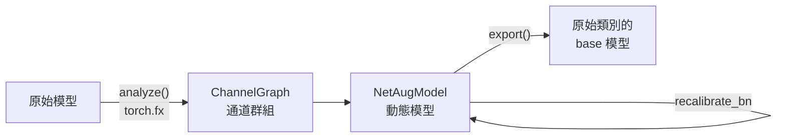
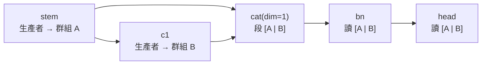
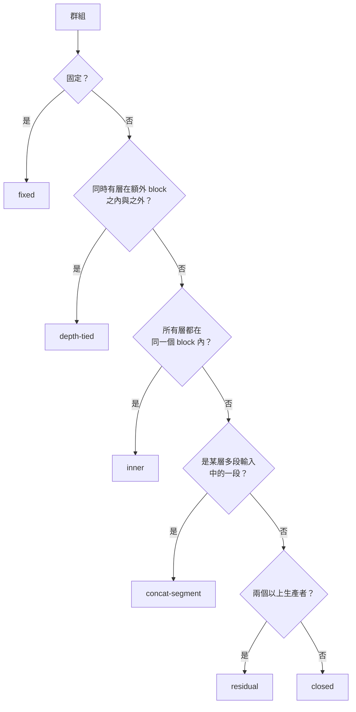
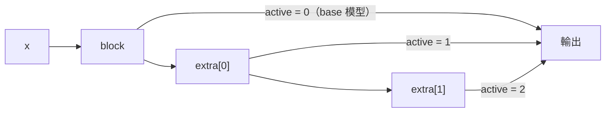
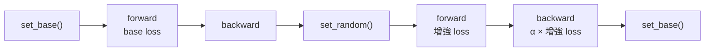
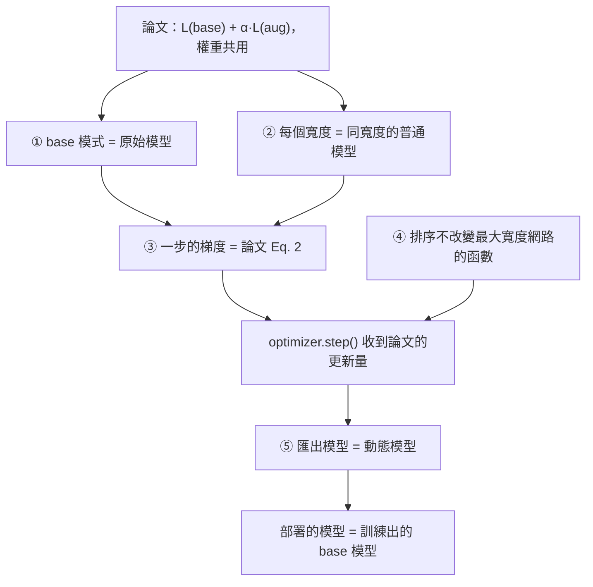

# torchnetaug 程式碼設計

**繁體中文** | [English](design.en.md)

用法見 [README](../README.md)，實驗見 [experiments.md](experiments.md)，術語見 [glossary.md](glossary.md)。本文件的 Python 範例由 `tests/test_docs.py` 執行。

## 重點

1. **通道群組是核心**：`analyze()` 用 `torch.fx` 找出必須同寬、同順序的通道，寬度切換、排序與匯出都以群組為單位（第 2 節）。
2. **動態層以最大寬度存權重**：base 模型的權重在前段，所以 base 模式的輸出等於原始模型（第 3 節）。
3. **一個群組一個排列**：排序不改變最大寬度網路的函數（第 5 節，含證明）。
4. **匯出回傳原始類別**：任何寬度都能匯出成普通 PyTorch 模型（第 6 節）。
5. **正確性有測試鏈**：609 個測試把每一環和普通 PyTorch 模型比對（第 9 節）。

## 1. 總覽



| 檔案 | 內容 |
|---|---|
| `graph.py` | `analyze()`、`ChannelGraph`、`LayerRole`、`TraceError`：求出通道群組 |
| `layers.py` | `DynamicConv2d`、`DynamicLinear`、`DynamicBatchNorm`：動態層 |
| `depth.py` | `DepthStack`、`tie_channels`：深度增強 |
| `netaug.py` | `NetAugModel`：建立動態模型、切換寬度與深度、排序、匯出 |
| `train.py` | `netaug_step()`、`recalibrate_bn()` |

## 2. 通道群組

**通道群組**是一組寬度與順序都必須相同的通道。下列通道屬於同一個群組：

- 一個 dense 層的輸出，以及所有讀取它的層的輸入。
- 殘差相加 `x + f(x)` 的兩邊。所以 ResNet 一個 stage 的所有 block 輸出是同一個群組。
- BN 與 depthwise conv 的輸入與輸出。

每個群組有大小（base 寬度）、是否固定、寬度選項 `round(大小 × m)`（`m` 取自 `width_mults`）。固定群組不加寬也不排序。模型輸入、輸出與無法安全分析的位置都會固定。

每個動態層有一個 `LayerRole`：

| `kind` | 層 | 意義 |
|---|---|---|
| `"dense"` | `nn.Conv2d`（`groups=1`）、`nn.Linear` | 輸出通道是 `out_group`；輸入通道依序屬於 `in_groups` |
| `"member"` | `nn.BatchNorm*`、depthwise `nn.Conv2d` | 輸入等於輸出，屬於 `in_groups` |

### 2.1 concat 與段

`torch.cat(..., dim=1)` 不合併群組，而是產生**段列表**，每個被串接的群組占一段：



```python
import torch
import torch.nn as nn
from torchnetaug import analyze


class DenseLike(nn.Module):
    def __init__(self):
        super().__init__()
        self.stem = nn.Conv2d(3, 6, 3, padding=1)
        self.c1 = nn.Conv2d(6, 4, 3, padding=1)
        self.bn = nn.BatchNorm2d(10)
        self.head = nn.Linear(10, 5)

    def forward(self, x):
        x0 = torch.relu(self.stem(x))
        x1 = torch.relu(self.c1(x0))
        y = self.bn(torch.cat([x0, x1], dim=1))  # 10 = 6 + 4 個通道，兩段
        return self.head(y.mean([2, 3]))


graph = analyze(DenseLike(), torch.randn(1, 3, 16, 16))
roles = graph.layers
stem_g, c1_g = roles["stem"].out_group, roles["c1"].out_group
assert roles["bn"].in_groups == (stem_g, c1_g)    # BN 讀兩段
assert roles["head"].in_groups == (stem_g, c1_g)  # Linear 也讀同樣兩段
print(graph.summary())
```

在最大寬度的權重中，每段的偏移量是前面各段**最大**寬度的和。執行時每段只取前 `active` 個通道（■ 是 base 通道，□ 是新增通道）：

```text
head.weight 的輸入維度（最大寬度 18 + 12 = 30）
┌──── stem 段：offset 0，最大 18 ────┬──── c1 段：offset 18，最大 12 ────┐
│ ■■■■■■ (base 6) □□□□□□□□□□□□       │ ■■■■ (base 4) □□□□□□□□            │
└────────────────────────────────────┴───────────────────────────────────┘
base 模式的索引 = [0..5] ∪ [18..21]
```

### 2.2 白名單分析

`analyze()` 用 `torch.fx.symbolic_trace` 追蹤模型，以 `ShapeProp` 取得形狀，再逐節點套用規則。**只有白名單上的運算讓通道穿透**，其他運算把它碰到的群組固定。所以不認得的運算只會縮小可增強的範圍，不會讓模型算錯。

| 類別 | 運算 | 處理 |
|---|---|---|
| dense 層 | `nn.Conv2d`（`groups=1`）、`nn.Linear`（2D 輸入） | 輸出開新群組 |
| member 層 | `nn.BatchNorm1d/2d/3d`、depthwise `nn.Conv2d` | 沿用輸入群組（`nn.SyncBatchNorm` 固定） |
| 逐元素 | ReLU、SiLU、GELU、Hardswish、Sigmoid、Tanh、Dropout、Identity、`clamp` 等（模組、`F.*`、`torch.*`、方法呼叫） | 穿透；逐通道張量邊界的 `clamp` 固定 |
| 空間運算 | MaxPool、AvgPool、Adaptive*Pool、Upsample、`F.interpolate`、`stochastic_depth` | 穿透 |
| 相加、相乘 | `+`、`-`、`*`、`/`、`torch.add` 等 | 合併兩邊群組；1 通道張量沿通道廣播，其群組固定在 1 |
| 串接 | `torch.cat` | `dim=1` 串接段列表；`dim>=2` 合併群組 |
| 改形狀 | `flatten`、`view`、`reshape`、`squeeze`、`nn.Flatten` | 第 0、1 維在任意寬度下都保持時穿透，否則固定 |
| 縮減 | `mean`、`sum`、`amax` | 不縮減第 0、1 維時穿透 |
| 中繼資料 | `x.size()`、`x.dim()`、`x.shape` | 忽略 |

常見的固定原因：

| 原因 | 例子 |
|---|---|
| 不在白名單的模組 | GroupNorm、LayerNorm、PReLU、`Conv1d`、`Conv3d`、轉置卷積 |
| 直接參與運算的參數 | layer scale 的 `nn.Parameter` |
| 改變通道對應 | `1 < groups < C` 的分組卷積、channel shuffle、`transpose`、`chunk`、通道切片 |
| 結構衝突 | 同一模組被呼叫多次、殘差兩邊的段結構不同 |

`graph.summary()` 列出每個群組的固定原因：

```python
class WithGroupNorm(nn.Module):
    def __init__(self):
        super().__init__()
        self.c1 = nn.Conv2d(3, 8, 3, padding=1)
        self.gn = nn.GroupNorm(2, 8)          # 不在白名單上
        self.c2 = nn.Conv2d(8, 6, 1)
        self.fc = nn.Linear(6, 4)

    def forward(self, x):
        x = torch.relu(self.gn(self.c1(x)))
        return self.fc(torch.relu(self.c2(x)).mean([2, 3]))


g = analyze(WithGroupNorm(), torch.randn(1, 3, 16, 16))
assert g.group_fixed[g.layers["c1"].out_group]       # 被 GroupNorm 讀取 → 固定
assert not g.group_fixed[g.layers["c2"].out_group]   # 仍可增強
print(g.summary())
```

追蹤失敗（例如依資料決定的 `if`）時丟出 `TraceError`。可改傳自訂 `torch.fx.Tracer`，或手動建立 `ChannelGraph`。

## 3. 動態層

`NetAugModel` 複製原始模型，把 `ChannelGraph.layers` 列出的層換成動態層：

- 權重以最大寬度配置，原始權重複製到 base 位置。
- 其餘位置用 PyTorch 預設初始化（BN 的 weight 為 1、bias 為 0）。
- 所以 base 模式的輸出**等於**原始模型。

| 屬性 | 意義 |
|---|---|
| `active_out` | dense 層的輸出通道數，永遠取前段 |
| `in_segments` | `((offset, active), ...)`：每段從 `offset` 起取 `active` 個通道；單段且 `offset=0` 時用 `narrow`，否則用 `index_select` |

`DynamicBatchNorm` 只在 base 模式更新 running 統計值。增強網路（預設 `update_bn_in_aug=False`）用批次統計值正規化，但不更新 running 統計值，避免污染 base 模型。

```python
import torchvision
from torchnetaug import NetAugModel, DynamicConv2d

tiny = torchvision.models.mobilenet_v2(width_mult=0.35, num_classes=10).eval()
x = torch.randn(2, 3, 32, 32)
aug = NetAugModel(tiny, x, width_mults=(1.0, 2.0, 3.0)).eval()

conv = aug.model.features[0][0]
assert isinstance(conv, DynamicConv2d)
print(conv.weight.shape, conv.active_out, conv.in_segments)  # 以最大寬度存放；base 只用前段

with torch.no_grad():
    assert torch.allclose(aug(x), tiny(x), atol=1e-5)  # base 模式等於原始模型
```

## 4. 寬度控制

`set_sizes(sizes)` 設定每個群組的寬度並更新所有動態層。`set_base()`、`set_max()`、`set_random(generator, granularity)` 都建立在它上面：

- `granularity="group"`：每個可增強群組各自抽。這對應官方實作的粒度：ResNet 一個 stage 是一個群組，MobileNetV2 的 expand 通道是獨立群組。
- `granularity="global"`：整個模型抽同一個倍數。

```python
import random

rng = random.Random(0)
aug.set_random(rng)
for g, size in enumerate(aug.active_sizes):
    assert size in aug.choices[g]
aug.set_base()
```

## 5. 通道排序

base 模型永遠使用前段通道。排序把每個群組中最重要的通道移到前面。

**為什麼要以群組為單位。** 如果一層只重排自己的輸出（`dim=0`），而不重排下游層的輸入（`dim=1`），或殘差兩邊用不同的排列，每次排序都會改變網路函數。本套件讓每個群組只有一個排列，殘差兩邊已併成同一群組，所以一定用同一個排列。

排列在各種運算上的處理方式：

| 運算 | 排列如何處理 |
|---|---|
| dense 層（`groups=1` 的 conv、linear） | 排列在這裡停下：輸入用輸入群組的排列（dim 1），輸出用輸出群組的排列（dim 0） |
| member 層（BN、depthwise conv）與白名單的逐通道運算 | 排列穿過：輸入與輸出是同一群組 |
| 相加、相乘（殘差、SE 的縮放） | 兩邊併成同一群組，所以用同一個排列 |
| `cat(dim=1)` | 各段保留自己的群組與排列 |

所以排序不需要 depthwise。需要的只是：群組的每個生產者、member 層與讀取者都用同一個排列。OFA 的 ResNet bottleneck 沒有 depthwise，也排序兩段中間通道（[`dynamic_layers.py` L766–L841](https://github.com/mit-han-lab/once-for-all/blob/f03b2673db313b9167e2a1c2b7a5cad540cc1313/ofa/imagenet_classification/elastic_nn/modules/dynamic_layers.py#L766-L841)）。

對排序範圍（`scope`，見第 5.2 節）內的每個群組：

1. 計算重要度（`channel_importance()`）：所有 dense 讀取者在對應輸入段上的權重 L1 範數。沒有 dense 讀取者時，改用 dense 生產者的輸出權重；BN 與 depthwise 的權重不使用。深度增強的額外 block 只用於整個在額外 block 內的群組（第 5.1 節的重要度定義）。精度至少 float32。
2. `perm = argsort(重要度, descending=True, stable=True)`。
3. 把 `perm` 套到所有攜帶這個群組的張量：

| 張量 | 維度 | 位置 |
|---|---|---|
| 生產者的 `weight`、`bias` | 0 | 前段 |
| member 層（BN 參數與 running 統計值、depthwise conv） | 0 | 段偏移量 |
| 讀取者的 `weight` | 1 | 段偏移量 |
| 上列參數的 `.grad`（不為 None 時），以及 optimizer 中形狀相同的狀態（momentum、`exp_avg` 等） | 同參數 | 同參數 |
| `extra_models`（如 EMA）的同名張量 | 同上 | 同上 |

每條通道路徑的兩端用同一排列，所以**最大寬度網路的函數不變**。改變的只有較小寬度保留哪些通道。

```python
aug.eval()
aug.set_max()
with torch.no_grad():
    before = aug(x)
perms = aug.sort_channels()            # {群組編號: 排列}
with torch.no_grad():
    after = aug(x)
assert torch.allclose(before, after, atol=1e-4)  # 最大寬度網路的輸出不變

for g, imp in aug.channel_importance().items():   # 排序後重要度遞減
    assert torch.all(imp[:-1] >= imp[1:] * (1 - 1e-5))
aug.set_base()
```

排序**會**改變 base 模型的輸出，所以要在訓練中定期執行，之後繼續訓練。訓練模式的 Dropout 遮罩作用在通道上，逐位比對時要關閉。

### 5.1 正確性證明

**記號。** 每個張量 `t` 有段列表 `spec(t) = (g1, …, gk)`，第 i 段的偏移量為 `off_i`。群組 `g` 的最大寬度為 `n_g`，作用寬度為 `k_g ≤ n_g`。

**重要度的定義。** 讀取者 `L` 的權重為 `W_L`（dim 0 是輸出通道，dim 1 是輸入通道），輸入段列表為 `(g_1, …, g_m)`，第 `i` 段的偏移量為 `off_i`。群組 `g` 的讀取者集合 `R_g` 是讀取 `g` 的 dense 層；其中有額外 block 之外的層時，`R_g` 只含這些層。所以只有讀取者全在額外 block 內的群組（群組整個在額外 block 內），才用額外 block 的層排序。

`imp_g[c] = Σ_{L ∈ R_g} Σ_{i: g_i = g} Σ_{o, 其餘維度} abs(W_L[o, off_i + c, …])`，`c ∈ [0, n_g)`，`o` 取遍 `W_L` 的全部輸出通道（最大寬度）。

`R_g` 是空集合時，改用 dense 生產者 `W_L` 的 dim 0（對全部輸入欄加總），生產者也照同一條額外 block 規則選取。

**有序。** 群組 `g` **有序**，是指對每個 `k`，從 1 到群組的通道數（所以也包含 `choices[g]` 裡的每個寬度選項），前 `k` 個通道就是重要度最高的 `k` 個：`min(imp_g[:k]) ≥ max(imp_g[k:])`。這等價於 `imp_g` 不遞增。浮點數下以相對容差比較（float64 為 1e-9），因為排列會改變加總順序。

**引理 S（逐通道獨立）。** 若 `f` 的輸出通道 `c` 只取決於輸入通道 `c`，則對任何索引序列 `I`（排列或子集）有 `f(x[:, I]) = f(x)[:, I]`。白名單中每個逐元素、池化、上採樣、改形狀與縮減運算都必須滿足 S。`tests/test_whitelist_lemmas.py` 從白名單自動產生案例，檢查排列與子集兩種情況，並檢查動態層的權重引理 `layer(x[:, P_in]; W[P_out][:, P_in]) = layer(x; W)[:, P_out]`。白名單新增運算而沒有案例時，測試會失敗。

**定理 1（每個寬度都是普通網路）。** 固定 `k_g`。只保留每個張量 `S(spec) = ∪_i (off_i + [0, k_gi))` 的通道與對應的權重行列，得到普通小網路 `N_k`；動態模型在寬度 `k` 的輸出等於 `N_k`。證明依拓撲順序歸納：dense 層輸出前 `k_g` 個通道，讀取的權重列與輸入段一一對應；member 層與白名單運算由引理 S 成立；相加、相乘的兩邊已由 union-find 併成同群組；`cat(dim=1)` 正是各段依序排列；其他運算的群組已固定。∎ `export(sizes)` 就是把 `N_k` 建出來。

**系理。** 取 `k = base`，`N_base` 就是原始網路。

**定理 2（排序不改變最大寬度網路的函數）。** 每個可增強群組取排列 `P_g`，固定群組取恆等。依上表排列所有張量後，最大寬度網路中每個張量 `t` 變成 `t[:, Π(spec(t))]`（`Π` 為各段 `P_gi` 的分塊排列）。模型輸出屬於固定群組，所以不變。證明同樣依拓撲順序歸納：dense 層 `W' = W[P_out][:, Π_in]` 使 `y'[o] = y[P_out(o)]`；BN 與 depthwise 逐通道移動參數（訓練模式的批次統計值也逐通道）；相加兩邊同群組；`cat` 的 `Π` 是分塊組合；其他運算的群組固定。∎

**引理 I（重要度對排列的行為）。** 每個可增強群組 `h` 取排列 `P_h`（不排的群組取恆等），依上表套用到所有張量，得到 `imp'`。則對每個群組 `g`：`imp'_g[c] = imp_g[P_g(c)]`。也就是說，(a) 其他群組的排列不改變 `imp_g`；(b) 自己的排列只是把 `imp_g` 重新排列。

**證明。** `R_g` 只取決於層的名稱與角色，不取決於排列，所以排列前後是同一個集合。固定讀取者 `L ∈ R_g` 與一個 `g_i = g` 的段。排列後 `W'_L[o, off_i + c] = W_L[P_out(o), off_i + P_g(c)]`，其中 `P_out` 是 `L` 輸出群組的排列（固定群組為恆等）。

- 對 `o` 加總時，`P_out` 是全部輸出通道上的雙射，所以加總不變。這一步不需要輸出群組不等於 `g`：**輸出群組等於 `g` 時同樣成立**（例如 `x + conv(x)` 中的 conv），因為 `P_g` 作用在 dim 0 上仍是雙射。
- 其他段 `j`（`g_j ≠ g`）的排列只在自己的欄範圍 `[off_j, off_j + n_{g_j})` 內移動元素，不碰第 `i` 段的欄。
- **`cat` 重複同一群組**（`g_i = g_j = g`，`i ≠ j`）時，兩段各自以同一個 `P_g` 排列，兩段的和仍是 `imp_g[P_g(c)]`。
- member 層不進入 `imp_g`，所以不影響結果。
- 備用算法（用 dense 生產者的 dim 0）同理：對輸入欄加總時，輸入群組的排列是欄上的雙射。∎

**系理（一次排完就有序，而且是不動點）。** `sort_channels` 先算出全部群組的重要度，再一次套用所有排列 `P_g = argsort(imp_g, 遞減, stable)`。由引理 I，排序後 `imp'_g = imp_g ∘ P_g` 不遞增，所以每個被排序的群組都有序。再排一次時每個排列都是恆等（stable 排序保留相等元素的順序），模型不變。浮點數下重要度近乎相等的通道可能互換，但由定理 2，最大寬度網路的函數仍不變。`scope` 排除的群組取恆等排列，結論不變。測試：`tests/test_sorting.py` 在 60 個隨機架構上排列其他群組，重要度的相對變化 ≤ 1e-9。

**定理 3（optimizer 狀態與 `.grad`）。** SGD（含 momentum、nesterov、weight decay）、Adam 與 AdamW 的更新對每個參數元素獨立。若每一步的 loss 都在最大寬度計算，由定理 2，loss 對參數的梯度對排列等變，所以「先排序再走 k 步」等於「先走 k 步再排序」，參數與 optimizer 狀態都相同。base 模型與增強寬度的步驟不在此列：排序會改變較小寬度的輸出，所以之後的梯度本來就不同。定理 3 說的是：重排 optimizer 狀態，讓每個狀態元素跟著它的參數元素走。`tests/test_sorting.py` 在 k ∈ {1, 5, 20} 驗證，相對偏差 < 1e-12。

- `apply_permutations` 也重排參數的 `.grad`（不為 None 時），所以在 `backward()` 與 `step()` 之間排序也正確。
- 不重排狀態時，動量與參數的通道對不上。**玩具實驗**中，排序後繼續訓練的參數相對偏離 21–31%；重建 optimizer（丟掉動量）偏離 31–58%；重排狀態的偏差約 1e-15。
- 官方實作排序時不讀寫 optimizer 狀態：optimizer 在訓練前建立一次（[`train.py` L198–L203](https://github.com/mit-han-lab/tinyml/blob/0e58f314dfe12967d6165f45238b1ea77b0f7a14/netaug/train.py#L198-L203)），每個 epoch 排序（[`train.py` L260–L263](https://github.com/mit-han-lab/tinyml/blob/0e58f314dfe12967d6165f45238b1ea77b0f7a14/netaug/train.py#L260-L263)）。tinyml 的 NetAug 實作中沒有讀寫 `optimizer.state` 的程式。
- OFA 在每個階段開始、optimizer 走第一步之前排序（[`progressive_shrinking.py` L353–L354](https://github.com/mit-han-lab/once-for-all/blob/f03b2673db313b9167e2a1c2b7a5cad540cc1313/ofa/imagenet_classification/elastic_nn/training/progressive_shrinking.py#L353-L354)），所以沒有這個問題。

**數值容差。** 排序後的輸出以相對誤差比較。train 模式的 BN 只用 2 張圖的批次統計量，會放大 float64 的捨入誤差。所以 train 模式的容許值放寬為 1e-8（`test_sort_one_kind`）與 1e-7（`test_sort_keeps_max_function`）；eval 模式維持 1e-10 與 1e-8。

**未涵蓋。**

- 分析程式本身（union-find 與白名單規則）沒有形式化驗證，由測試支持。
- 浮點數下加總順序改變，會造成約 `1e-6`（float32）或 `1e-12`（float64）的相對誤差。
- `torch.fx` 只記錄範例輸入走過的路徑。

### 5.2 群組類別與排序範圍

`group_kinds()` 把每個群組分成 6 類。判定依下圖的順序，符合第一個就停：



| 類別 | 條件 | 例子 |
|---|---|---|
| `fixed` | 固定群組 | 輸入影像、分類器輸出 |
| `depth-tied` | 群組同時有層在某個額外 block 之內與之外 | 帶 `depth=` 的 stage 主幹 |
| `inner` | 群組的所有層都在同一個 block 內 | MBv2 的 expand 通道、SE 的隱藏通道、BasicBlock 與 Bottleneck 的中間通道 |
| `concat-segment` | 群組是某個讀取者或 member 層輸入中的一段（該層輸入有多段） | Inception、DenseNet 類的分支輸出 |
| `residual` | 有兩個以上的生產者（經相加或相乘併成一群） | stage 主幹 |
| `closed` | 其餘：只有一個生產者 | MBv2 的 stem 與最後一個 1×1 conv |

**block 的自動判定。** `blocks=None`（預設）時，`group_kinds()` 依模組階層找出 block：

| 步驟 | 規則 |
|---|---|
| 候選 | 不是根模型、不是純容器（`nn.Sequential`、`nn.ModuleList`、`nn.ModuleDict`、`DepthStack`）、內含已分析層的模組 |
| 內含群組 | 所有層都在候選裡面的群組 |
| 跨界群組 | 有層在候選裡面、也有層在外面的群組 |
| block | 至少有一個內含群組，而且它裡面每個「有內含群組的候選」最多只有一個跨界群組 |
| 限制 | 規則只看模組階層。判定不合意時，用 `blocks=` 指定模組路徑或類別 |

最後一條規則有兩個效果。`InvertedResidual` 內含 SE，SE 只有 expand 這一個跨界群組，所以 `InvertedResidual` 是 block。包住多個 stage 的 `backbone` 不是 block，因為裡面改變寬度的 BasicBlock 有兩個跨界群組。

**實測結果**（torchvision 預設寬度，`num_classes=10`）：

| 模型 | inner | residual | closed | fixed | inner 群組改到的層數 |
|---|---|---|---|---|---|
| `mobilenet_v2` | 16 | 5 | 4 | 2 | 5 |
| `resnet18` | 8 | 4 | 0 | 2 | 3 |
| `resnet50` | 32 | 4 | 1 | 2 | 3 |
| `mobilenet_v3_small` | 19 | 5 | 3 | 2 | 2（SE 隱藏）、5、7（帶 SE 的 expand） |

**排序範圍。** `sort_channels(scope=...)` 選擇要排序的群組。範圍外的群組完全不變（取恆等排列）。

| `scope` | 排序的群組 |
|---|---|
| `"all"`（預設） | 所有可增強群組 |
| `"inner"` | `inner` 群組，對應官方與 OFA 的範圍（第 5.3 節） |
| `"closed"` | `inner` 與 `closed` 群組 |
| 群組編號的集合 | 指定的可增強群組；含固定群組時丟 `ValueError` |

`blocks=` 會傳給 `group_kinds()`，用於 `"inner"` 與 `"closed"`。

```python
from collections import Counter

kinds = aug.group_kinds()                       # {群組編號: GroupInfo}
print(Counter(info.kind for info in kinds.values()))
first = next(info for info in kinds.values() if info.kind == "inner")
print(first.block, first.readers)               # block 的路徑與 dense 讀取者

perms = aug.sort_channels(scope="inner")        # 只排序 inner 群組
assert set(perms) == {g for g, info in kinds.items() if info.kind == "inner"}
```

### 5.3 官方的排序範圍與原因

官方實作增強 6 種寬度：stem 的兩個輸出、stage 輸出、expand、head 的 final conv，以及隨 expand 變動的 SE 隱藏通道。它只排序其中 2 種，兩種都是 `inner`：

| 寬度 | 官方是否排序 | 連結 |
|---|---|---|
| inverted block 的 expand 通道 | 排序 | [`utils.py` L171–L187](https://github.com/mit-han-lab/tinyml/blob/0e58f314dfe12967d6165f45238b1ea77b0f7a14/netaug/models/netaug/utils.py#L171-L187) |
| SE 隱藏通道 | 排序 | [`utils.py` L154–L168](https://github.com/mit-han-lab/tinyml/blob/0e58f314dfe12967d6165f45238b1ea77b0f7a14/netaug/models/netaug/utils.py#L154-L168) |
| stem、stage 主幹、head 的 final conv | 增強但不排序：`all_blocks` 只含各 stage 的 block 與 head 的 inverted block，`sort_channels` 只對這些 block 呼叫 | [`mbv2.py` L141–L148](https://github.com/mit-han-lab/tinyml/blob/0e58f314dfe12967d6165f45238b1ea77b0f7a14/netaug/models/netaug/mbv2.py#L141-L148)、[`mbv2.py` L275–L277](https://github.com/mit-han-lab/tinyml/blob/0e58f314dfe12967d6165f45238b1ea77b0f7a14/netaug/models/netaug/mbv2.py#L275-L277)；寬度清單在 [`mbv2.py` L28–L139](https://github.com/mit-han-lab/tinyml/blob/0e58f314dfe12967d6165f45238b1ea77b0f7a14/netaug/models/netaug/mbv2.py#L28-L139) |
| 其他 block 類型 | `raise NotImplementedError` | [`utils.py` L186–L187](https://github.com/mit-han-lab/tinyml/blob/0e58f314dfe12967d6165f45238b1ea77b0f7a14/netaug/models/netaug/utils.py#L186-L187) |

**原因（推論）。** 排序程式的結構和 OFA 的 `re_organize_middle_weights`（[`dynamic_layers.py` L347–L413](https://github.com/mit-han-lab/once-for-all/blob/f03b2673db313b9167e2a1c2b7a5cad540cc1313/ofa/imagenet_classification/elastic_nn/modules/dynamic_layers.py#L347-L413)）相同。OFA-MBv3 中，expand 是 block 內唯一可變的寬度。NetAug 新增了輸出寬度的增強，但排序沒有跟著擴充。這是從程式結構推論的，官方沒有說明。

本套件預設排序所有可增強群組（`scope="all"`），`scope="inner"` 對應官方與 OFA 的範圍。

**重要度的差異。** 官方只看一個讀取者，也就是 block 的 point conv（[`utils.py` L174–L177](https://github.com/mit-han-lab/tinyml/blob/0e58f314dfe12967d6165f45238b1ea77b0f7a14/netaug/models/netaug/utils.py#L174-L177)）。本套件加總所有 dense 讀取者的原始 L1，所以 kernel 大的讀取者權重較高：**玩具網路**中，一個 3×3 讀取者占總和的 50%。`inner` 群組只有一個 dense 讀取者時，兩者逐元素相等（測試驗證 MBv2）。帶 SE 的 block 中，expand 群組有兩個 dense 讀取者（point conv 與 SE 的第一個 conv），所以和官方不同。

逐項對照與行號連結見 [official_diff.md](official_diff.md)。

## 6. 匯出

`export()` 切到 base 模式，取出動態層的作用切片，載入**原始模型的副本**。所以回傳原始類別、形狀相同，部署端不需要本套件。

`export(sizes)` 匯出任意寬度（`N_k`）：保留原始結構與 `forward`，把加寬的層換成同類別、作用大小的普通層，並沿用原層的 dtype、裝置、`.training` 旗標與 `requires_grad`。

```python
small = aug.export().eval()
assert type(small) is type(tiny)
assert {k: v.shape for k, v in small.state_dict().items()} == {k: v.shape for k, v in tiny.state_dict().items()}
with torch.no_grad():
    assert torch.allclose(small(x), aug(x), atol=1e-5)  # aug 已在 base 模式

aug.set_width(2.0)
sizes = list(aug.active_sizes)
wide = aug.export(sizes).eval()
aug.eval()
with torch.no_grad():
    assert torch.allclose(wide(x), aug(x), atol=1e-5)
assert sum(p.numel() for p in wide.parameters()) == aug.num_active_params()
assert not any(type(m).__module__.startswith("torchnetaug") for m in wide.modules())
aug.set_base()
```

## 7. 深度增強

論文與官方實作只增強寬度。本套件參考 Once-for-All（Cai et al., ICLR 2020）的彈性深度：base 模型是原始網路，增強網路在指定 block 之後多執行 `0..k` 個額外 block。

`NetAugModel(..., depth={路徑: k})` 在追蹤前把每個指定 block 換成 `DepthStack`：



- 建立前先執行一次，檢查 block 只被呼叫一次，且輸出形狀等於輸入形狀。
- 額外 block 是副本，權重重新初始化。若把最後一個 BN 歸零後副本變成恆等函數（殘差 block），就保留歸零，加寬後新增通道也維持 0；否則用一般初始化。範例輸出接近 0 時，改用正值探針判斷。
- 追蹤時 `active` 取最大值，所以分析看得到所有額外 block。原始模型另存一份供 `export()` 使用。

**`tie_channels` 的作用。** 追蹤時，block 之後的層讀取最後一個額外 block 的輸出；base 模式則讀取 block 本身。非殘差 block 沒有相加把兩者併成同一群組，排序會靜默改變網路函數。`tie_channels(x, ref)` 執行時回傳 `x`，但以 `torch.fx.wrap` 留下節點，讓分析器合併兩個群組。

```python
from torchnetaug import DepthStack


class PlainBlock(nn.Sequential):
    def __init__(self, c):
        super().__init__(nn.Conv2d(c, c, 3, padding=1, bias=False), nn.BatchNorm2d(c), nn.ReLU())


plain = nn.Sequential(
    nn.Conv2d(3, 8, 3, padding=1), nn.BatchNorm2d(8), nn.ReLU(),
    PlainBlock(8), PlainBlock(8),                       # 非殘差，深度增強加在最後一個
    nn.AdaptiveAvgPool2d(1), nn.Flatten(), nn.Linear(8, 10),
)
deep = NetAugModel(plain, x, width_mults=(1.0, 2.0), depth={"4": 2}).eval()
assert isinstance(deep.model[4], DepthStack)
producer = deep.graph.layers["4.block.0"].out_group
assert all(deep.graph.layers[f"4.extra.{i}.0"].out_group == producer for i in range(2))

outs = []
for d in (0, 1, 2):
    deep.set_state((deep.max_sizes, {"4": d}, "max"))
    with torch.no_grad():
        outs.append(deep(x))
deep.sort_channels()
for d, before in zip((0, 1, 2), outs):
    deep.set_state((deep.max_sizes, {"4": d}, "max"))
    with torch.no_grad():
        assert torch.allclose(deep(x), before, atol=1e-5)
deep.set_base()
```

**狀態、BN 與匯出。**

- 寬度與深度合成一個狀態 `(sizes, depths, mode)`。`mode_ctx`、`export`、`recalibrate_bn` 結束時會還原它。
- 只有寬度與深度都是 base 時，BN 才更新統計值。所以評估較深的網路前要 `recalibrate_bn(..., depths=...)`。
- `set_random()` 先抽寬度，再為每個深度增強點均勻抽 `0..k`。
- `export()` 把 `P.block.*` 改回 `P.*`，並丟掉 `P.extra.*`。`export(sizes, depths)` 把 `DepthStack` 換成 `nn.Sequential(block, *作用中的額外 block)`。

## 8. 訓練一步

`netaug_step()` 實作論文的目標 `L(base) + α × L(aug)`。兩次梯度累加在共用權重上，`optimizer.step()` 由呼叫端執行：



`recalibrate_bn()` 在指定寬度與深度下重設 BN running 統計值，以累積平均（`momentum=None`）跑過指定批次。結束時（包含出錯）還原狀態、momentum 與逐模組訓練旗標。未執行的額外 block 不重設。

**base 權重收到的梯度。** 以兩層線性網路 `y = V·W·x` 為例，增強網路多了 `V_i·W_i·x`。平方誤差下：

```text
g_base = Vᵀ · r · xᵀ
g_aug  = g_base + Vᵀ · (V_i·W_i·x) · xᵀ
NetAug（α = 1）：2·g_base + Vᵀ · (V_i·W_i·x) · xᵀ
```

- 第一項接近把 base 模型的學習率加倍，第二項是 NetAug 特有的訊號。
- 非線性網路中，ReLU 開關與 BN 批次統計值也會因額外通道而改變。
- 這是梯度結構，不是效果的證明。實測的 cosine 與長度比見 [experiments.md 第 4.4 節](experiments.md#44-梯度)。

## 9. 正確性驗證

「實作正確」指套件算出的值等於論文的定義。每一環都和**不經過本套件、直接用 PyTorch 建的普通模型**比對：



`uv run pytest` 共 609 個測試。測試在 float64 下以緊容差比對，並先隨機化所有參數與 BN 統計值，避免預設值掩蓋錯誤。

| 測試檔 | 數量 | 驗證的事 |
|---|---|---|
| `test_correctness.py` | 111 | ① base = 原始模型；⑤ 匯出（dtype、精度、逐模組旗標）；④ 排序保持最大寬度網路的函數、排序後有序且冪等；optimizer 狀態重排；BN 不被增強網路污染；③ 梯度逐元素等於 Eq. 2；白名單邊界條件 |
| `test_random_architectures.py` | 61 | 60 個隨機架構（殘差、concat、depthwise、SE 及不支援的運算）上的 ①④⑤ |
| `test_whitelist_lemmas.py` | 172 | 引理 S 與動態層權重引理 |
| `test_sorting.py` | 105 | 引理 I（60 個隨機架構）；重要度在 MBv2 上等於官方值；備用算法與額外 block 規則；定理 3 與 `.grad` 重排；`apply_permutations` 的錯誤檢查 |
| `test_widths.py` | 55 | ② 每個寬度的參數量、權重形狀、輸出與 BN 更新，等於用建構子直接建出的同寬度模型 |
| `test_depth.py` | 48 | 深度增強的 ①③④⑤、恆等初始化、狀態還原與錯誤訊息 |
| `test_onnx.py` | 12 | 匯出模型經 dynamo 與 TorchScript 轉 ONNX，onnxruntime 輸出一致（差異 < 2e-8） |
| `test_group_kinds.py` | 31 | 4 個 torchvision 模型的群組類別數量；block 的判定與 `blocks=`；`scope` 的鍵與錯誤；只排一種類別時最大寬度網路的函數不變 |
| `test_dynamic_usage.py` | 8 | 手動使用動態層；拒絕含動態層的模型 |
| `test_docs.py` | 6 | 文件範例可執行 |

突變測試確認這些測試有效。下列錯誤都會讓對應的測試失敗：`netaug_step` 忽略 `alpha`、改用不同的增強網路、只重排生產者的輸出、把排序改成遞增或隨機。排序後的有序性以相對容差檢查（float64 為 1e-9，float32 為 1e-5），因為其他群組的排列會改變加總順序。

這條鏈證明程式照論文的定義計算，**不**證明 NetAug 會提高準確率。那是實驗問題。

## 10. 與官方實作的差異

下表是摘要。20 項逐項對照、性質分類與行號連結見 [official_diff.md](official_diff.md)。

| 項目 | 官方實作 | `torchnetaug` |
|---|---|---|
| 適用模型 | 手寫的 MobileNet 系列 | 任何可被 `torch.fx` 追蹤的模型 |
| 增強維度 | 寬度 + expand ratio | 每個通道群組的寬度，可選用深度 |
| 寬度抽樣 | stage 的第一個 block、stem、head 各自抽；expand 逐 block 抽 | 每個群組一次，或整個模型一次 |
| 排序 | 只排 `inner` 群組（expand 與 SE 隱藏通道） | 預設排所有可增強群組，`scope=` 可選範圍；一個群組一個排列，含 optimizer 狀態與 `.grad` |
| 增強時的 BN | 更新統計值，評估前重設 | 預設不更新，另有 `recalibrate_bn` |
| 匯出 | 手寫 `export()` | 回傳原始類別的副本 |

## 11. 設計決定與限制

**只接受普通層。** 含 `DynamicModule` 的模型會丟 `TypeError`，原因是：追蹤會把動態層當成未知運算；手動 `graph=` 時動態層不會被加寬；`export()` 也會依賴本套件。未採用的替代方案是提供套件自己的組合模組（`Sequential`、`Residual`、`Concat`）來宣告通道關係。它能支援無法追蹤的模型，但和自動分析大量重複，而自訂 tracer 或手動 `ChannelGraph` 已能處理這些情況。

| 限制 | 說明 |
|---|---|
| 支援的層 | 只增強 `nn.Conv2d`、`nn.Linear`（2D 輸入）與 BatchNorm；模型必須能被 `torch.fx` 追蹤 |
| 記憶體 | 最大寬度網路的參數量約為 base 模型的 `max(width_mults)²` 倍 |
| 權重 | 綁定權重的層無法加寬，會丟 `ValueError`；註冊在被加寬層上的自訂 buffer 會遺失 |
| 深度增強 | 只用於保持形狀、每次 forward 只執行一次的 block，且不能和手動 `graph=` 併用 |
| 多 GPU | DDP 未實際測試 |
