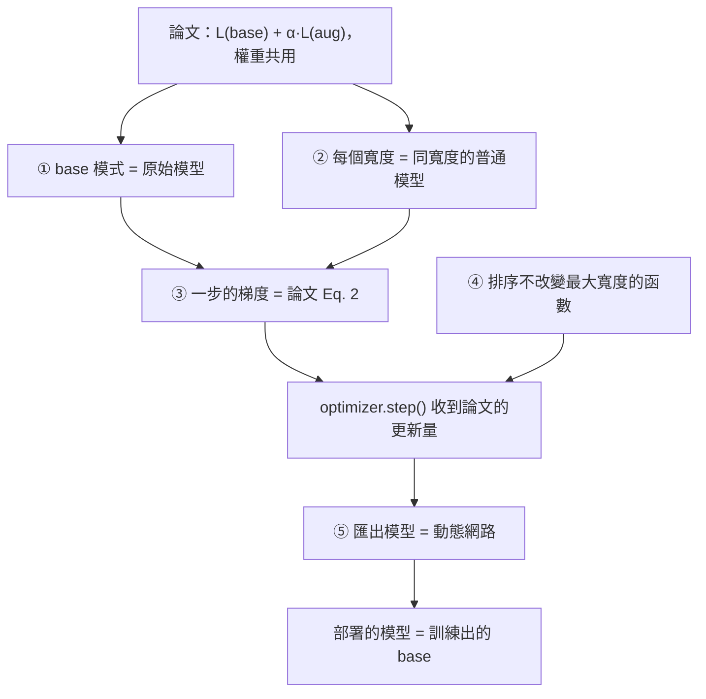

# torchnetaug 程式碼設計

**繁體中文** | [English](design.en.md)

本文件說明 `torchnetaug` 的內部設計與正確性依據。用法見 [README](../README.md)，實驗結果見 [experiments.md](experiments.md)，術語見 [glossary.md](glossary.md)。文件中的 Python 範例由 `tests/test_docs.py` 執行。

## 1. 總覽

NetAug 在訓練時把小模型（base）嵌入較寬的網路一起訓練。所有寬度共用同一組權重，base 使用每個通道群組的前段通道。訓練後只匯出 base。

```text
原始模型 ──► analyze() ──► ChannelGraph ──► NetAugModel ──► export() ──► 原始類別的小模型
            (torch.fx)      (通道群組)       (最大寬度動態模型)
                                               │
                             netaug_step ──────┤  base loss + alpha × aug loss
                             recalibrate_bn    │  評估或匯出前重新估計 BN 統計值
                             sort_channels ────┘  依重要度排序通道
```

| 檔案 | 內容 |
|---|---|
| `graph.py` | `analyze()`、`ChannelGraph`、`LayerRole`、`TraceError`：求出通道群組 |
| `layers.py` | `DynamicConv2d`、`DynamicLinear`、`DynamicBatchNorm`：以最大寬度存權重，執行時切片 |
| `depth.py` | `DepthStack`、`tie_channels`：深度增強 |
| `netaug.py` | `NetAugModel`：建立最大寬度模型、切換寬度與深度、排序、匯出 |
| `train.py` | `netaug_step()`、`recalibrate_bn()` |

## 2. 通道群組

**通道群組**是一組寬度與順序都必須相同的通道。例如：一個 dense 層的輸出與所有讀取它的層的輸入；殘差相加 `x + f(x)` 的兩邊（所以 ResNet 一個 stage 的所有 block 輸出屬於同一個群組）；BN 與 depthwise conv 的輸入與輸出。

每個群組有大小（base 寬度）、是否固定、寬度選項 `round(大小 × m)`（`m` 取自 `width_mults`）。固定群組不加寬也不排序；模型輸入、輸出與無法安全分析的位置都會固定。

每個動態層有一個 `LayerRole`：

| `kind` | 層 | 意義 |
|---|---|---|
| `"dense"` | `nn.Conv2d`（`groups=1`）、`nn.Linear` | 輸出通道是 `out_group`；輸入通道依序屬於 `in_groups` |
| `"member"` | `nn.BatchNorm*`、depthwise `nn.Conv2d` | 輸入等於輸出，屬於 `in_groups` |

### 2.1 concat 與段

`torch.cat(..., dim=1)` 不合併群組，而是產生**段列表**，每個被串接的群組占一段：

```python
import torch
import torch.nn as nn
from torchnetaug import analyze


class DenseLike(nn.Module):
    def __init__(self):
        super().__init__()
        self.stem = nn.Conv2d(3, 6, 3, padding=1)
        self.c1 = nn.Conv2d(6, 4, 3, padding=1)
        self.bn = nn.BatchNorm2d(10)
        self.head = nn.Linear(10, 5)

    def forward(self, x):
        x0 = torch.relu(self.stem(x))
        x1 = torch.relu(self.c1(x0))
        y = self.bn(torch.cat([x0, x1], dim=1))  # 10 = 6 + 4 個通道，兩段
        return self.head(y.mean([2, 3]))


graph = analyze(DenseLike(), torch.randn(1, 3, 16, 16))
roles = graph.layers
stem_g, c1_g = roles["stem"].out_group, roles["c1"].out_group
assert roles["bn"].in_groups == (stem_g, c1_g)    # BN 讀兩段
assert roles["head"].in_groups == (stem_g, c1_g)  # Linear 也讀同樣兩段
print(graph.summary())
```

在最大寬度的權重中，每段的偏移量是前面各段**最大**寬度的和。執行時每段只取前 `active` 個通道：

```text
head.weight 的輸入維度（最大寬度 18 + 12 = 30）
┌──── stem 段：offset 0，最大 18 ────┬──── c1 段：offset 18，最大 12 ────┐
│ ■■■■■■ (base 6) □□□□□□□□□□□□       │ ■■■■ (base 4) □□□□□□□□            │
└────────────────────────────────────┴───────────────────────────────────┘
base 模式的索引 = [0..5] ∪ [18..21]
```

### 2.2 白名單分析

`analyze()` 用 `torch.fx.symbolic_trace` 追蹤模型，以 `ShapeProp` 取得形狀，再逐節點套用規則。**只有白名單上的運算讓通道穿透**，其他運算把它碰到的群組固定。不認得的運算只會縮小可增強的範圍，不會讓模型算錯。

| 類別 | 運算 | 處理 |
|---|---|---|
| dense 層 | `nn.Conv2d`（`groups=1`）、`nn.Linear`（2D 輸入） | 輸出開新群組 |
| member 層 | `nn.BatchNorm1d/2d/3d`、depthwise `nn.Conv2d` | 沿用輸入群組（`nn.SyncBatchNorm` 固定） |
| 逐元素 | ReLU、SiLU、GELU、Hardswish、Sigmoid、Tanh、Dropout、Identity、`clamp` 等（模組、`F.*`、`torch.*`、方法呼叫） | 穿透；逐通道張量邊界的 `clamp` 固定 |
| 空間運算 | MaxPool、AvgPool、Adaptive*Pool、Upsample、`F.interpolate`、`stochastic_depth` | 穿透 |
| 相加、相乘 | `+`、`-`、`*`、`/`、`torch.add` 等 | 合併兩邊群組；1 通道張量沿通道廣播，其群組固定在 1 |
| 串接 | `torch.cat` | `dim=1` 串接段列表；`dim>=2` 合併群組 |
| 改形狀 | `flatten`、`view`、`reshape`、`squeeze`、`nn.Flatten` | 第 0、1 維在任意寬度下都保持時穿透，否則固定 |
| 縮減 | `mean`、`sum`、`amax` | 不縮減第 0、1 維時穿透 |
| 中繼資料 | `x.size()`、`x.dim()`、`x.shape` | 忽略 |

常見的固定原因：GroupNorm、LayerNorm、PReLU 等未列入的模組；直接參與運算的 `nn.Parameter`（如 layer scale）；`1 < groups < C` 的分組卷積；同一模組被呼叫多次；channel shuffle、`transpose`、`chunk`、通道切片；殘差兩邊的段結構不同；`Conv1d`、`Conv3d`、轉置卷積。`graph.summary()` 列出每個群組的固定原因：

```python
class WithGroupNorm(nn.Module):
    def __init__(self):
        super().__init__()
        self.c1 = nn.Conv2d(3, 8, 3, padding=1)
        self.gn = nn.GroupNorm(2, 8)          # 不在白名單上
        self.c2 = nn.Conv2d(8, 6, 1)
        self.fc = nn.Linear(6, 4)

    def forward(self, x):
        x = torch.relu(self.gn(self.c1(x)))
        return self.fc(torch.relu(self.c2(x)).mean([2, 3]))


g = analyze(WithGroupNorm(), torch.randn(1, 3, 16, 16))
assert g.group_fixed[g.layers["c1"].out_group]       # 被 GroupNorm 讀取 → 固定
assert not g.group_fixed[g.layers["c2"].out_group]   # 仍可增強
print(g.summary())
```

追蹤失敗（例如依資料決定的 `if`）時丟出 `TraceError`；可改傳自訂 `torch.fx.Tracer` 或手動建立 `ChannelGraph`。

## 3. 動態層

`NetAugModel` 複製原始模型，把 `ChannelGraph.layers` 列出的層換成動態層：權重以最大寬度配置；原始權重複製到 base 位置；其餘位置用 PyTorch 預設初始化（BN 的 weight 為 1、bias 為 0）。因此 base 模式的輸出**等於**原始模型。

| 屬性 | 意義 |
|---|---|
| `active_out` | dense 層的輸出通道數，永遠取前段 |
| `in_segments` | `((offset, active), ...)`：每段從 `offset` 起取 `active` 個通道；單段且 `offset=0` 時用 `narrow`，否則用 `index_select` |

`DynamicBatchNorm.update_stats`：base 模式正常更新 running 統計值；增強網路（預設 `update_bn_in_aug=False`）用批次統計值正規化，但不更新 running 統計值，避免污染 base。

```python
import torchvision
from torchnetaug import NetAugModel, DynamicConv2d

tiny = torchvision.models.mobilenet_v2(width_mult=0.35, num_classes=10).eval()
x = torch.randn(2, 3, 32, 32)
aug = NetAugModel(tiny, x, width_mults=(1.0, 2.0, 3.0)).eval()

conv = aug.model.features[0][0]
assert isinstance(conv, DynamicConv2d)
print(conv.weight.shape, conv.active_out, conv.in_segments)  # 以最大寬度存放；base 只用前段

with torch.no_grad():
    assert torch.allclose(aug(x), tiny(x), atol=1e-5)  # base 模式等於原始模型
```

## 4. 寬度控制

`set_sizes(sizes)` 設定每個群組的寬度並更新所有動態層。`set_base()`、`set_max()`、`set_random(generator, granularity)` 都建立在它上面；`granularity="group"` 每個未固定群組各自抽，`"global"` 整個模型抽同一倍數。以群組為單位抽樣，對應官方實作的粒度：ResNet 一個 stage 是一個群組；MobileNetV2 的 expand 通道是獨立群組。

```python
import random

rng = random.Random(0)
aug.set_random(rng)
for g, size in enumerate(aug.active_sizes):
    assert size in aug.choices[g]
aug.set_base()
```

## 5. 通道排序

base 永遠使用前段通道。排序把每個群組中最重要的通道移到前面。

**參考實作的問題。** `netaug/` 逐模組排序：只重排自己的輸出（`dim=0`），不重排下游層的輸入（`dim=1`），殘差兩邊也各用不同排列。每次排序都改變網路函數（見 [reference/netaug_reference_impl.md](reference/netaug_reference_impl.md) 第 3.4 節）。

**本套件：一個群組一個排列。** 殘差已把兩邊併成同一群組，所以兩邊一定用同一排列。對每個未固定群組：

1. 重要度（`channel_importance()`）：所有 dense 讀取者在對應輸入段上的權重 L1 範數；沒有 dense 讀取者時改用產生者的輸出權重。精度至少 float32。
2. `perm = argsort(重要度, descending=True, stable=True)`。
3. 把 `perm` 套到所有攜帶這個群組的張量：

| 張量 | 維度 | 位置 |
|---|---|---|
| 產生者的 `weight`、`bias` | 0 | 前段 |
| member 層（BN 參數與 running 統計值、depthwise conv） | 0 | 段偏移量 |
| 讀取者的 `weight` | 1 | 段偏移量 |
| optimizer 中形狀相同的狀態（momentum、`exp_avg` 等） | 同參數 | 同參數 |
| `extra_models`（如 EMA）的同名張量 | 同上 | 同上 |

每條通道路徑的兩端用同一排列，所以**最大寬度的網路函數不變**；改變的只有較小寬度保留哪些通道。

```python
aug.eval()
aug.set_max()
with torch.no_grad():
    before = aug(x)
perms = aug.sort_channels()            # {群組編號: 排列}
with torch.no_grad():
    after = aug(x)
assert torch.allclose(before, after, atol=1e-4)  # 最大寬度的輸出不變

for g, imp in aug.channel_importance().items():   # 排序後重要度遞減
    assert torch.all(imp[:-1] >= imp[1:] * (1 - 1e-5))
aug.set_base()
```

排序**會**改變 base 的輸出，所以要在訓練中定期執行，之後繼續訓練。訓練模式的 Dropout 遮罩作用在通道上，逐位比對時要關閉。

### 5.1 正確性證明

**記號。** 每個張量 `t` 有段列表 `spec(t) = (g1, …, gk)`，第 i 段的偏移量為 `off_i`。群組 `g` 的最大寬度為 `n_g`，作用寬度為 `k_g ≤ n_g`。

**引理 S（逐通道獨立）。** 若 `f` 的輸出通道 `c` 只取決於輸入通道 `c`，則對任何索引序列 `I`（排列或子集）有 `f(x[:, I]) = f(x)[:, I]`。白名單中每個逐元素、池化、上採樣、改形狀與縮減運算都必須滿足 S。`tests/test_whitelist_lemmas.py` 從白名單自動產生案例檢查排列與子集兩種情況，並檢查動態層的權重引理 `layer(x[:, P_in]; W[P_out][:, P_in]) = layer(x; W)[:, P_out]`；白名單新增運算而沒有案例時測試失敗。

**定理 1（每個寬度都是普通網路）。** 固定 `k_g`。只保留每個張量 `S(spec) = ∪_i (off_i + [0, k_gi))` 的通道與對應的權重行列，得到普通小網路 `N_k`；動態模型在寬度 `k` 的輸出等於 `N_k`。證明依拓撲順序歸納：dense 層輸出前 `k_g` 個通道，讀取的權重列與輸入段一一對應；member 層與白名單運算由引理 S 成立；相加、相乘的兩邊已由 union-find 併成同群組；`cat(dim=1)` 正是各段依序排列；其他運算的群組已固定。∎ `export(sizes)` 就是把 `N_k` 建出來。

**系理。** 取 `k = base`，`N_base` 就是原始網路。

**定理 2（排序不變最大寬度的函數）。** 每個未固定群組取排列 `P_g`，固定群組取恆等。依上表排列所有張量後，最大寬度網路中每個張量 `t` 變成 `t[:, Π(spec(t))]`（`Π` 為各段 `P_gi` 的分塊排列）。模型輸出屬於固定群組，所以不變。證明同樣依拓撲順序歸納：dense 層 `W' = W[P_out][:, Π_in]` 使 `y'[o] = y[P_out(o)]`；BN 與 depthwise 逐通道移動參數（訓練模式的批次統計值也逐通道）；相加兩邊同群組；`cat` 的 `Π` 是分塊組合；其他運算的群組固定。∎

**定理 3（optimizer 狀態）。** SGD 與 Adam 的更新逐元素進行，所以「先排列再走一步」等於「先走一步再排列」。

**未涵蓋。** 分析程式本身（union-find 與白名單規則）沒有形式化驗證，由測試支持；浮點數下加總順序改變造成約 `1e-6`（float32）或 `1e-12`（float64）的相對誤差；`torch.fx` 只記錄範例輸入走過的路徑。

## 6. 匯出

`export()` 切到 base 模式，取出動態層的作用切片，載入**原始模型的副本**，所以回傳原始類別、形狀相同，部署端不需要本套件。

```python
small = aug.export().eval()
assert type(small) is type(tiny)
assert {k: v.shape for k, v in small.state_dict().items()} == {k: v.shape for k, v in tiny.state_dict().items()}
with torch.no_grad():
    assert torch.allclose(small(x), aug(x), atol=1e-5)  # aug 已在 base 模式
```

`export(sizes)` 匯出任意寬度（`N_k`）：保留原始結構與 `forward`，把加寬的層換成同類別、作用大小的普通層，沿用原層的 dtype、裝置、`.training` 旗標與 `requires_grad`。

```python
aug.set_width(2.0)
sizes = list(aug.active_sizes)
wide = aug.export(sizes).eval()
aug.eval()
with torch.no_grad():
    assert torch.allclose(wide(x), aug(x), atol=1e-5)
assert sum(p.numel() for p in wide.parameters()) == aug.num_active_params()
assert not any(type(m).__module__.startswith("torchnetaug") for m in wide.modules())
aug.set_base()
```

## 7. 深度增強

論文與官方程式只增強寬度。本套件參考 Once-for-All（Cai et al., ICLR 2020）的 elastic depth：base 是原始網路，增強網路在指定 block 之後多執行 `0..k` 個額外 block。

`NetAugModel(..., depth={路徑: k})` 在追蹤前把每個指定 block 換成 `DepthStack`：

```text
DepthStack.forward(x):
    y = block(x)
    for i in range(active):              # active = 0 時就是 block(x)
        y = tie_channels(extra[i](y), y)
    return y
```

- 建立前先執行一次，檢查 block 只被呼叫一次且輸出形狀等於輸入形狀。
- 額外 block 是副本，權重重新初始化。若把最後一個 BN 歸零後副本變成恆等函數（殘差 block），就保留歸零，加寬後新增通道也維持 0；否則（非殘差 block）用一般初始化。範例輸出接近 0 時改用正值探針判斷。
- 追蹤時 `active` 為最大值，所以分析看得到所有額外 block。原始模型另存一份供 `export()` 使用。

**`tie_channels` 的作用。** 追蹤時，block 之後的層 `L` 被記錄為讀取最後一個額外 block 的輸出，但 base 模式下 `L` 讀的是 block 本身的輸出。殘差 block 的相加自然把兩者併成同一群組；非殘差 block 則會產生新群組，排序時兩者得到不同排列，網路函數會靜默改變。`tie_channels(x, ref)` 在執行時直接回傳 `x`，但以 `torch.fx.wrap` 留下節點，分析器據此合併兩個群組。

```python
from torchnetaug import DepthStack


class PlainBlock(nn.Sequential):
    def __init__(self, c):
        super().__init__(nn.Conv2d(c, c, 3, padding=1, bias=False), nn.BatchNorm2d(c), nn.ReLU())


plain = nn.Sequential(
    nn.Conv2d(3, 8, 3, padding=1), nn.BatchNorm2d(8), nn.ReLU(),
    PlainBlock(8), PlainBlock(8),                       # 非殘差，深度增強加在最後一個
    nn.AdaptiveAvgPool2d(1), nn.Flatten(), nn.Linear(8, 10),
)
deep = NetAugModel(plain, x, width_mults=(1.0, 2.0), depth={"4": 2}).eval()
assert isinstance(deep.model[4], DepthStack)
producer = deep.graph.layers["4.block.0"].out_group
assert all(deep.graph.layers[f"4.extra.{i}.0"].out_group == producer for i in range(2))

outs = []
for d in (0, 1, 2):
    deep.set_state((deep.max_sizes, {"4": d}, "max"))
    with torch.no_grad():
        outs.append(deep(x))
deep.sort_channels()
for d, before in zip((0, 1, 2), outs):
    deep.set_state((deep.max_sizes, {"4": d}, "max"))
    with torch.no_grad():
        assert torch.allclose(deep(x), before, atol=1e-5)
deep.set_base()
```

**狀態、BN 與匯出。**

- 寬度與深度合成一個狀態 `(sizes, depths, mode)`；`mode_ctx`、`export`、`recalibrate_bn` 結束時還原。只有寬度與深度都是 base 時，BN 才更新統計值。
- `set_random()` 先抽寬度，再為每個深度增強點均勻抽 `0..k`；沒有 `depth=` 時不多用亂數。
- 額外 block 只在增強網路中執行，所以評估較深的網路前要 `recalibrate_bn(..., depths=...)`。
- `export()` 把 `P.block.*` 改回 `P.*` 並丟掉 `P.extra.*`；`export(sizes, depths)` 把 `DepthStack` 換成 `nn.Sequential(block, *作用中的額外 block)`。

## 8. 訓練一步

`netaug_step()` 實作論文的目標 `L(base) + alpha × L(aug)`，每步取樣一個增強網路：`set_base()` → forward → backward；`set_random()` → forward → `backward(alpha × aug_loss)`；回到 base。兩次梯度累加在共用權重上，`optimizer.step()` 由呼叫端執行。

`recalibrate_bn()` 在指定寬度與深度下重設 BN running 統計值，以累積平均（`momentum=None`）跑過指定批次，結束（含出錯）時還原狀態、momentum 與逐模組訓練旗標。未執行的額外 block 不重設。

**base 權重收到的梯度。** 以兩層線性網路 `y = V·W·x` 為例，增強網路多了 `V_i·W_i·x`。平方誤差下：

```text
g_base = Vᵀ · r · xᵀ
g_aug  = g_base + Vᵀ · (V_i·W_i·x) · xᵀ
NetAug（alpha = 1）：2·g_base + Vᵀ · (V_i·W_i·x) · xᵀ
```

第一項接近把 base 的學習率加倍；第二項是 NetAug 特有的訊號。非線性網路中，ReLU 開關與 BN 批次統計值也會因額外通道而改變。這是梯度結構，不是效果的證明。`examples/cifar_netaug.py --grad-log-every N` 記錄兩者的 cosine 與長度比，實測結果見 [experiments.md 第 4.4 節](experiments.md)。

## 9. 正確性驗證

「實作正確」指套件算出的值等於論文的定義。每一環都和**不經過本套件、直接用 PyTorch 建的普通模型**比對：



`uv run pytest` 共 471 個測試。測試在 float64 下以緊容差比對，並先隨機化所有參數與 BN 統計值，避免預設值掩蓋錯誤。

| 測試檔 | 數量 | 驗證的事 |
|---|---|---|
| `test_correctness.py` | 111 | ① base = 原始模型；⑤ 匯出（dtype、精度、逐模組旗標）；④ 排序保持最大寬度函數、排序後有序且冪等；optimizer 狀態重排；BN 不被增強網路污染；③ 梯度逐元素等於 Eq. 2；白名單邊界條件 |
| `test_random_architectures.py` | 61 | 60 個隨機架構（殘差、concat、depthwise、SE 及不支援的運算）上的 ①④⑤ |
| `test_whitelist_lemmas.py` | 172 | 引理 S 與動態層權重引理 |
| `test_widths.py` | 55 | ② 每個寬度的參數量、權重形狀、輸出與 BN 更新，等於用建構子直接建出的同寬度模型 |
| `test_depth.py` | 48 | 深度增強的 ①③④⑤、恆等初始化、狀態還原與錯誤訊息 |
| `test_onnx.py` | 12 | 匯出模型經 dynamo 與 TorchScript 轉 ONNX，onnxruntime 輸出一致（差異 < 2e-8） |
| `test_dynamic_usage.py` | 8 | 手動使用動態層；拒絕含動態層的模型 |
| `test_docs.py` | 4 | 文件範例可執行 |

突變測試確認這些測試有效：讓 `netaug_step` 忽略 `alpha`、改用不同的增強網路、只重排產生者輸出（參考實作的做法）、把排序改成遞增或隨機時，對應測試都會失敗。排序後的有序性以相對容差檢查（float64 為 1e-9，float32 為 1e-5），因為其他群組的排列會改變加總順序。

這條鏈證明程式照論文定義計算，**不**證明 NetAug 會提高準確率；那是實驗問題。

## 10. 與論文、參考實作的差異

| 項目 | 官方實作 | `netaug/` 參考實作 | `torchnetaug` |
|---|---|---|---|
| 適用模型 | 手寫的 MobileNet 系列 | 手寫的 YOLOv8 模組 | 任何可被 `torch.fx` 追蹤的模型 |
| 增強維度 | 寬度 + expand ratio | 寬度（`max_depth` 未使用） | 每個通道群組的寬度，選用深度 |
| 寬度取樣 | stage 首個 block、stem、head 各自抽；expand 逐 block 抽 | 每層各自 | 每個群組一次，或整體一次 |
| 排序 | 只排 inverted block 中間通道 | 只排輸出，殘差兩邊各排 | 一個群組一個排列，含 optimizer 狀態 |
| 增強時的 BN | 更新統計值，評估前重設 | 更新，可選重設 | 預設不更新，另有 `recalibrate_bn` |
| 匯出 | 手寫 `export()` | 手寫 `export_module()` | 回傳原始類別的副本 |

## 11. 設計決定與限制

- **只接受普通層。** 含 `DynamicModule` 的模型丟 `TypeError`：追蹤會把動態層當成未知運算，手動 `graph=` 時動態層不會被加寬，`export()` 也會依賴本套件。未採用的替代方案是提供套件自己的組合模組（`Sequential`、`Residual`、`Concat`）宣告通道關係；它能支援無法追蹤的模型，但與自動分析大量重複，而自訂 tracer 或手動 `ChannelGraph` 已能處理這些情況。
- 只增強 `nn.Conv2d`、`nn.Linear`（2D 輸入）與 BatchNorm；模型必須能被 `torch.fx` 追蹤。
- 最大寬度模型的參數量約為 base 的 `max(width_mults)²` 倍。
- 綁定權重的層無法加寬，會丟 `ValueError`。
- 註冊在被加寬層上的自訂 buffer 會在換成動態層時遺失。
- 深度增強只用於保持形狀、每次 forward 只執行一次的 block，且不能和手動 `graph=` 併用。
- 多 GPU（DDP）未實際測試。
