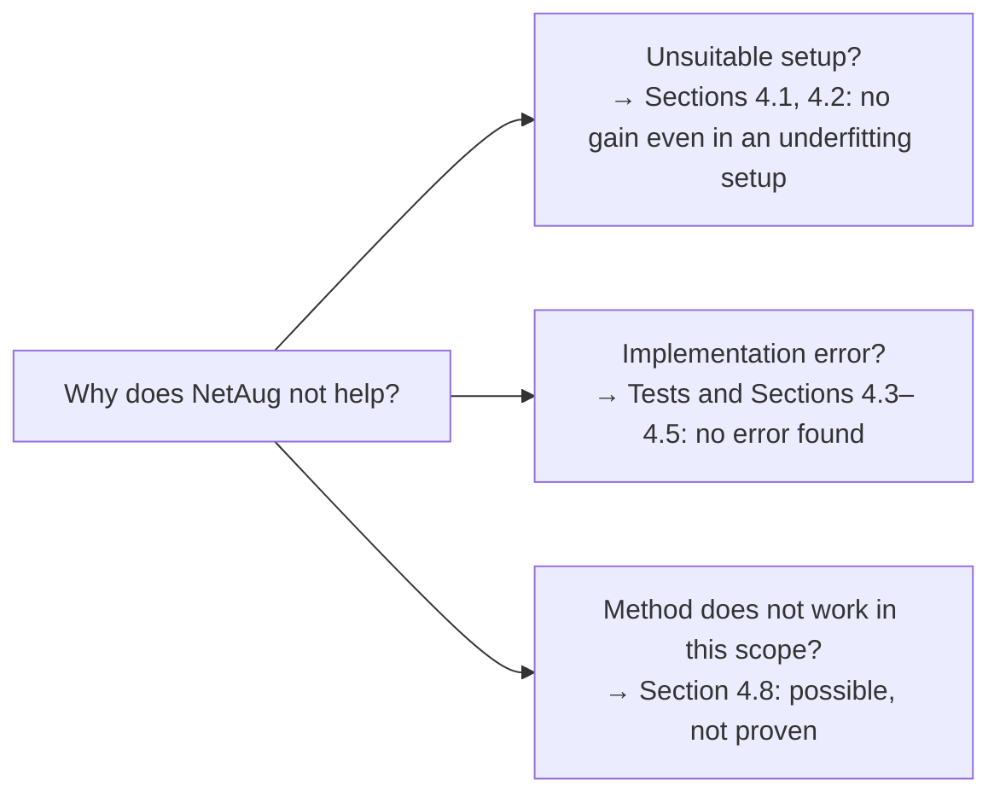
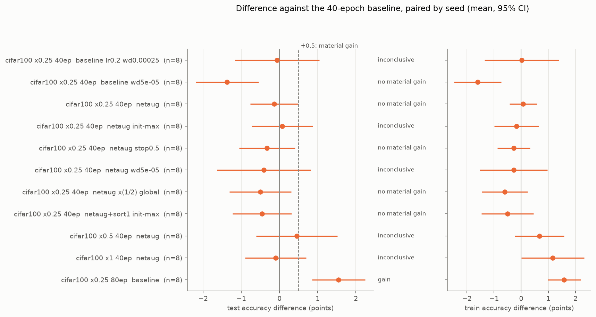
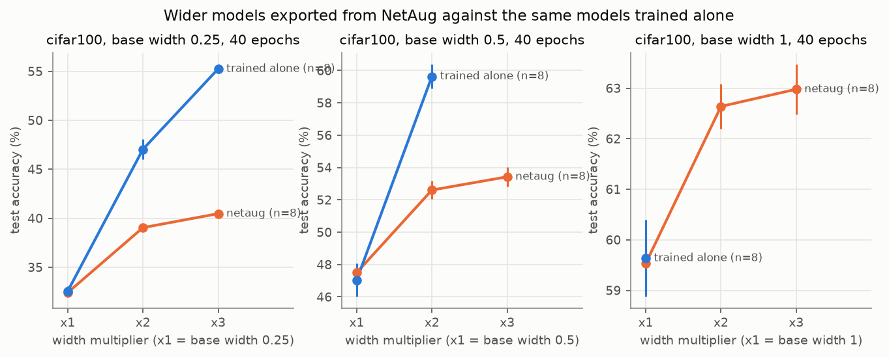
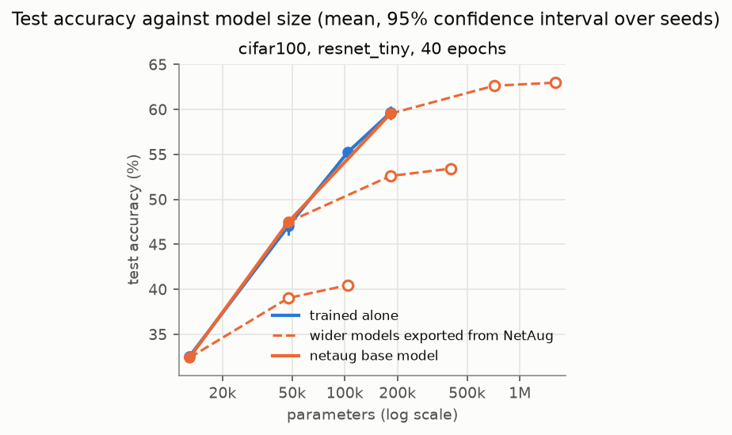
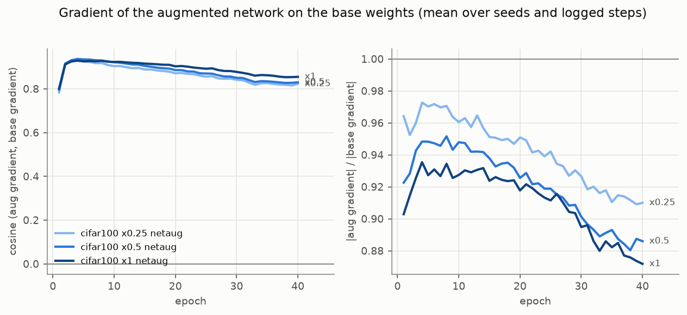
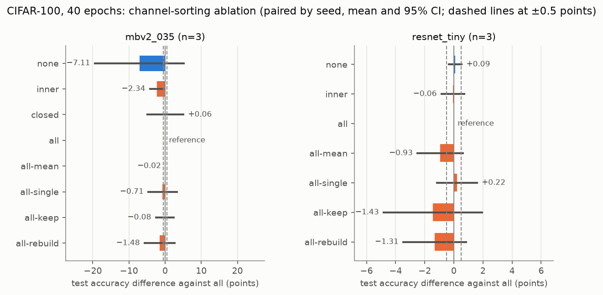

# torchnetaug experiment results and observations

[繁體中文](experiments.md) | **English**

Dates: 2026-11-19 (CIFAR-10), 2026-11-23–24 (CIFAR-100), 2026-11-27 (sorting ablation, Section 4.7). For the code design and correctness verification, see [design.en.md](design.en.md). For the project summary, see [summary.en.md](../summary.en.md). For terms, see [glossary.md](glossary.md).

## 1. Key points

1. **NetAug did not significantly improve the test accuracy of the base model.** On CIFAR-10 the gain is at most +0.34 percentage points, smaller than the seed noise. On CIFAR-100 (8 seeds per setting), no NetAug setting has a 95% confidence interval with a lower bound above 0.
2. **A baseline trained for 40 more epochs gives a significant gain**: +1.54 percentage points (95% CI [+0.85, +2.24]). It uses about 2 times the compute, still less than the 2.6 times of NetAug in this environment.
3. **The training accuracy goes up, but the test accuracy does not** (+0.7 to +1.3 percentage points per seed on CIFAR-10; +1.16 percentage points on average at CIFAR-100 ×1). Depth augmentation, channel sorting and the recipe options of the official implementation did not change the result (on MobileNetV2, sorting reduced the loss from NetAug in every seed, but NetAug stayed below the baseline; see Section 4.7).
4. **Exported wide models are 1.3 to 20.5 percentage points below models of the same width trained alone.** MobileNetV2 is worse with NetAug (below the baseline in all 3 seeds). The cause is not known.
5. **No implementation error was found.** For all exported models, the output difference from the dynamic model is 0.



## 2. Common setup

| Item | Setting |
|---|---|
| Code | Branch `feat/torchnetaug`: CIFAR-10 width `941b37a`, depth `83e5073`, CIFAR-100 `f81bdfc`, sorting ablation `13a9f0e` |
| Environment | Python 3.14.3, PyTorch 2.11.0+cu128, Windows 10, RTX 3060 Ti 8 GB (bf16); Colab Tesla T4 15 GB (second batch completing 8 seeds on CIFAR-100, fp16) |
| Model | TinyResNet: CIFAR ResNet-18 at 1/8 width (8, 16, 32, 64 channels, 176,402 parameters); `--width` multiplies this by a base width multiplier |
| Training | 40 epochs, batch 128, Nesterov SGD (momentum 0.9), lr 0.1 cosine, weight decay 5e-4 (not on BN and bias), random crop and horizontal flip, 16-bit autocast (bf16 on 3060 Ti, fp16 on T4) |
| NetAug | `width_mults=(1.0, 2.0, 3.0)`, `alpha=1.0`, each channel group samples its own width, augmentation for the whole run |
| Evaluation | Before evaluation, the BN statistics of each model are re-estimated on 10,000 training images (no data augmentation). Test accuracy uses the 10,000 test images; training accuracy uses the first 10,000 training images |
| Comparison | Runs with the same seed have the same base initialization and data order, so each run is paired with the baseline of the same seed and subtracted |

## 3. CIFAR-10

### 3.1 Width augmentation

3 seeds per setting. `+sort10` means the channels are sorted every 10 epochs.

| Method | test acc (%) | train acc (%) | Paired difference (points) |
|---|---|---|---|
| baseline | 86.92 ± 0.35 | 91.90 ± 0.23 | — |
| netaug | 87.07 ± 0.39 | 92.70 ± 0.20 | +0.15 ± 0.74 (s0 +0.83, s1 +0.27, s2 −0.64) |
| netaug+sort10 | 87.26 ± 0.09 | 92.81 ± 0.23 | +0.34 ± 0.44 (s0 +0.76, s1 +0.37, s2 −0.11) |

Each width exported from the NetAug model, compared with a model of the same width trained alone (test acc %):

| Width | Parameters | Trained alone | netaug export | netaug+sort10 export |
|---|---|---|---|---|
| ×1.0 | 176,402 | 86.92 ± 0.35 | 87.07 ± 0.39 | 87.26 ± 0.09 |
| ×1.5 | 395,350 | 89.27 ± 0.11 | 87.48 ± 0.25 | 88.00 ± 0.13 |
| ×2.0 | 701,466 | 90.46 ± 0.27 | 88.22 ± 0.16 | 88.48 ± 0.21 |
| ×2.5 | 1,094,750 | 91.27 ± 0.33 | 88.32 ± 0.31 | 88.49 ± 0.23 |
| ×3.0 | 1,575,202 | 91.62 ± 0.30 | 88.44 ± 0.18 | 88.50 ± 0.27 |

Observations:

- The gain of the base is smaller than the standard deviation of the paired difference, and in each method one of the 3 seeds is negative.
- The training accuracy goes up by 0.7 to 1.3 percentage points for every seed. This agrees with the mechanism "reduce underfitting", but the test accuracy does not go up with it.
- From ×1.5 up, the exported wide models are 1.3 to 3.2 percentage points lower, and the gap grows with the width. The added channels get gradients only when they are sampled.
- The gain of the paper (ImageNet, MobileNetV2-Tiny, 150 epochs, +1.6 percentage points) was not reproduced. The dataset, the model and the training length are all different. The official default also stops width augmentation for the last 75 epochs (only the expand ratio is still sampled) and sorts every epoch; this experiment augments for the whole run and sorts every 10 epochs.

### 3.2 Channel sorting

- In 9 sorts (3 seeds × epochs 10, 20, 30), the largest change of the max-width output is 8.6e-6 (the logits are about 20 to 31). So sorting keeps the function on really trained weights.
- **None of the 9 sorts moved any channel into the base.** The added channels use the default initialization, and PyTorch scales it by the number of input channels, so the new weights are smaller (for example, in `layers.0.conv1` the standard deviation is about 0.070 in the base block and 0.039 in the new block). Before training, the smallest importance of the base channels in each group is already 1.06 to 1.19 times the largest importance of the new channels. During training the base channels get a gradient at every step, so the gap stays.
- Sorting only changes which channels the middle widths keep (before training, 168 to 188 of the 720 channels kept by ×2 are swapped). So `+sort10` helps the wider models a little (×1.5 +0.52, ×2.0 +0.26), and the difference at the base should be read as seed noise.

### 3.3 Depth augmentation

One extra block after the last block of each stage (`--depth 1`), 3 seeds per setting.

| Method | test acc (%) | train acc (%) | Paired difference (points) |
|---|---|---|---|
| baseline | 86.92 ± 0.35 | 91.90 ± 0.23 | — |
| Depth augmentation | 86.87 ± 0.20 | 92.28 ± 0.16 | −0.05 ± 0.29 |
| Width + depth augmentation | 86.96 ± 0.05 | 92.77 ± 0.21 | +0.04 ± 0.34 |

- Depth augmentation has no measurable effect on the base, and it does not make width augmentation better.
- The exported network with all extra blocks on has 56% more parameters (274,802 versus 176,402) but the same accuracy (86.92 ± 0.17). The extra blocks are residual copies that start as identity functions and are trained only when sampled, so they learn almost nothing in 40 epochs.

## 4. CIFAR-100 diagnosis

The effect on CIFAR-10 is small. This section checks why: the setup does not suit NetAug, the implementation has a problem, or NetAug has no effect in this kind of setup.

### 4.1 Design

- **An underfitting setup.** CIFAR-100, TinyResNet at base width ×0.25 (2, 4, 8, 16 channels), with a training accuracy of only 33.8%. ×0.5 and ×1 are also tested.
- **Reading rules fixed in advance.** For the 95% confidence interval (t distribution) of the paired difference: lower bound above 0 means "gain"; upper bound below +0.5 percentage points means "no real gain"; otherwise "inconclusive".
- **Controls.** lr 0.2 with weight decay 2.5e-4 (NetAug adds two losses, which is like a larger gradient); a baseline trained for 80 epochs (2 times the compute, less than the about 2.6 times of NetAug in this environment); ×2 and ×3 models trained alone.

### 4.2 Base model

| Setting | n | test acc (%) | Test difference [95% CI] | Train difference [95% CI] | Reading |
|---|---|---|---|---|---|
| ×0.25 baseline | 8 | 32.54 | — | — | — |
| ×0.25 NetAug | 8 | 32.41 | −0.14 [−0.76, +0.49] | +0.08 [−0.43, +0.58] | No real gain |
| ×0.25 NetAug, initialize the whole max-width network (`--init max`) | 8 | 32.61 | +0.07 [−0.73, +0.87] | −0.17 [−1.00, +0.65] | Inconclusive |
| ×0.25 NetAug, stop augmentation for the second half (`--stop-aug 0.5`) | 8 | 32.22 | −0.33 [−1.06, +0.40] | −0.27 [−0.87, +0.32] | No real gain |
| ×0.25 NetAug, sort every epoch + `--init max` | 8 | 32.09 | −0.46 [−1.23, +0.32] | −0.51 [−1.47, +0.46] | No real gain |
| ×0.25 NetAug, sample ×1 or ×2 for the whole model (`x(1/2) global`) | 8 | 32.04 | −0.50 [−1.31, +0.31] | −0.61 [−1.45, +0.24] | No real gain |
| ×0.25 NetAug, weight decay 5e-5 (against the baseline with the same weight decay) | 8 | 30.76 | −0.41 [−1.64, +0.82] | −0.28 [−1.52, +0.97] | Inconclusive |
| ×0.5 NetAug | 8 | 47.50 | +0.46 [−0.61, +1.52] | +0.67 [−0.24, +1.58] | Inconclusive |
| ×1 NetAug | 8 | 59.53 | −0.10 [−0.90, +0.69] | +1.16 [+0.00, +2.32] | Inconclusive |
| Control: ×0.25 baseline, lr 0.2, weight decay 2.5e-4 | 8 | 32.48 | −0.06 [−1.17, +1.04] | +0.02 [−1.34, +1.38] | Inconclusive |
| Control: ×0.25 baseline, weight decay 5e-5 | 8 | 31.17 | −1.37 [−2.19, −0.55] | −1.60 [−2.47, −0.74] | No real gain |
| Control: ×0.25 baseline, 80 epochs | 8 | 34.09 | **+1.54 [+0.85, +2.24]** | +1.58 [+0.97, +2.19] | Gain |



- No NetAug setting gives a test gain. At ×0.25, default NetAug, stopping augmentation for the second half, sorting every epoch and sampling ×1/×2 for the whole model all read as "no real gain" (for default NetAug the upper bound, +0.49, is 0.01 below the threshold).
- 40 more epochs of training give a significant gain. In this environment one NetAug step takes about 2.6 times the baseline step (the paper reports +16.7%), so this compute comparison applies only to this environment.
- The difference in training accuracy grows with the base width (×0.25 +0.08, ×0.5 +0.67, ×1 +1.16). At ×1 the 95% confidence interval lies above 0, yet the test accuracy still shows no gain (−0.10), the same as ResNet50 in the paper.
- The paper says smaller models gain more. Here the most underfitting model, ×0.25, gains the least.

### 4.3 Exported wide models





| Base width | Exported ×2 | Exported ×3 | Same width trained alone |
|---|---|---|---|
| ×0.25 | 39.04 | 40.47 | 47.04 (×2), 55.25 (×3) |
| ×0.25, stop augmentation 0.5 | 34.33 | 34.73 | Same as above |
| ×0.5 | 52.61 | 53.43 | 59.64 (×2) |

- The exported wide models are 7.0 to 20.5 percentage points below models of the same width trained alone. When each group samples its own width, the whole ×3 network is almost never sampled. The networks actually sampled in training (19,000 to 92,000 parameters) give 36.97 ± 2.41% on average after export, while a 47,600-parameter model trained alone gives 47.04%.
- **Wide-path check**: when the whole network samples ×1 or ×2 together, the exported ×2 gives 41.39 ± 1.19% (n=8). The ×2 network is trained in only about half of the steps, and the after-the-fact control, a ×2 model trained alone for 20 epochs, gives 43.23 ± 0.90% (n=8), 1.84 percentage points higher. This control was not designed in advance, so the reading is "inconclusive": no clear defect was seen, but the check does not prove that the wide path has no problem.

### 4.4 Gradients



Every 20 steps, the cosine and the length ratio between the augmented gradient and the base gradient on the base weights are logged. For all three widths the cosine is 0.82 to 0.93 and the length ratio is 0.87 to 0.97. At a cosine of 0.82 to 0.92, the component perpendicular to the base gradient is still about 40% to 57% of the base gradient length, so it is wrong to say that the augmented gradient carries no new information. The result agrees with "NetAug acts mostly like a larger step size here", but the lr 0.2 control that checks this idea is "inconclusive", so the idea is not proven.

### 4.5 Sorting

With a sort every epoch, the 39 sorts of each seed move only 0 to 4 channels into the base in total, which agrees with Section 3.2.

### 4.6 MobileNetV2 (preliminary, 1 seed)

The gains of the paper come from MobileNet-class models, so torchvision MobileNetV2 (width 0.35, 520,000 parameters) was also tested.

| Setting | baseline | NetAug |
|---|---|---|
| 40 epochs | 41.61% | 36.50% (exported ×2 38.3%, ×3 38.6%) |
| 40 epochs + 5 epochs warmup | 44.86% | 40.80% (exported ×2 42.27%, ×3 42.46%) |
| 10 epochs | 20.7% | 13.0% |

- The base loss of NetAug is higher than the baseline from the first epoch. In the first epoch the cosine between the augmented gradient and the base gradient is only 0.25 (length ratio 3.1); after that it is 0.4 to 0.64 (TinyResNet: 0.8 to 0.93).
- 10-epoch ablations: NetAug with lr 0.05 gives 18.2%, NetAug with α=0 gives 19.6%, and the baseline with lr 0.2 and weight decay 2.5e-4 gives 20.8%. So the forward pass of the wrapper is not the cause, and doubling the step size alone does not make the baseline worse; the problem is in the gradient of the augmented loss.
- A fan-out initialization of the added channels was worse (10 epochs: 10.0%) and was withdrawn. Warmup lowers the length ratio of the first epoch to 1.2, but the cosine is still only 0.12, and NetAug is still 4.1 percentage points lower.
- This model is not suitable for a direct conclusion: the total stride is 32, so a 32×32 input becomes 1×1 at the end, and the baseline reaches only 41.6%. Width still helps: width 0.5 trained alone gives 45.02% (816,000 parameters).
- For 40-epoch results with 3 seeds, see Section 4.7: baseline 41.08% to 41.81%, NetAug (no sorting) 13.46% to 36.50%.
- The raw data is in `runs/diag/mbv2_default_init/`.

### 4.7 Sorting ablation (3 seeds)

This section checks whether three choices of channel sorting change the training result: the sort scope, how the importance is combined, and what happens to the optimizer state at a sort. The official implementation sorts only inner groups, uses the importance of one reader, and does not permute the momentum at a sort. By default this package sorts every free group, sums the importance of all dense readers, and permutes the optimizer state. For the differences, see [official_diff.en.md](official_diff.en.md). For the design of sorting, see [Section 5 of design.en.md](design.en.md#5-channel-sorting).

Each setting changes one factor, and the reference setting is `all`. Every setting except `none` sorts once per epoch (`--sort-every 1`). The experiment uses CIFAR-100, 40 epochs and seeds 0, 1 and 2, with MobileNetV2 (`mbv2_035`) and TinyResNet (`resnet_tiny`): 45 runs in total, all in bf16 on the RTX 3060 Ti. `resnet_tiny` has no closed groups, so `closed` would equal `inner` and is not run.

| Setting | Options | What it tests |
|---|---|---|
| `none` | `--sort-every 0` | No sorting: the effect of sorting itself |
| `inner` | `--sort-scope inner` | The sort scope of the official implementation: inner groups only |
| `closed` | `--sort-scope closed` | Sorts inner groups and closed groups (`mbv2_035` only) |
| `all` | `--sort-every 1` | Reference setting: every free group, summed importance, permuted optimizer state |
| `all-mean` | `--sort-agg mean` | The L1 of each reader is divided by that reader's weights per channel, then summed |
| `all-single` | `--sort-agg single` | Only the L1 of the first reader (the official implementation uses one reader) |
| `all-keep` | `--sort-opt keep` | The optimizer state is not permuted (as in the official implementation), so the channels of the momentum and the parameters no longer match |
| `all-rebuild` | `--sort-opt rebuild` | The optimizer state is cleared after each sort, so the momentum starts again from 0; the lr schedule does not change |

Each sort records these values in `sort_log` of the jsonl file:

- The number of groups in the scope, and the number of groups whose order this sort changed (`groups`, `sorted_groups`).
- The number of groups whose permutation differs from the default sort (summed importance, every free group) (`diff_from_default`). It confirms that the setting really changed the permutation.
- The number of channels moved into the base (`moved_into_base`): channels inside the base width after the sort that were outside it before.
- The largest change of the max-width network output on 500 test images (`max_abs_diff`, next to the largest logit `max_abs_logit`). A sort must keep the function the same, so this value must be close to 0.

`examples/sort_report.py` writes the results (see Section 6). The decision rule is the one of Section 4.1.

CIFAR-100, 40 epochs, seed 0, 1, 2.
Values are means over 3 seeds; differences are means of the per-seed paired differences, with the 95% confidence interval (t distribution).

| model | setting | n | test acc (%) | vs all (points) | vs none (points) | exported ×1.5 | exported ×2 | exported ×2.5 | exported ×3 | sorts | groups reordered per sort | groups different from the default sort, per sort | channels moved into base (all sorts) | max change of the max-width output | minutes |
|---|---|---|---|---|---|---|---|---|---|---|---|---|---|---|---|
| mbv2_035 | `none` | 3 | 26.01 | −7.11 [−19.67, +5.44] | — | 26.58 | 27.71 | 27.82 | 27.97 | 0 | — | — | — | — | 10.2 |
| mbv2_035 | `inner` | 3 | 30.78 | −2.34 [−4.43, −0.25] | +4.78 [−8.88, +18.43] | 31.04 | 31.98 | 32.31 | 32.29 | 39 | 16 / 16 | 9 | 1222.7 | 4.3e-04 | 9.9 |
| mbv2_035 | `closed` | 3 | 33.18 | +0.06 [−5.20, +5.32] | +7.17 [−4.93, +19.28] | 33.41 | 33.93 | 34.14 | 34.03 | 39 | 19.8 / 20 | 5 | 3824.3 | 9.8e-04 | 9.9 |
| mbv2_035 | `all` | 3 | 33.12 | — | +7.11 [−5.44, +19.67] | 33.53 | 33.79 | 33.96 | 33.87 | 39 | 24.4 / 25 | 0 | 3544.7 | 1.3e-03 | 10.2 |
| mbv2_035 | `all-mean` | 3 | 33.10 | −0.02 [−0.08, +0.03] | +7.09 [−5.43, +19.61] | 33.48 | 33.83 | 33.92 | 33.98 | 39 | 24.4 / 25 | 0.1 | 3584.7 | 1.3e-03 | 9.7 |
| mbv2_035 | `all-single` | 3 | 32.41 | −0.71 [−4.89, +3.47] | +6.41 [−6.03, +18.84] | 33.05 | 33.14 | 33.18 | 33.23 | 39 | 24.5 / 25 | 5 | 3854.3 | 7.9e-03 | 10.3 |
| mbv2_035 | `all-keep` | 3 | 33.04 | −0.08 [−2.79, +2.62] | +7.03 [−8.01, +22.07] | 33.45 | 34.00 | 34.12 | 34.21 | 39 | 24.4 / 25 | 0 | 3660.3 | 1.2e-03 | 10.2 |
| mbv2_035 | `all-rebuild` | 3 | 31.64 | −1.48 [−5.92, +2.96] | +5.63 [−11.11, +22.37] | 32.10 | 32.46 | 32.53 | 32.49 | 39 | 24.3 / 25 | 0 | 3590 | 9.9e-04 | 10.2 |
| resnet_tiny | `none` | 3 | 59.80 | +0.09 [−0.42, +0.60] | — | 60.53 | 62.54 | 62.84 | 63.10 | 0 | — | — | — | — | 5.3 |
| resnet_tiny | `inner` | 3 | 59.65 | −0.06 [−0.91, +0.79] | −0.15 [−0.55, +0.24] | 60.79 | 62.71 | 62.86 | 63.11 | 39 | 7.8 / 8 | 4 | 0.7 | 2.3e-05 | 5.4 |
| resnet_tiny | `all` | 3 | 59.71 | — | −0.09 [−0.60, +0.42] | 61.03 | 62.53 | 62.84 | 62.99 | 39 | 11.6 / 12 | 0 | 0 | 4.6e-05 | 5.3 |
| resnet_tiny | `all-mean` | 3 | 58.77 | −0.93 [−2.56, +0.69] | −1.03 [−2.78, +0.73] | 60.38 | 62.30 | 62.75 | 62.86 | 39 | 11.7 / 12 | 4 | 0.3 | 6.1e-05 | 5.2 |
| resnet_tiny | `all-single` | 3 | 59.92 | +0.22 [−1.22, +1.66] | +0.12 [−1.60, +1.85] | 60.73 | 62.44 | 62.76 | 62.97 | 39 | 11.6 / 12 | 4 | 1 | 6.1e-05 | 5.1 |
| resnet_tiny | `all-keep` | 3 | 58.27 | −1.43 [−4.89, +2.02] | −1.53 [−5.46, +2.40] | 59.65 | 61.30 | 61.72 | 61.75 | 39 | 11.6 / 12 | 0 | 0 | 6.1e-05 | 5.3 |
| resnet_tiny | `all-rebuild` | 3 | 58.40 | −1.31 [−3.53, +0.92] | −1.40 [−3.70, +0.90] | 59.83 | 61.33 | 61.78 | 62.00 | 39 | 11.6 / 12 | 0 | 0.7 | 9.2e-05 | 5.4 |



Observations:

1. **On MobileNetV2, the NetAug result changes a lot from seed to seed, and sorting reduces the loss.** Without sorting, the 3 seeds give 36.50%, 28.06% and 13.46%. The baseline with the same seeds gives 41.61%, 41.81% and 41.08% (seeds 1 and 2 were run separately, results in `runs/sort_ablation_baseline.jsonl`). `all` is above `none` in every seed (+3.41, +5.06 and +12.87 percentage points), but still 1.70 to 14.75 percentage points below the baseline. The confidence interval includes 0, so "sorting helps MobileNetV2" is undecided.
2. **On MobileNetV2, the sort scope of the official implementation (`inner`) is worse than `all`**: −2.34 [−4.43, −0.25], negative in all 3 seeds (−1.96, −3.30 and −1.75). `closed` and `all` show no measurable difference.
3. **On TinyResNet, sorting gives no real gain**: `all` against `none` is −0.09 [−0.60, +0.42], and `inner` against `none` is −0.15 [−0.55, +0.24]. Both upper bounds are below +0.5.
4. **How the importance is combined and what happens to the optimizer state have no measurable effect.** On MobileNetV2, `all-mean` chooses almost the same permutation as `all` (0.1 groups different per sort on average); the difference is −0.02 [−0.08, +0.03]. The other settings have mean differences from −1.48 to +0.22 percentage points, and all their confidence intervals include 0.
5. **Sorting keeps the function the same, but the two models move very different numbers of channels into the base.** The largest change of the max-width output, relative to the largest logit, is at most 7e-7 for TinyResNet and at most 7.4e-4 for MobileNetV2 (7.9e-3 against a logit of 10.8; the cause was not checked). On TinyResNet, the 39 sorts of a run move 0 to 2 channels into the base in total (as in Sections 3.2 and 4.5); on MobileNetV2 they move 931 to 4,500 channels. This difference may be why sorting has a clear effect only on MobileNetV2 (not proven).

### 4.8 Possible causes (not proven)

The gains of the paper come from MobileNet-class models on ImageNet, where augmentation widens the expand channels of the inverted blocks, trained for 150 epochs with 5 epochs of warmup. The architecture, the dataset and the training length of these experiments are all different.

## 5. Limitations

- CIFAR-10 has only 3 seeds per setting; CIFAR-100 has 8 seeds per setting; Section 4.6 (MobileNetV2) has only 1 seed, and the sorting ablation has only 3 seeds. Differences smaller than about 0.5 percentage points cannot be told apart from seed noise.
- Only 40 epochs (80 for a control), 32×32 images and two architectures were used. ImageNet was not tested.
- During some runs the GPU was also running other programs, and the second batch ran in fp16 on a Colab Tesla T4, so the run times are only approximate.

## 6. Reproduction

Put the data in `data/` (if the SSL certificate of the official CIFAR host has expired, download with `curl -L`). Each run appends one line of results to a jsonl file.

```bash
uv run python examples/check_widths_fake_data.py       # fake data: size and computation at each width are correct
bash examples/run_cifar10_compare.sh                   # Section 3.1
bash examples/run_cifar10_depth.sh                     # Section 3.3
uv run python examples/summarize.py runs/cifar10_compare.jsonl runs/cifar10_depth.jsonl

bash examples/run_diagnosis.sh                         # Section 4 (all 7 stages, 8 seeds each)
uv run python examples/summarize.py --ref-epochs 40 runs/diag/method_*.jsonl
uv run python examples/plot_results.py --out runs/plots --ref-epochs 40 runs/diag/method_*.jsonl

uv run python examples/sort_ablation.py --amp bf16     # Section 4.7 (45 runs, results in runs/sort_ablation.jsonl)
uv run python examples/sort_report.py runs/sort_ablation.jsonl --lang en --plot docs/figures
```

- The stages of `run_diagnosis.sh`: `main` (8 seeds), `dose` (base width 0.5, 1.0), `controls`, `alone`, `ablations`, `sanity`, `recipe`. Finished runs are skipped.
- Main options of `cifar_netaug.py`: `--width` (base width multiplier), `--depth`, `--init {base,max}`, `--stop-aug`, `--sort-every`, `--granularity {group,global}`, `--grad-log-every N`, `--amp {bf16,fp16,off}`, `--warmup N`.
- `sort_report.py` prints the results table of Section 4.7 to standard output (`--lang zh` gives the Chinese header row); `--plot` writes `sort_ablation.png`.
- `examples/run_cifar100_regime.sh` is an earlier CIFAR-100 control script. This document does not use its results.
- MobileNetV2: `uv run python examples/cifar_netaug.py --model {mbv2_035,mbv2_050} --method {baseline,netaug} --dataset cifar100 --epochs 40 --seed 0 --eval-widths 1.0 2.0 3.0 --out <file>`, optionally with `--warmup 5`, `--grad-log-every 20`, `--alpha 0`, or `--lr 0.05 --wd 1e-3`.
