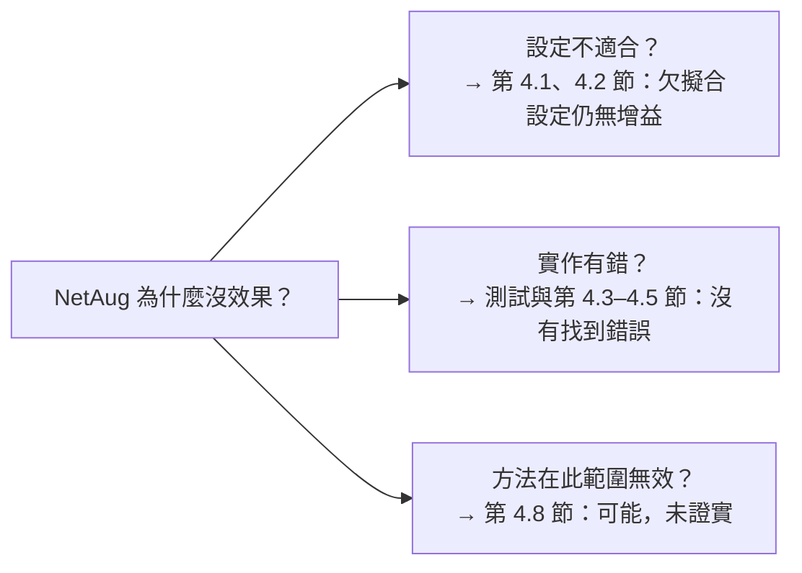
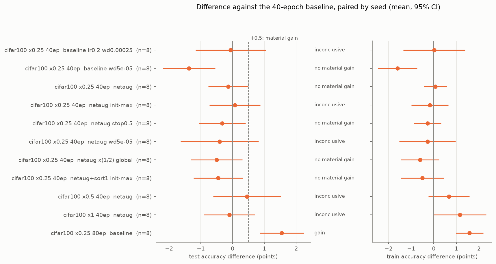
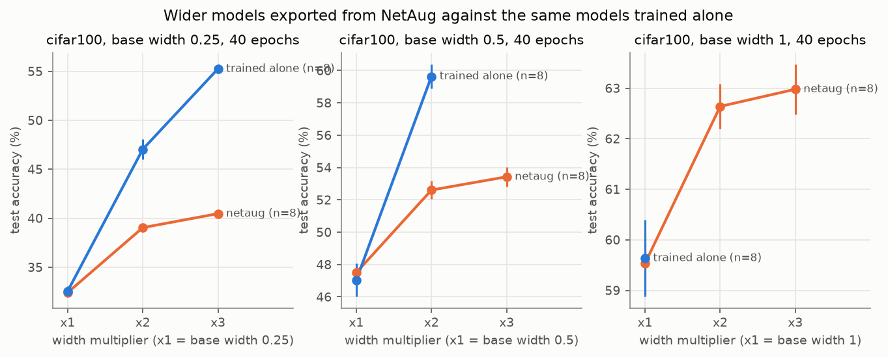
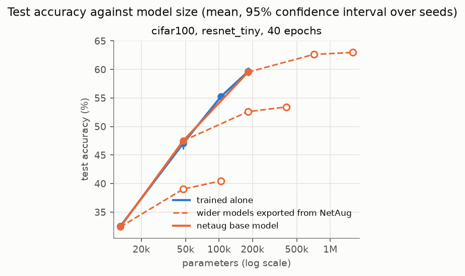
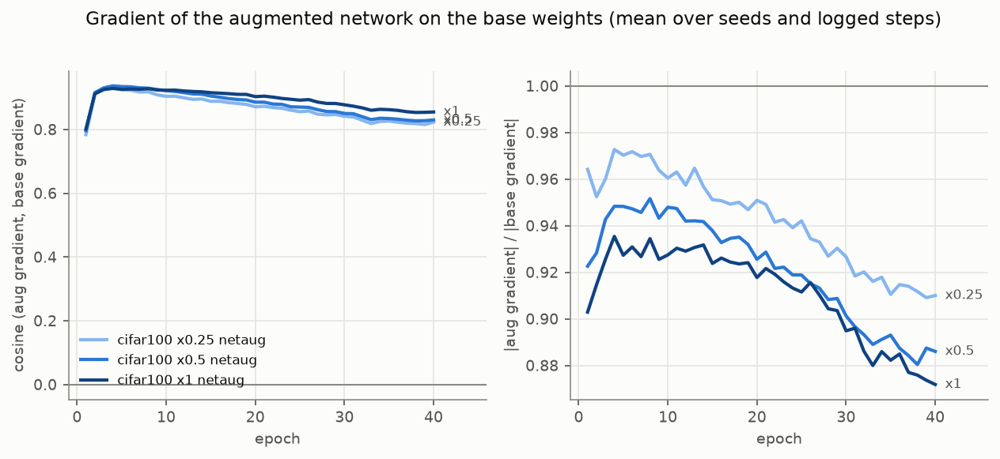

# torchnetaug 實驗結果與觀察

**繁體中文** | [English](experiments.en.md)

日期：2026-11-19（CIFAR-10）、2026-11-23–24（CIFAR-100）；排序消融（第 4.7 節）執行中。程式設計與正確性驗證見 [design.md](design.md)，專案總結見 [summary.md](../summary.md)，術語見 [glossary.md](glossary.md)。

## 1. 重點

1. **NetAug 沒有顯著提高 base 模型的測試準確率。** CIFAR-10 的增益在 +0.34 個百分點以內，小於 seed 雜訊。CIFAR-100（每種設定 8 個 seed）沒有任何 NetAug 設定的 95% 信賴區間下限大於 0。
2. **baseline 多訓練 40 epoch 有顯著增益**：+1.54 個百分點（95% CI [+0.85, +2.24]）。它的計算量約為 2 倍，仍少於本環境中 NetAug 的 2.6 倍。
3. **訓練準確率上升，測試準確率沒有**（CIFAR-10 每個 seed +0.7 到 +1.3 個百分點；CIFAR-100 ×1 平均 +1.16 個百分點）。深度增強、通道排序與官方實作的配方選項都沒有改變結果。
4. **匯出的寬模型比同寬度單獨訓練的模型低 1.3 到 20.5 個百分點。** MobileNetV2（1 個 seed）在 NetAug 下更差，原因未確定。
5. **沒有找到實作錯誤。** 所有匯出模型與動態模型的輸出差異都是 0。



## 2. 共同設定

| 項目 | 設定 |
|---|---|
| 程式碼 | 分支 `feat/torchnetaug`：CIFAR-10 寬度 `941b37a`、深度 `83e5073`、CIFAR-100 `f81bdfc`、排序消融 `13a9f0e` |
| 環境 | Python 3.14.3、PyTorch 2.11.0+cu128、Windows 10、RTX 3060 Ti 8 GB（bf16）；Colab Tesla T4 15 GB（CIFAR-100 補齊至 8 個 seed 的後半批次與排序消融，fp16） |
| 模型 | TinyResNet：CIFAR 版 ResNet-18，寬度 1/8（8、16、32、64 通道，176,402 個參數）；`--width` 再乘上 base 寬度倍數 |
| 訓練 | 40 epoch、batch 128、Nesterov SGD（momentum 0.9）、lr 0.1 cosine、weight decay 5e-4（BN 與 bias 不做）、隨機裁切與水平翻轉、16-bit autocast（3060 Ti 用 bf16，T4 用 fp16） |
| NetAug | `width_mults=(1.0, 2.0, 3.0)`、`alpha=1.0`、每個通道群組各自抽寬度、全程增強 |
| 評估 | 每個模型先用 10,000 張訓練影像（無資料增強）重新估計 BN 統計值。測試準確率用 10,000 張測試影像，訓練準確率用前 10,000 張訓練影像 |
| 比較 | 同一個 seed 的 base 初始化與資料順序相同，所以和 baseline 逐 seed 配對相減 |

## 3. CIFAR-10

### 3.1 寬度增強

每種設定 3 個 seed。`+sort10` 表示每 10 個 epoch 排序一次通道。

| 方法 | test acc (%) | train acc (%) | 配對差異（百分點） |
|---|---|---|---|
| baseline | 86.92 ± 0.35 | 91.90 ± 0.23 | — |
| netaug | 87.07 ± 0.39 | 92.70 ± 0.20 | +0.15 ± 0.74（s0 +0.83、s1 +0.27、s2 −0.64） |
| netaug+sort10 | 87.26 ± 0.09 | 92.81 ± 0.23 | +0.34 ± 0.44（s0 +0.76、s1 +0.37、s2 −0.11） |

從 NetAug 模型匯出的各寬度與同寬度單獨訓練的模型（test acc %）：

| 寬度 | 參數量 | 單獨訓練 | netaug 匯出 | netaug+sort10 匯出 |
|---|---|---|---|---|
| ×1.0 | 176,402 | 86.92 ± 0.35 | 87.07 ± 0.39 | 87.26 ± 0.09 |
| ×1.5 | 395,350 | 89.27 ± 0.11 | 87.48 ± 0.25 | 88.00 ± 0.13 |
| ×2.0 | 701,466 | 90.46 ± 0.27 | 88.22 ± 0.16 | 88.48 ± 0.21 |
| ×2.5 | 1,094,750 | 91.27 ± 0.33 | 88.32 ± 0.31 | 88.49 ± 0.23 |
| ×3.0 | 1,575,202 | 91.62 ± 0.30 | 88.44 ± 0.18 | 88.50 ± 0.27 |

觀察：

- base 的增益小於配對差異的標準差，3 個 seed 中各有一個為負。
- 每個 seed 的訓練準確率都上升 0.7 到 1.3 個百分點。這符合「緩解欠擬合」的機制，但測試準確率沒有對應上升。
- 匯出的寬模型從 ×1.5 起低 1.3 到 3.2 個百分點，寬度越大差距越大。新增通道只在被抽到時才得到梯度。
- 論文的增益（ImageNet、MobileNetV2-Tiny、150 epoch，+1.6 個百分點）沒有重現。資料集、模型與訓練長度都不同。官方預設還會在最後 75 個 epoch 停止寬度增強（只有 expand ratio 仍抽樣），並每個 epoch 排序；本實驗全程增強，每 10 個 epoch 排序。

### 3.2 通道排序

- 9 次排序（3 個 seed × 第 10、20、30 epoch）中，最大寬度輸出的變化最大是 8.6e-6（logit 約 20 到 31），也就是排序在實際訓練的權重上保持函數不變。
- **9 次都沒有把任何通道移入 base。** 新增通道用預設初始化，而 PyTorch 的初始化依輸入通道數縮放，所以新權重較小（例如 `layers.0.conv1` 的 base 區塊標準差約 0.070，新區塊約 0.039）。未訓練時，每個群組中 base 通道重要度的最小值已是新通道最大值的 1.06 到 1.19 倍；訓練時 base 通道每一步都有梯度，差距維持住。
- 排序只改變中間寬度保留哪些通道（×2 保留的 720 個通道中，未訓練時有 168 到 188 個被換掉）。所以 `+sort10` 對較寬的模型有小幅幫助（×1.5 +0.52、×2.0 +0.26），base 的差異應視為 seed 雜訊。

### 3.3 深度增強

在每個 stage 的最後一個 block 之後加 1 個額外 block（`--depth 1`），每種設定 3 個 seed。

| 方法 | test acc (%) | train acc (%) | 配對差異（百分點） |
|---|---|---|---|
| baseline | 86.92 ± 0.35 | 91.90 ± 0.23 | — |
| 深度增強 | 86.87 ± 0.20 | 92.28 ± 0.16 | −0.05 ± 0.29 |
| 寬度 + 深度增強 | 86.96 ± 0.05 | 92.77 ± 0.21 | +0.04 ± 0.34 |

- 深度增強對 base 沒有可測量的效果，也沒有讓寬度增強變好。
- 開啟所有額外 block 的匯出網路多 56% 參數（274,802 對 176,402），準確率卻相同（86.92 ± 0.17）。額外 block 是從恆等函數開始的殘差副本，只在被抽到時才訓練，40 epoch 內幾乎沒有學到東西。

## 4. CIFAR-100 診斷

CIFAR-10 的效果很小。本節檢查原因：設定不適合、實作有問題，或 NetAug 在這類設定本來就沒有效果。

### 4.1 設計

- **欠擬合的設定。** CIFAR-100，TinyResNet base 寬度 ×0.25（2、4、8、16 通道），訓練準確率只有 33.8%。另測 ×0.5 與 ×1。
- **事先定好的判讀規則。** 配對差異的 95% 信賴區間（t 分布）下限大於 0：「有增益」；上限小於 +0.5 個百分點：「沒有實質增益」；其他：「無法判定」。
- **對照組。** lr 0.2 加 weight decay 2.5e-4（NetAug 的兩個 loss 相加，等於放大梯度）；baseline 訓練 80 epoch（2 倍計算量，少於本環境中 NetAug 的約 2.6 倍）；單獨訓練的 ×2、×3 模型。

### 4.2 base 模型

| 設定 | n | test acc (%) | 測試差異 [95% CI] | 訓練差異 [95% CI] | 判讀 |
|---|---|---|---|---|---|
| ×0.25 baseline | 8 | 32.54 | — | — | — |
| ×0.25 NetAug | 8 | 32.41 | −0.14 [−0.76, +0.49] | +0.08 [−0.43, +0.58] | 沒有實質增益 |
| ×0.25 NetAug，最大網路整體初始化（`--init max`） | 8 | 32.61 | +0.07 [−0.73, +0.87] | −0.17 [−1.00, +0.65] | 無法判定 |
| ×0.25 NetAug，後半停止增強（`--stop-aug 0.5`） | 8 | 32.22 | −0.33 [−1.06, +0.40] | −0.27 [−0.87, +0.32] | 沒有實質增益 |
| ×0.25 NetAug，每 epoch 排序 + `--init max` | 8 | 32.09 | −0.46 [−1.23, +0.32] | −0.51 [−1.47, +0.46] | 沒有實質增益 |
| ×0.25 NetAug，整個模型抽 ×1 或 ×2（`x(1/2) global`） | 8 | 32.04 | −0.50 [−1.31, +0.31] | −0.61 [−1.45, +0.24] | 沒有實質增益 |
| ×0.25 NetAug，weight decay 5e-5（對同 weight decay 的 baseline） | 8 | 30.76 | −0.41 [−1.64, +0.82] | −0.28 [−1.52, +0.97] | 無法判定 |
| ×0.5 NetAug | 8 | 47.50 | +0.46 [−0.61, +1.52] | +0.67 [−0.24, +1.58] | 無法判定 |
| ×1 NetAug | 8 | 59.53 | −0.10 [−0.90, +0.69] | +1.16 [+0.00, +2.32] | 無法判定 |
| 對照：×0.25 baseline，lr 0.2、weight decay 2.5e-4 | 8 | 32.48 | −0.06 [−1.17, +1.04] | +0.02 [−1.34, +1.38] | 無法判定 |
| 對照：×0.25 baseline，weight decay 5e-5 | 8 | 31.17 | −1.37 [−2.19, −0.55] | −1.60 [−2.47, −0.74] | 沒有實質增益 |
| 對照：×0.25 baseline，80 epoch | 8 | 34.09 | **+1.54 [+0.85, +2.24]** | +1.58 [+0.97, +2.19] | 有增益 |



- 沒有任何 NetAug 設定得到測試增益。×0.25 的預設 NetAug、後半停止增強、每 epoch 排序與整個模型抽 ×1/×2 四種設定皆判定為「沒有實質增益」（其中預設 NetAug 的上限 +0.49 只比門檻低 0.01）。
- 多訓練 40 epoch 有顯著增益。本環境中 NetAug 每步時間約是 baseline 的 2.6 倍（論文為 +16.7%），所以這個計算量比較只適用於本環境。
- 訓練準確率的差異隨 base 寬度增加（×0.25 +0.08、×0.5 +0.67、×1 +1.16），其中 ×1 的 95% 信賴區間下限大於 0，但測試準確率仍無增益（−0.10），和論文中 ResNet50 的情況相同。
- 論文說越小的模型增益越大；這裡最欠擬合的 ×0.25 增益最小。

### 4.3 匯出的寬模型





| base 寬度 | 匯出 ×2 | 匯出 ×3 | 同寬度單獨訓練 |
|---|---|---|---|
| ×0.25 | 39.04 | 40.47 | 47.04（×2）、55.25（×3） |
| ×0.25，停止增強 0.5 | 34.33 | 34.73 | 同上 |
| ×0.5 | 52.61 | 53.43 | 59.64（×2） |

- 匯出的寬模型比單獨訓練的同寬度模型低 7.0 到 20.5 個百分點。每個群組各自抽寬度時，整個 ×3 網路幾乎不會被抽到；訓練中實際抽到的網路（1.9 萬到 9.2 萬個參數）匯出後平均是 36.97 ± 2.41%，而單獨訓練的 4.76 萬參數模型是 47.04%。
- **寬路徑檢查**：整個網路一起抽 ×1 或 ×2 時，匯出的 ×2 是 41.39 ± 1.19%（n=8）。×2 網路只在約一半的步驟被訓練，事後對照的單獨訓練 20 epoch ×2 是 43.23 ± 0.90%（n=8），差 1.84 個百分點。這個對照不是事先設計的，所以判讀是「無法判定」：沒有看到明顯缺陷，也不能證明寬路徑沒有問題。

### 4.4 梯度



每 20 步記錄增強梯度與 base 梯度在 base 權重上的 cosine 與長度比。三種寬度的 cosine 都在 0.82 到 0.93，長度比在 0.87 到 0.97。cosine 0.82 到 0.92 時，垂直於 base 梯度的分量仍有 base 梯度長度的約 40% 到 57%，所以不能說增強梯度沒有新資訊。結果符合「NetAug 在這裡主要像放大步長」，但檢查這個想法的 lr 0.2 對照是「無法判定」，所以未證實。

### 4.5 排序

每 epoch 排序一次時，39 次排序每個 seed 總共只把 0 到 4 個通道換進 base，與第 3.2 節一致。

### 4.6 MobileNetV2（初步，1 個 seed）

論文的增益來自 MobileNet 類模型，所以也測了 torchvision MobileNetV2（寬度 0.35，52 萬個參數）。

| 設定 | baseline | NetAug |
|---|---|---|
| 40 epoch | 41.61% | 36.50%（匯出 ×2 38.3%、×3 38.6%） |
| 40 epoch + 5 epoch warmup | 44.86% | 40.80%（匯出 ×2 42.27%、×3 42.46%） |
| 10 epoch | 20.7% | 13.0% |

- NetAug 的 base loss 從第 1 個 epoch 起就高於 baseline。增強梯度與 base 梯度的 cosine 在第 1 個 epoch 只有 0.25（長度比 3.1），之後 0.4 到 0.64（TinyResNet 是 0.8 到 0.93）。
- 10 epoch 的排除實驗：NetAug lr 0.05 是 18.2%，NetAug α=0 是 19.6%，baseline lr 0.2 加 weight decay 2.5e-4 是 20.8%。所以包裝器的 forward 不是原因，單純加倍步長也不會讓 baseline 變差；問題在增強 loss 的梯度。
- 新增通道改用 fan-out 初始化更差（10 epoch 10.0%），已撤回。warmup 讓第一個 epoch 的長度比降到 1.2，但 cosine 仍只有 0.12，NetAug 仍低 4.1 個百分點。
- 這個模型不適合直接下結論：總步幅 32 讓 32×32 輸入最後只剩 1×1，baseline 只有 41.6%。寬度仍有幫助：寬度 0.5 單獨訓練是 45.02%（81.6 萬個參數）。
- 原始資料在 `runs/diag/mbv2_default_init/`。

### 4.7 排序消融（1 個 seed，執行中）

本節檢查通道排序的三個選擇是否影響訓練結果：排序範圍、重要度的合計方式，以及排序時怎麼處理 optimizer 狀態。官方實作只排序 inner 群組、重要度只用一個讀取者，而且排序時不重排動量。本套件預設排序所有可增強群組、加總所有 dense 讀取者的重要度，並重排 optimizer 狀態。差異見 [official_diff.md](official_diff.md)，排序的設計見 [design.md 第 5 節](design.md#5-通道排序)。

每個設定只改變一個因素，參考設定是 `all`。除了 `none`，所有設定都每個 epoch 排序一次（`--sort-every 1`）。實驗用 CIFAR-100、40 epoch、seed 0，模型是 MobileNetV2（`mbv2_035`）與 TinyResNet（`resnet_tiny`），共 15 次執行。`resnet_tiny` 沒有 closed 群組，`closed` 會等於 `inner`，所以不執行。

| 設定 | 選項 | 檢查什麼 |
|---|---|---|
| `none` | `--sort-every 0` | 不排序：排序本身的效果 |
| `inner` | `--sort-scope inner` | 官方實作的排序範圍：只排序 inner 群組 |
| `closed` | `--sort-scope closed` | 排序 inner 群組與 closed 群組（只有 `mbv2_035`） |
| `all` | `--sort-every 1` | 參考設定：所有可增強群組、加總重要度、重排 optimizer 狀態 |
| `all-mean` | `--sort-agg mean` | 每個讀取者的 L1 先除以該讀取者每個通道的權重數，再加總 |
| `all-single` | `--sort-agg single` | 只用第一個讀取者的 L1（官方實作只用一個讀取者） |
| `all-keep` | `--sort-opt keep` | 不重排 optimizer 狀態（官方實作的作法），動量和參數的通道會錯位 |
| `all-rebuild` | `--sort-opt rebuild` | 排序後清除 optimizer 狀態，動量從 0 開始；lr 排程不變 |

每次排序在 jsonl 的 `sort_log` 記錄下列數值：

- 範圍內的群組數與這次改變順序的群組數（`groups`、`sorted_groups`）。
- 排列和預設排序（加總重要度、所有可增強群組）不同的群組數（`diff_from_default`）。它確認這個設定真的改變了排列。
- 移入 base 的通道數（`moved_into_base`）：排序後在 base 寬度內、排序前在 base 寬度外的通道。
- 最大寬度網路在 500 張測試影像上的輸出最大變化（`max_abs_diff`，對照最大 logit `max_abs_logit`）。排序應保持函數不變，所以這個值應接近 0。

結果待補：實驗在 Colab 上等待 GPU 額度。結果表與圖 `figures/sort_ablation.png` 由 `examples/sort_report.py` 產生（見第 6 節）。

只有 1 個 seed，所以小於約 0.5 個百分點的差異無法和 seed 雜訊區分（見第 5 節）。

### 4.8 可能的原因（未證實）

論文的增益來自 ImageNet 上的 MobileNet 類模型，增強會加寬 inverted block 的 expand 通道，訓練 150 epoch 加 5 epoch warmup。本實驗的架構、資料集與訓練長度都不同。

## 5. 限制

- CIFAR-10 每種設定只有 3 個 seed；CIFAR-100 每種設定 8 個 seed；MobileNetV2 與排序消融只有 1 個 seed。小於約 0.5 個百分點的差異無法和 seed 雜訊區分。
- 只用 40 epoch（對照組 80 epoch）、32×32 影像與兩種架構，沒有測 ImageNet。
- 部分執行期間顯示卡同時在跑其他程式，且後半批次在 Colab Tesla T4 上以 fp16 執行，所以執行時間只能大略參考。

## 6. 重現

資料放在 `data/`（CIFAR 官方主機的 SSL 憑證過期時，用 `curl -L` 下載）。每次執行在 jsonl 檔加一行結果。

```bash
uv run python examples/check_widths_fake_data.py       # 假資料：每個寬度的大小與計算正確
bash examples/run_cifar10_compare.sh                   # 第 3.1 節
bash examples/run_cifar10_depth.sh                     # 第 3.3 節
uv run python examples/summarize.py runs/cifar10_compare.jsonl runs/cifar10_depth.jsonl

bash examples/run_diagnosis.sh                         # 第 4 節（全部 7 個階段，各 8 個 seed）
uv run python examples/summarize.py --ref-epochs 40 runs/diag/method_*.jsonl
uv run python examples/plot_results.py --out runs/plots --ref-epochs 40 runs/diag/method_*.jsonl

uv run python examples/sort_ablation.py --seeds 0      # 第 4.7 節（15 次執行，結果在 runs/sort_ablation.jsonl）
uv run python examples/sort_report.py runs/sort_ablation.jsonl --lang zh --plot docs/figures
```

- `run_diagnosis.sh` 的階段：`main`（8 個 seed）、`dose`（base 寬度 0.5、1.0）、`controls`、`alone`、`ablations`、`sanity`、`recipe`。已完成的執行會跳過。
- `cifar_netaug.py` 的主要選項：`--width`（base 寬度倍數）、`--depth`、`--init {base,max}`、`--stop-aug`、`--sort-every`、`--granularity {group,global}`、`--grad-log-every N`、`--amp {bf16,fp16,off}`、`--warmup N`。
- `sort_report.py` 把第 4.7 節的結果表印到標準輸出（`--lang en` 產生英文表頭），`--plot` 寫出 `sort_ablation.png`。
- `examples/run_cifar100_regime.sh` 是較早的 CIFAR-100 對照腳本，本文件沒有使用它的結果。
- MobileNetV2：`uv run python examples/cifar_netaug.py --model {mbv2_035,mbv2_050} --method {baseline,netaug} --dataset cifar100 --epochs 40 --seed 0 --eval-widths 1.0 2.0 3.0 --out <檔案>`，可加 `--warmup 5`、`--grad-log-every 20`、`--alpha 0` 或 `--lr 0.05 --wd 1e-3`。
