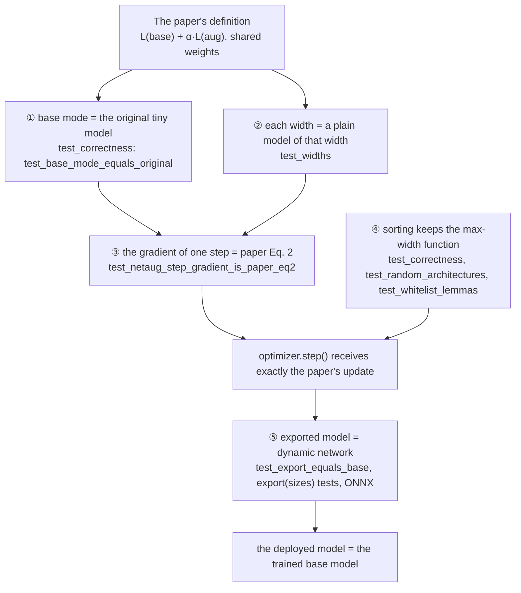
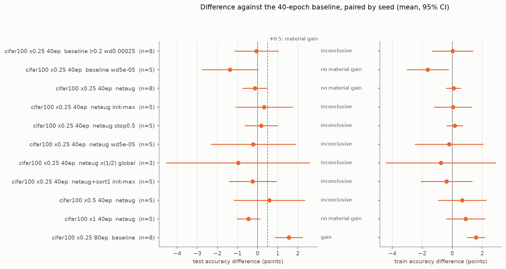
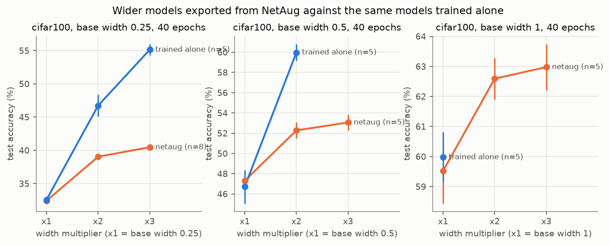
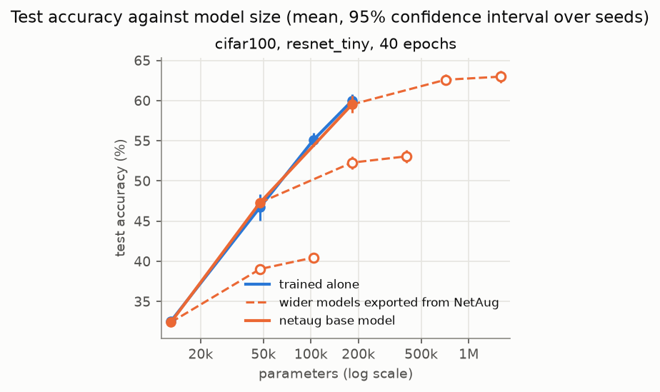
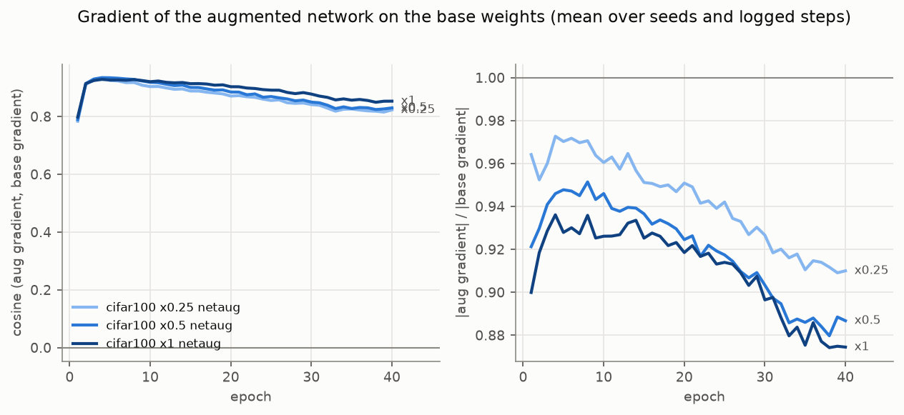

# torchnetaug Verification and Experiment Report

[繁體中文](report.md) | **English**

Date: 2026-11-19. For the terms, see [glossary.md](glossary.md).

## Summary

This report answers five questions. It also records the verification method, the experiment results, and the problems found.

1. **Does NetAug have depth augmentation?** The paper, the official code (MIT HAN Lab), and the reference implementation `netaug/` augment only width. The reference implementation has a `max_depth` parameter, but nothing uses it. This package adds depth augmentation (`NetAugModel(..., depth={...})`). It follows the elastic depth of Once-for-All, from the same research group.
2. **Can you build a network directly from Dynamic modules?** Yes. You can set the widths by hand, and the output is exactly the same as a plain network. But then you must handle the width and channel sorting of every layer yourself. The recommended way is to compose the network from ordinary `torch.nn` layers in the usual PyTorch way, and then pass it to `NetAugModel`. The channel analysis then handles width switching, channel sorting, and export automatically, for any kind of model. A model that contains dynamic layers is now rejected explicitly.
3. **Can the exported model be converted to ONNX?** Yes. The exported models at base, ×2, and random widths convert with both the dynamo and the TorchScript exporters. The onnxruntime output matches PyTorch.
4. **How well does it work?** With CIFAR-10, TinyResNet, 40 epochs, and 3 seeds, the effect on the base model is small and not significant: width augmentation +0.15 ± 0.74, with sorting +0.34 ± 0.44, depth augmentation −0.05 ± 0.29, and width + depth +0.04 ± 0.34 percentage points. Train accuracy rises in every setting, which matches the "reduce underfitting" mechanism, but this does not turn into test accuracy. The wider networks exported from the NetAug model are worse than networks of the same width trained alone. Every exported model has an output difference of 0 from the dynamic network (Sections 3 and 5).
5. **Does NetAug work, and does the implementation have a problem?** In a setting that underfits more (CIFAR-100, TinyResNet at base widths ×0.25, ×0.5 and ×1, 3 to 8 seeds), no setting gives a test gain either. The same compute spent on 40 more epochs gives a significant gain of +1.54 percentage points. Three recipe options of the official code and the paper's weight decay give no gain either, but these settings have only 5 seeds and read "inconclusive". No implementation bug was found that would make NetAug fail. A first MobileNetV2 result (1 seed) shows NetAug training worse, still 4.1 points lower with the official warmup; the cause is not identified (Section 10).

## 1. Environment

| Item | Version |
|---|---|
| Code | Branch `feat/torchnetaug` (commit `941b37a` when the experiments started; commit `83e5073` for the depth experiments; commit `5fc4285` plus uncommitted changes in `examples/` for Section 10) |
| Python | 3.14.3 |
| PyTorch | 2.11.0+cu128 (all tests also ran on the 2.15.0 CPU build) |
| ONNX | onnx 1.23.2, onnxscript 0.7.2, onnxruntime 1.32.0 |
| Hardware | Windows 10, RTX 3060 Ti 8 GB (driver 576.02) |

## 2. Correctness verification

`uv run pytest` runs 471 tests, and all pass. The tests compare outputs in float64 with tight tolerances. Before each comparison, they randomize all parameters and BN statistics, so default values cannot hide errors.

| Test file | Count | What it checks |
|---|---|---|
| `test_correctness.py` | 111 | base mode equals the original model; export (including float64 precision under a float32 default dtype, per-module training flags, and `requires_grad`); sorting keeps the max-width function; order after sorting, and sorting is idempotent; optimizer state reordering; the augmented network does not corrupt BN; gradients (including element-wise equality with paper Eq. 2); whitelist edge guards (lower-rank broadcasts, tensor `clamp`, hardcoded `view`/`squeeze`, parameterless BN, `SyncBatchNorm`) |
| `test_random_architectures.py` | 61 | The same properties on 60 randomly generated architectures (combinations of residual, concat, depthwise, SE, and others), including order after sorting and idempotence |
| `test_whitelist_lemmas.py` | 172 | The assumptions of the sorting correctness proof: whitelisted operations act on each channel independently; the permutation lemma for dynamic layers |
| `test_widths.py` | 55 | At each width, the parameter count, weight shapes, and output equal a plain model built directly at that width |
| `test_depth.py` | 48 | Depth augmentation (Section 5), including residual identity init across widened channels, zero example-input guard, and width + depth Eq. 2 gradient checks |
| `test_onnx.py` | 12 | ONNX conversion (Section 7) |
| `test_dynamic_usage.py` | 8 | Manual use of dynamic layers, and rejection of models that contain dynamic layers (Section 6) |
| `test_docs.py` | 4 | Every Python example in the documents runs (Chinese and English versions) |

### 2.1 The chain of evidence: what "the implementation is correct" means

"The implementation is correct" means: what the package computes equals what the paper defines. This splits into five links. Each link is compared with **a model built directly with plain PyTorch, without this package**:

- ① and ② prove that the forward pass is correct: at every width, the output equals a plain model built directly at that width.
- ③ proves directly that the gradient is correct. The test uses two independent plain models: `export()` (base) and `export(sizes)` (the augmented network sampled in the same step). Each one computes its own gradients. The test puts them back at their positions in the shared weights and adds them. The sum must equal the result of `netaug_step` element by element. When `netaug_step` is changed on purpose to ignore `alpha`, or to sample a different augmented network (mutation tests), this test fails.
- ④ proves that channel sorting changes only which channels the smaller widths keep. It does not change the max-width network function.
- ⑤ proves that the plain model used for deployment gives the same output as the dynamic network used in training.

This chain proves that the code computes what the paper defines. It does **not** prove that NetAug always improves accuracy: that is an empirical question, and experiments answer it (Sections 3 and 5).

## 3. CIFAR-10 width augmentation experiment

### 3.1 Setup

- Model: TinyResNet (the CIFAR version of ResNet-18 at 1/8 width: 8, 16, 32, 64 channels, 176,402 parameters).
- Training: 40 epochs, batch 128, Nesterov SGD (momentum 0.9), lr 0.1 cosine, weight decay 5e-4 (not applied to BN and bias), random crop and horizontal flip, bf16 autocast.
- NetAug: `width_mults=(1.0, 2.0, 3.0)`, `alpha=1.0`, each group samples its own width. `+sort10` means channel sorting every 10 epochs.
- Evaluation: before evaluation, every model re-estimates its BN statistics with 20 training batches (10,000 images in total, no data augmentation). Test accuracy uses the 10,000 test images. Train accuracy uses the first 10,000 training images.
- Each setting uses 3 seeds (0, 1, 2). Runs with the same seed have the same base weight initialization and the same data order, so the results can be compared as pairs, seed by seed.
- Control group: the same architecture trained alone at ×1.5, ×2.0, ×2.5, and ×3.0 width. These models are compared with models of the same width exported from the NetAug model.

### 3.2 Results

**Base width (the deployed model, 176,402 parameters)**

| Method | Test acc (%) | Train acc (%) | Per-seed paired difference from baseline (percentage points) | Mean ± std |
|---|---|---|---|---|
| baseline | 86.92 ± 0.35 | 91.90 ± 0.23 | — | — |
| netaug | 87.07 ± 0.39 | 92.70 ± 0.20 | s0 +0.83, s1 +0.27, s2 −0.64 | +0.15 ± 0.74 |
| netaug+sort10 | 87.26 ± 0.09 | 92.81 ± 0.23 | s0 +0.76, s1 +0.37, s2 −0.11 | +0.34 ± 0.44 |

**Each width: exported from the NetAug model vs. trained alone (test acc %, 3 seeds each)**

| Width | Parameters | Trained alone | netaug export | netaug+sort10 export | Max difference between export and dynamic network |
|---|---|---|---|---|---|
| ×1.0 | 176,402 | 86.92 ± 0.35 | 87.07 ± 0.39 | 87.26 ± 0.09 | 0 |
| ×1.5 | 395,350 | 89.27 ± 0.11 | 87.48 ± 0.25 | 88.00 ± 0.13 | 0 |
| ×2.0 | 701,466 | 90.46 ± 0.27 | 88.22 ± 0.16 | 88.48 ± 0.21 | 0 |
| ×2.5 | 1,094,750 | 91.27 ± 0.33 | 88.32 ± 0.31 | 88.49 ± 0.23 | 0 |
| ×3.0 | 1,575,202 | 91.62 ± 0.30 | 88.44 ± 0.18 | 88.50 ± 0.27 | 0 |

Random width sampled separately for each group (the distribution that training actually samples from; 3 samples per run, 9 in total): netaug 87.92 ± 0.30 (87.45–88.27), netaug+sort10 87.96 ± 0.24 (87.57–88.30), parameter count 316,466–1,382,354.

### 3.3 Interpretation

- **The gain on the base model is small and not significant.** The mean gains are +0.15 and +0.34 percentage points. These are smaller than the standard deviations of the paired differences (0.74 and 0.44). In each method, one of the 3 seeds is negative. For TinyResNet on CIFAR-10 with 40 epochs, we cannot claim that NetAug improves the base model.
- **Train accuracy rises by 0.7–1.3 percentage points for every seed** (netaug: s0 +0.70, s1 +0.99, s2 +0.71; netaug+sort10: +0.79, +1.27, +0.68). This matches the NetAug mechanism of "reducing underfitting". But test accuracy does not rise by a matching amount.
- **The wider exported models are clearly worse than models trained alone.** From ×1.5 up, the gap is 1.3–3.2 percentage points, and the gap grows with the width. NetAug trains for the base model. A wider network trains its added channels only when it is sampled. So these exported models cannot replace wide models trained alone.
- **`+sort10` helps the wider models a little** (×1.5 +0.52, ×2.0 +0.26), and has no effect on base: Section 4 shows that sorting never moved a channel into base.
- **Export is exactly correct.** At every width, the difference between the output of the exported model and the dynamic network is 0.
- The gain that the paper reports (ImageNet, MobileNetV2-Tiny, top-1 from 51.7% to 53.3% at 150 epochs, +1.6 percentage points) does not reproduce on a smaller dataset with shorter training. The settings also differ. The official default stops width augmentation for the last 75 epochs (the augmented width is fixed at the minimum; only the expand ratio is still sampled), and sorts once per epoch. This experiment augments for the whole run (`stop_aug 0`) and sorts every 10 epochs. This does not mean the implementation is wrong (the tests in Section 2 guarantee correctness). It means that the size of the effect depends on the settings.

## 4. Channel sorting

Sorting is designed to guarantee this: the function of the max-width network does not change. Only the set of channels that the smaller widths keep changes.

`assert_sorted` in `tests/conftest.py` checks the order after sorting. In each group, the recomputed importance must be non-increasing up to rounding error. When sorting runs again right away, it may only swap channels whose importance is equal up to rounding error. The recomputed values are not bit-identical, because the permutations of other groups change the order in which the readers' weights are summed (the maximum measured in float32 is about 1.6e-6 relative error). So the check uses a relative tolerance (1e-9 for the float64 tests; 1e-5 is recommended for float32). The check runs on 8 fixed models, 60 random architectures, and 4 depth-augmented models. It was also verified separately in float32 on CPU and CUDA. When sorting is changed to ascending order or to a random permutation (mutation tests), the check fails.

The experiments record two things at each sort.

- **Change in the max-width output**: over 9 sorts (3 seeds × epochs 10, 20, 30), the maximum is 8.6e-6, while the absolute values of the logits are about 20 to 31. This is error from the float32 summation order. It shows that sorting also keeps the function unchanged on weights from real training.
- **Number of channels moved into base**: 0 in all 9 sorts. So sorting never changed the channels that the base model uses.

The reason is structural. When the model is widened, the weights of the new channels get the default initialization. The PyTorch default initialization scales with the number of input channels. At max width, a layer has 3 times the original input channels, so the new weights have a smaller standard deviation (for example, in `layers.0.conv1` it is about 0.070 for the base block and about 0.039 for the new block). Before training, in every group, the smallest importance of a base channel is already 1.06 to 1.19 times the largest importance of a new channel (float32, as in the experiment, 3 seeds). During training, the base channels get gradients at every step, but the new channels get gradients only when they are sampled. So the gap stays.

So in this setting, sorting changes only which channels the middle widths (for example ×2) keep: before training, 168 to 188 of the 720 channels that the ×2 width keeps are replaced (float32, 3 seeds). It has no effect on the base model. The difference in base accuracy between `+sort10` and `netaug` is seed noise, not an effect of sorting.

## 5. Depth augmentation

### 5.1 Design

For the detailed design, see [Section 7 of architecture.en.md](architecture.en.md). Key points:

- `depth={"layers.1": 1, ...}`: adds `k` extra blocks after the specified block. The augmented network samples how many of them to run from `0..k`. The base network runs none of them, so base and `export()` are still the original model.
- An extra block is a copy of the block with re-initialized weights. In a copy of a residual block, the last BN is set to zero, so the copy starts as an identity function.
- The output of an extra block belongs to the same channel group as the output of the original block. Non-residual blocks need this. Without it, during sorting, the layer after the block would read channels in a different permutation in base mode and in deeper modes. The network function would then change without any error message. When a test turns this mechanism off, the sorting test for non-residual networks fails.
- Depth augmentation can be used together with width augmentation. Each step samples both width and depth.

### 5.2 Verification

`tests/test_depth.py` checks the following on TinyResNet, torchvision ResNet-18, MobileNetV2, and a non-residual convolution stack:

- The output of base mode (in training and evaluation mode) and of `export()` equals the original model, and the state_dict keys of `export()` are also the same;
- A residual copy starts as an identity function; a non-residual copy is not set to zero;
- At max width, the output for every depth combination (including all zeros) is the same before and after sorting;
- `export(sizes, depths)` is a plain PyTorch model (with no module from this package). Its output equals the dynamic network, and its parameter count equals `num_active_params()`;
- `mode_ctx`, `export`, and `recalibrate_bn` restore the width and depth when they finish; `recalibrate_bn(depths=...)` updates the BN of the extra blocks;
- `netaug_step` trains the extra blocks, and the augmented network does not change the BN statistics;
- Errors give clear messages: a changed shape, a block that runs twice, no parameters, a path that does not exist, and nesting.

### 5.3 CIFAR-10 results

One extra block is added after the last block of each stage of TinyResNet (`--depth 1`). The training setup is the same as in Section 3.

| Method | Test acc (%) | Train acc (%) | Per-seed paired difference from baseline (percentage points) | Mean ± std |
|---|---|---|---|---|
| baseline | 86.92 ± 0.35 | 91.90 ± 0.23 | — | — |
| Depth augmentation (+1 block per stage) | 86.87 ± 0.20 | 92.28 ± 0.16 | s0 +0.05, s1 +0.17, s2 −0.38 | −0.05 ± 0.29 |
| Width + depth augmentation | 86.96 ± 0.05 | 92.77 ± 0.21 | s0 +0.32, s1 +0.14, s2 −0.33 | +0.04 ± 0.34 |
| (Reference) width augmentation only | 87.07 ± 0.39 | 92.70 ± 0.20 | s0 +0.83, s1 +0.27, s2 −0.64 | +0.15 ± 0.74 |

| Exported network | Parameters | Test acc (%) |
|---|---|---|
| Depth augmentation: base width, every extra block on | 274,802 | 86.92 ± 0.17 |
| Width + depth augmentation: base width, every extra block on | 274,802 | 87.01 ± 0.17 |
| Depth augmentation: depth combinations sampled in training (9) | 176,402–274,802 | 86.89 ± 0.19 |
| Width + depth augmentation: width and depth combinations sampled in training (9) | 537,442–1,880,594 | 87.85 ± 0.24 |

Every exported network has an output difference of 0 from the dynamic network.

- **Depth augmentation has no measurable effect on the base model.** The mean paired differences of the two settings are −0.05 and +0.04 percentage points, far smaller than the variation between seeds. Adding depth also does not make width augmentation better (+0.04 vs. +0.15; this difference is also within the noise).
- **Train accuracy still rises**: by 0.18–0.64 percentage points per seed with depth only, and by 0.58–1.24 with width + depth. As with width augmentation, the gain on the training set does not turn into test accuracy.
- **The extra blocks learn almost nothing.** With every extra block on, the network has 56% more parameters (274,802 vs. 176,402), but the same accuracy as base (86.92 vs. 86.87). The extra blocks are residual copies whose last BN starts at 0, and they get gradients only when they are sampled. So after 40 epochs they are still close to the identity function.
- Each run takes about 4.6–5.4 minutes. During some runs, the GPU was also running other programs, so the times of different methods cannot be compared directly.

## 6. Composing your own network and Dynamic modules

### 6.1 Recommended way: plain layers + automatic analysis

You use ordinary `torch.nn` layers, write `__init__` and `forward` in the usual PyTorch way, and then pass the model to `NetAugModel`. `torch.fx` traces the model. Then the analyzer finds the channel groups: which layers read the same channels, which group each part of a concat output comes from, and which two residual sides must match. Width switching, sorting, and export all follow this result. So you do not need to write any code that says "how to sort this kind of block". `tests/test_docs.py` runs the "Composing your own network" example in the README (concat, depthwise, residual). The tests on 60 random architectures also verify this.

### 6.2 Using dynamic layers directly

You can use dynamic layers such as `DynamicConv2d` on their own. After you set `active_out` and `set_in_segments()` by hand, the output is exactly the same as a plain network loaded with the same sliced weights (`test_hand_built_dynamic_network_equals_plain_network`, difference 0). But then you must keep the widths of all layers consistent yourself. Channel sorting must know every connected tensor, so manual upkeep easily goes wrong.

Before this change, passing a model with dynamic layers to `NetAugModel` had two problems:

- Through tracing, `torch.fx` fails or treats the dynamic layers as unknown operations.
- Through a manual `graph=`, the model is accepted, but the dynamic layers are not widened, and the result of `export()` still contains dynamic layers. Deployment then requires this package. This contradicts the design rule that "the exported model does not depend on this package".

Now, when `analyze()` and `NetAugModel` find a dynamic layer, they raise a `TypeError` that names the module path and class. The message says to pass a model built from plain layers.

### 6.3 Alternative not adopted

Another approach is to provide the package's own composition modules (for example `Sequential`, `Residual`, `Concat`). The composition structure would then declare the channel relations directly, without `torch.fx`. The advantage is support for models that cannot be traced. The disadvantages are that users must switch to a different API, and most of its function duplicates the current automatic analysis. Today, a model that cannot be traced can use a custom tracer or a manual `ChannelGraph`, so this approach is not adopted for now. If support for many untraceable models becomes necessary, it can be evaluated again.

## 7. ONNX

`tests/test_onnx.py` takes the exported models of TinyResNet and MobileNetV2 (×0.35) at base, ×2, and random widths. It converts them to ONNX with the dynamo exporter and with the TorchScript exporter. Then it runs them with onnxruntime (CPU) and compares the output with PyTorch (tolerance rtol 1e-4, atol 1e-5; the actual difference is below 2e-8). All 12 combinations pass.

- The exported models contain no module from this package, so the ONNX graph contains only standard operations.
- `NetAugModel` itself in base mode also converts to ONNX, but the graph carries the max-width weights. Call `export()` before deployment.
- The ONNX packages are development dependencies, not package dependencies. When they are not installed, these tests are skipped.

## 8. Problems found and how they were handled

| Problem | Impact | Fix |
|---|---|---|
| `export(sizes)` did not use the model's dtype when it built new layers | A bfloat16 model (or any model whose dtype differs from the default dtype) could not run after export | New layers are converted to the dtype and device of the original layer; `test_export_sizes_keeps_model_dtype` |
| Models that contain dynamic layers were accepted silently | They were not widened, and the export result depended on this package | An explicit `TypeError`; `test_dynamic_usage.py` |
| Sorting never moves channels into base | `+sort` has no effect on the base model | Not a code error. It is a structural result of the initialization scale. Explained in this report and in the documents (Section 4) |
| `export(sizes, depths)` failed when a depth point was a single layer (not a block) | Only base `export()` worked | The name mapping now also covers `P.block` and `P.extra.i` themselves; `test_bare_layer_as_depth_point_exports` |
| `depth=` and `recalibrate_bn` restored only the train/eval flag of the root module | Frozen (eval) submodules were switched to training mode | Save and restore the flag of each module; `test_depth_keeps_per_module_train_flags` |
| `recalibrate_bn` did not restore the state when an error occurred during switching; base calibration cleared the BN statistics of extra blocks that did not run | The width and depth state was lost; with `update_bn_in_aug=True`, the statistics of the extra blocks were cleared | Switching moved into `try`; extra blocks that do not run are not reset; `test_recalibrate_bn_restores_state_and_flags_on_error` |
| `NetAugModel._apply` overrode `nn.Module._apply` | `.to()`, `.cuda()`, `.float()`, and similar calls all failed | Renamed to `_apply_state`; `test_module_conversions_work` |
| After `.double()` or `.half()`, the base `export()` fell back to float32 | The exported weights were silently rounded to float32 | `load_state_dict(..., assign=True)`, and buffers outside the state_dict also follow the model; `test_module_conversions_work`, `test_export_keeps_dtype_of_non_persistent_buffers` |
| Frozen BN inside a depth point block was switched back to training mode | The running statistics of the frozen BN were updated | `DepthStack` sets only its own flag; `make_extra` restores the flag of each module |
| The depth augmentation prototype used hand-written switches | The experiment results could not represent the package behavior | Changed to the package API (`depth=`); the experiment script is now `examples/cifar_netaug.py --depth` |
| `binary()` did not fix lower-rank tracked broadcast tensors; `passthrough()` allowed tensor bounds in `clamp`/`clip`; `reshape_like()` missed hardcoded channel sizes in `view`/`reshape` and dim-1 `squeeze`/`flatten` | Touched groups stayed free and crashed or corrupted shapes once widened | Tightened the whitelist guards so those groups stay fixed; `test_binary_lower_rank_broadcast_is_fixed`, `test_clamp_with_tensor_bounds_is_fixed`, `test_reshape_hardcoded_and_size1_squeeze_are_fixed` |
| With width + depth combined, widening reset the newly added channels of a residual extra block's zeroed last BN back to 1 | Residual extra blocks were identity only at base width, not at wider widths | Track zero-initialized BN paths and zero all widened channels after `_widen()`; `test_residual_extra_blocks_start_as_identity` |
| Tracing a bias-free non-residual block with all-zero `example_inputs` caused `make_extra` to mistake it for an identity block and zero its BN | The base channels of the non-residual extra block were cut off (zero output on real inputs) | Use a positive non-zero probe when the example output is near zero; `test_zero_example_input_does_not_zero_plain_extra_block` |
| `BatchNorm(affine=False, track_running_stats=False)` raised `StopIteration` on `next(old.buffers())` | Parameterless, stateless BN layers could not be wrapped | Handle layers with no parameters or buffers in `_widen` and `_plain_layer`; `test_batchnorm_no_affine_no_stats` |
| Under a float32 default dtype, `export(sizes)` created new layers in float32 before `.copy_()`, truncating float64 weights | Exported float64 models lost precision | Construct plain layers directly with the source layer's `device` and `dtype` before copying; `test_export_sizes_keeps_float64_precision_under_float32_default` |
| Export overwrote per-module `.training` flags with `out.train(self.training)`, `_plain_layer` dropped `requires_grad=False`, and `SyncBatchNorm` was replaced by local `DynamicBatchNorm` | Frozen BNs switched back to train mode, frozen weights unfroze, and DDP silently lost cross-rank sync | Preserve per-module `.training` and `requires_grad` on export; keep `SyncBatchNorm` fixed; `test_export_preserves_per_module_training_and_requires_grad`, `test_sync_batchnorm_is_fixed`, `test_depth_export_preserves_per_module_training_and_requires_grad` |

## 9. Limitations

- In Sections 3 to 5 each setting has only 3 seeds and 40 epochs, on CIFAR-10 and one model only. Section 10 uses CIFAR-100 with 3 to 8 seeds per setting, and only 1 seed for MobileNetV2. Differences smaller than about 0.5 percentage points cannot be told apart from seed noise.
- The minutes per run are only a rough reference: during some runs, the same GPU was also running tests or other programs.
- Depth augmentation works only on blocks that keep the shape and run once per forward pass, and it requires `torch.fx` tracing.
- Multi-GPU (DDP) is not tested yet.
- A custom buffer registered on a layer that is widened (Conv, Linear, BN) is not supported: it is lost when the layer is replaced by a dynamic layer.

## 10. Does NetAug work? A CIFAR-100 diagnosis

Date: 2026-11-23. The effect in Section 3 is small. This section checks why: the setting does not suit NetAug, the implementation has a problem, or NetAug does not help in this kind of setting.

### 10.1 Design

- **An underfitting setting.** NetAug aims to reduce the underfitting of small models. On CIFAR-10 the train accuracy of TinyResNet is already close to its test accuracy, so the diagnosis uses CIFAR-100 and narrower TinyResNets. At base width ×0.25 (2, 4, 8 and 16 channels) the train accuracy is only 33.8%, which is clear underfitting.
- **Paired comparison.** Each setting is compared with the baseline of the same seed. The report gives the mean difference and its 95% confidence interval (t distribution).
- **Decision rule, fixed before the runs.** Lower bound of the interval above 0: "gain". Upper bound below +0.5 points: "no material gain". Otherwise: "inconclusive".
- **Controls.**
  - Learning rate 0.2 with weight decay 2.5e-4. The NetAug loss is the sum of two losses, which makes the gradient larger. This control checks for "only a larger step".
  - The baseline trained for 80 epochs, about the compute of NetAug.
  - Models of width ×2 and ×3 trained alone, to compare with the wide models exported from NetAug.
- **To reproduce:** `examples/run_diagnosis.sh` (stages `main`, `dose`, `controls`, `alone`, `ablations`, `sanity`, `recipe`), `examples/summarize.py --ref-epochs 40` for the tables and `examples/plot_results.py` for the figures.

### 10.2 Results for the base model

CIFAR-100, TinyResNet, 40 epochs. Differences are in percentage points of test (or train) accuracy, with the 95% confidence interval in brackets.

| Setting | n | Test accuracy | Test difference | Train difference | Reading |
|---|---|---|---|---|---|
| ×0.25 baseline | 8 | 32.54 | — | — | — |
| ×0.25 NetAug | 8 | 32.41 | −0.14 [−0.76, +0.49] | +0.08 [−0.43, +0.58] | no material gain |
| ×0.25 NetAug, largest network initialized as a whole (`--init max`) | 5 | 32.72 | +0.32 [−1.11, +1.74] | +0.04 [−1.24, +1.32] | inconclusive |
| ×0.25 NetAug, augmentation stopped for the last half (`--stop-aug 0.5`) | 5 | 32.59 | +0.18 [−0.65, +1.00] | +0.16 [−0.38, +0.69] | inconclusive |
| ×0.25 NetAug, sorting every epoch + `--init max` | 5 | 32.16 | −0.25 [−1.44, +0.94] | −0.38 [−2.11, +1.35] | inconclusive |
| ×0.25 NetAug, weight decay 5e-5 (against the baseline with the same weight decay) | 5 | 30.81 | −0.22 [−2.34, +1.89] | −0.22 [−2.50, +2.07] | inconclusive |
| ×0.5 NetAug | 5 | 47.31 | +0.59 [−1.19, +2.36] | +0.66 [−0.95, +2.27] | inconclusive |
| ×1 NetAug | 5 | 59.52 | −0.46 [−1.05, +0.14] | +0.89 [−0.40, +2.18] | no material gain |
| Control: ×0.25 baseline, learning rate 0.2, weight decay 2.5e-4 | 8 | 32.48 | −0.06 [−1.17, +1.04] | +0.02 [−1.34, +1.38] | inconclusive |
| Control: ×0.25 baseline, weight decay 5e-5 | 5 | 31.03 | −1.38 [−2.78, +0.03] | −1.64 [−3.04, −0.24] | no material gain |
| Control: ×0.25 baseline, 80 epochs | 8 | 34.09 | **+1.54 [+0.85, +2.24]** | +1.58 [+0.97, +2.19] | gain |

- **No NetAug setting gives a test gain.** Two NetAug settings, ×0.25 and ×1, read "no material gain"; the other NetAug settings read "inconclusive". The ×0.25 upper bound of +0.49 is only 0.01 below the +0.5 cutoff, so that reading holds only just.
- **The same compute spent on 40 more epochs gives +1.54 points, a significant gain.** In this harness a NetAug step takes about 2.6 times as long as a baseline step (the paper reports +16.7%), so this comparison holds only for this harness.
- **The train difference grows with the base width:** ×0.25 +0.08, ×0.5 +0.66, ×1 +0.89. All three intervals include 0, so this is only a trend. At ×1 the train accuracy goes up and the test accuracy goes down. The paper's ResNet50 shows the same pattern (train accuracy up, validation accuracy down).
- **The paper says smaller models gain more. This diagnosis does not show that.** ×0.25 underfits the most but gains the least.

### 10.3 Exported wide models

| Base width | Exported ×2 | Exported ×3 | Trained alone at the same width |
|---|---|---|---|
| ×0.25 | 39.04 | 40.47 | 46.72 (×2), 55.13 (×3) |
| ×0.25, augmentation stopped at 0.5 | 34.61 | 35.02 | as above |
| ×0.5 | 52.28 | 53.06 | 59.98 (×2) |

- The exported wide models are 7 to 15 points below the models of the same width trained alone. When each channel group samples its own width, the full ×3 network is almost never sampled. The networks actually sampled in training (19k to 92k parameters) reach 36.97 ± 2.41% when exported, against 46.7% for a 47.6k-parameter model trained alone.
- **Wide-path check (stage `sanity`).** One multiplier, ×1 or ×2, is sampled for the whole network, so half of the augmented steps train the full ×2 network. The exported ×2 model reaches 41.22 ± 1.56% (n=3). The ×2 network is trained in only about half of the steps, so a control was added afterwards: the ×2 model trained alone for 20 epochs reaches 43.2% (n=3, `ALONE_WIDTHS=0.5 EPOCHS=20 ABLATION_SEEDS="0 1 2" STAGES=alone bash examples/run_diagnosis.sh`). The gap is about 2 points; against the ×2 model trained alone for 40 epochs (46.72%) it is 5.5 points. The ×2 network shares its weights with the base, and this control was not planned in advance, so the reading of this check is "inconclusive": it shows no clear defect, but it does not prove that the wide path is free of problems.
- The output of every exported model equals the output of the dynamic network.

### 10.4 Gradients

Every 20 steps, the run logs the cosine and the norm ratio of the augmented gradient against the base gradient on the base weights. At all three widths the cosine is between 0.82 and 0.93 and the norm ratio is between 0.87 and 0.97. At a cosine of 0.82 to 0.92, the component orthogonal to the base gradient is still about 40% to 57% of the base gradient norm, so "no new information" is too strong. The result is consistent with "here NetAug acts mainly like a larger step", but it does not show that this is the cause: the control for this idea (learning rate 0.2, weight decay 2.5e-4) reads "inconclusive". The three widths give similar values, so the gradients do not explain the differences between widths.

### 10.5 Sorting

With sorting every epoch, the 39 sorts move only 0 to 4 channels into the base in total (per seed). The base channels receive both the base and the augmented gradients at every step, so they are already the most important channels. This agrees with Section 4.

### 10.6 MobileNetV2 (preliminary, 1 seed)

The paper's gains come from MobileNet-style models, so torchvision's MobileNetV2 (width 0.35, 524k parameters) was also tried.

- 40 epochs: baseline 41.61%, NetAug 36.50%. The NetAug base loss is above the baseline from the first epoch on, and the gap persists. The exported ×2 and ×3 models reach only 38.3% and 38.6%.
- In the first epoch the cosine of the augmented against the base gradient is 0.25 and the norm ratio is 3.1. Later the cosine reaches only 0.4 to 0.64 (TinyResNet: 0.8 to 0.93).
- 10-epoch probes: baseline 20.7%, NetAug 13.0%, NetAug at learning rate 0.05 18.2%, NetAug with α=0 19.6%, baseline at learning rate 0.2 with weight decay 2.5e-4 20.8%. So the wrapper's forward pass is not the cause, and a doubled step alone does not make the baseline worse; the problem is in the gradient of the augmented loss.
- Initializing the added channels with torchvision's rule (fan-out) made it worse (10.0% after 10 epochs). The official code also says that fan-out works badly at large expand ratios, so this change was reverted.
- This model does not support a conclusion yet. torchvision's MobileNetV2 has a total stride of 32, so a 32×32 input ends at 1×1, and the baseline reaches only 41.6% (TinyResNet ×1 reaches 60% with 182k parameters). Width does still help here: MobileNetV2 at width 0.5 trained alone reaches 45.02% (816k parameters), 3.4 points above width 0.35.
- The raw data is in `runs/diag/mbv2_default_init/`. Command: `uv run python examples/cifar_netaug.py --model {mbv2_035,mbv2_050} --method {baseline,netaug} --dataset cifar100 --epochs 40 --seed 0 --eval-widths 1.0 2.0 3.0 --out <file>`. The short probes use `--epochs 10`, plus `--grad-log-every 20`, `--alpha 0` or `--lr 0.05 --wd 1e-3`.
- **With the official 5-epoch warmup (`--warmup 5`):** baseline 44.86%, NetAug 40.80%, exported ×2 and ×3 42.27% and 42.46%. Warmup improves both runs (baseline +3.3, NetAug +4.3 points), but NetAug is still 4.1 points lower. In the first epoch the norm ratio drops from 3.1 to 1.2, and the cosine is still only 0.12. So the missing warmup is not the main reason that NetAug is worse.
- Conclusion: **in this harness NetAug trains MobileNetV2 worse, and the cause is not identified.** This is not a verdict on the MobileNet architecture.

### 10.7 Conclusions

- **Implementation:** no bug was found that would make NetAug fail. The correctness tests show that one NetAug step equals Eq. 2 of the paper (Section 2.1). Exported models equal the dynamic network exactly. The wide-path check shows no clear defect, but its reading is "inconclusive".
- **Effect:** on CIFAR-100 with TinyResNet and 40 epochs, NetAug does not raise the test accuracy of the base model. Three recipe options of the official code (initializing the largest network, stopping augmentation, sorting every epoch) and the paper's weight decay do not change this. These runs have only 5 seeds, and their reading is "inconclusive".
- **Possible reasons (not shown):** the paper's gains come from MobileNet-style models on ImageNet, where the augmentation widens the expand channels of inverted blocks, trained for 150 epochs with a 5-epoch warmup. This diagnosis differs in architecture, dataset and training length. With the official warmup, NetAug still trains MobileNetV2 worse here (Section 10.6). A test on MobileNet-style models first needs strides suited to 32×32 inputs.
