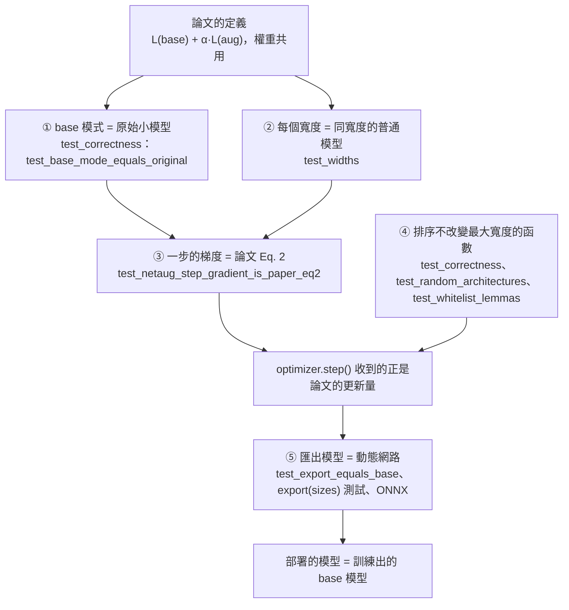
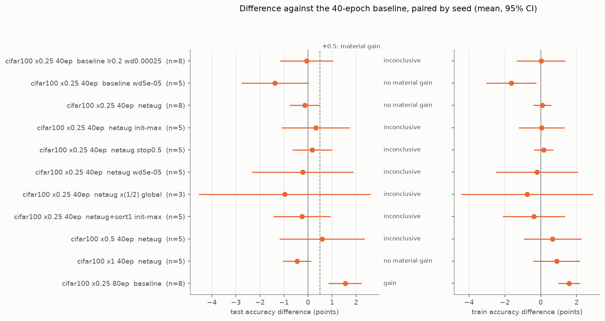
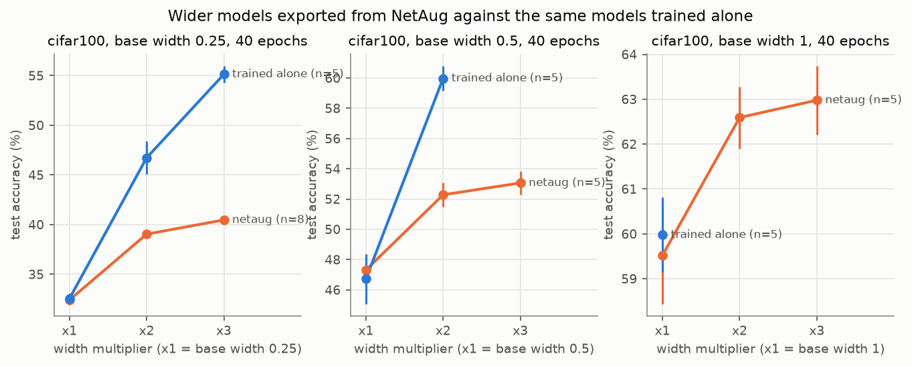
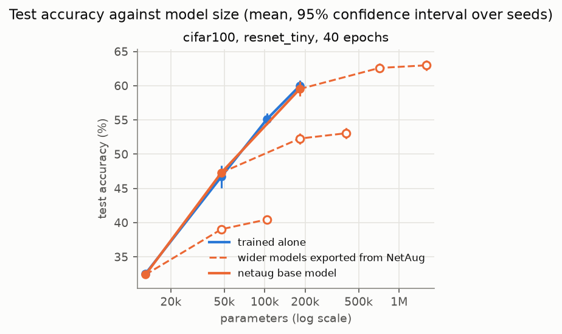
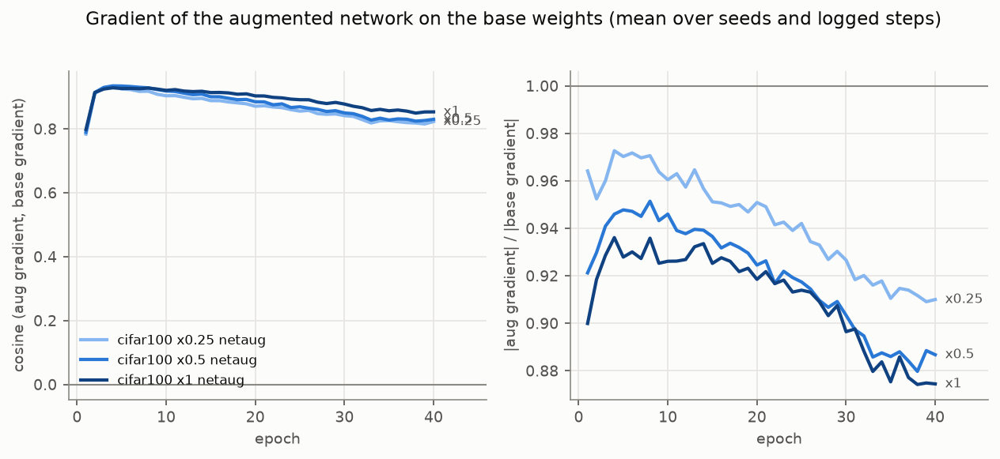

# torchnetaug 驗證與實驗報告

**繁體中文** | [English](report.en.md)

日期：2026-11-19。術語對照見 [glossary.md](glossary.md)。

## 摘要

本報告回答五個問題，並記錄驗證方法、實驗結果與找到的問題。

1. **NetAug 有沒有深度增強？** 論文、官方程式（MIT HAN Lab）與參考實作 `netaug/` 都只增強寬度。參考實作有 `max_depth` 參數，但沒有被使用。本套件新增了深度增強（`NetAugModel(..., depth={...})`），做法參考同一研究團隊的 Once-for-All 的 elastic depth。
2. **可以直接用 Dynamic 模組建構網路嗎？** 可以手動設定寬度，輸出與普通網路完全相同。但這樣要自己處理每一層的寬度與通道排序。建議的方式是用一般的 `torch.nn` 層、照 PyTorch 原本的方式自行組合網路，再交給 `NetAugModel`：寬度切換、通道排序與匯出都由通道分析自動處理，與模型種類無關。含有動態層的模型現在會被明確拒絕。
3. **匯出後可以轉成 ONNX 嗎？** 可以。base、×2 與隨機寬度的匯出模型，用 dynamo 與 TorchScript 兩種匯出器都能轉換，onnxruntime 的輸出與 PyTorch 一致。
4. **效果如何？** 在 CIFAR-10、TinyResNet、40 epochs、3 個 seed 的設定下，對 base 模型的效果很小，而且不顯著：寬度增強 +0.15 ± 0.74、加排序 +0.34 ± 0.44、深度增強 −0.05 ± 0.29、寬度 + 深度 +0.04 ± 0.34 個百分點。每種設定的訓練準確率都上升，符合「緩解欠擬合」的機制，但沒有轉成測試準確率。從 NetAug 模型匯出的較寬網路不如同寬度單獨訓練的網路。所有匯出模型與動態網路的輸出差異都是 0（第 3、5 節）。
5. **NetAug 是否有效？實作有沒有問題？** 在較欠擬合的 CIFAR-100 設定（TinyResNet，base 寬度 ×0.25、×0.5、×1，3 到 8 個 seed）也沒有任何設定得到測試增益；同樣的計算量用來多訓練 40 epoch 則有 +1.54 個百分點的顯著增益。官方程式的三個配方選項與論文的 weight decay 也沒有帶來增益，但這些設定只有 5 個 seed，結果是「無法判定」。沒有找到會讓 NetAug 失效的實作錯誤。MobileNetV2 的初步結果（1 個 seed）是 NetAug 訓練得更差，加上官方的 warmup 後仍低 4.1 個百分點，原因尚未確定（第 10 節）。

## 1. 環境

| 項目 | 版本 |
|---|---|
| 程式碼 | 分支 `feat/torchnetaug`（實驗開始時為 commit `941b37a`；深度實驗為 commit `83e5073`；第 10 節為 commit `5fc4285` 加上 `examples/` 中尚未 commit 的修改） |
| Python | 3.14.3 |
| PyTorch | 2.11.0+cu128（另以 2.15.0 CPU 版跑過全部測試） |
| ONNX | onnx 1.23.2、onnxscript 0.7.2、onnxruntime 1.32.0 |
| 硬體 | Windows 10、RTX 3060 Ti 8 GB（驅動 576.02） |

## 2. 正確性驗證

`uv run pytest` 共 471 個測試，全部通過。測試在 float64 下以很緊的容差比對，而且先把所有參數與 BN 統計值隨機化，避免預設值掩蓋錯誤。

| 測試檔 | 數量 | 驗證的事 |
|---|---|---|
| `test_correctness.py` | 111 | base 模式等於原始模型、匯出（含 float32 預設下的 float64 精度、逐模組旗標與 `requires_grad`）、排序保持最大寬度函數、排序後有序且冪等、optimizer 狀態重排、BN 不被增強網路污染、梯度（含逐元素等於論文 Eq. 2）、白名單邊界防護（低秩廣播、張量 `clamp`、硬編碼 `view`/`squeeze`、無參數 BN、`SyncBatchNorm`） |
| `test_random_architectures.py` | 61 | 60 個隨機產生的架構（殘差、concat、depthwise、SE 等組合）上的同樣性質，含排序後有序且冪等 |
| `test_whitelist_lemmas.py` | 172 | 排序正確性證明的前提：白名單運算逐通道獨立、動態層的排列引理 |
| `test_widths.py` | 55 | 每個寬度的參數量、權重形狀與輸出，等於直接用該寬度建立的普通模型 |
| `test_depth.py` | 48 | 深度增強（第 5 節），含加寬後殘差恆等初始化、全零範例輸入防護與寬度+深度 Eq. 2 梯度測試 |
| `test_onnx.py` | 12 | ONNX 轉換（第 7 節） |
| `test_dynamic_usage.py` | 8 | 手動使用動態層，以及對含動態層模型的拒絕（第 6 節） |
| `test_docs.py` | 4 | 文件中的 Python 範例都能執行（中文與英文版） |

### 2.1 證明鏈：「實作正確」是什麼意思

「實作正確」指的是：套件算出的東西，等於論文定義的東西。這拆成五個環節，每一環都和**不經過本套件、直接用普通 PyTorch 建的模型**比對：

- ① 和 ② 證明 forward 正確：任何寬度下，輸出都等於直接用那個寬度建立的普通模型。
- ③ 直接證明梯度正確。測試用兩個獨立的普通模型：`export()`（base）與 `export(sizes)`（同一步抽到的增強網路）。兩者各自算梯度，放回共用權重的對應位置後相加，必須逐元素等於 `netaug_step` 的結果。故意讓 `netaug_step` 忽略 `alpha`，或抽到不同的增強網路時（突變測試），這個測試都會失敗。
- ④ 證明通道排序只改變「較小寬度保留哪些通道」，不改變最大寬度的網路函數。
- ⑤ 證明部署時用的普通模型，和訓練時的動態網路輸出相同。

這條鏈證明的是「程式照論文的定義計算」。它**不能**證明 NetAug 一定會提高準確率：那是經驗問題，要用實驗回答（第 3、5 節）。

## 3. CIFAR-10 寬度增強實驗

### 3.1 設定

- 模型：TinyResNet（CIFAR 版 ResNet-18，寬度為 1/8：8、16、32、64 通道，176,402 個參數）。
- 訓練：40 epochs、batch 128、Nesterov SGD（momentum 0.9）、lr 0.1 cosine、weight decay 5e-4（BN 與 bias 不做）、隨機裁切與水平翻轉、bf16 autocast。
- NetAug：`width_mults=(1.0, 2.0, 3.0)`、`alpha=1.0`、每個群組各自抽寬度。`+sort10` 表示每 10 個 epoch 排序一次通道。
- 評估：所有模型都先用 20 個訓練批次（共 10,000 張，無資料增強）重新估計 BN 統計值。測試準確率用 10,000 張測試影像，訓練準確率用前 10,000 張訓練影像。
- 每種設定 3 個 seed（0、1、2）。同一個 seed 的 base 權重初始化與資料順序相同，所以可以逐 seed 配對比較。
- 對照組：同一架構在 ×1.5、×2.0、×2.5、×3.0 寬度下單獨訓練，用來和從 NetAug 模型匯出的同寬度模型比較。

### 3.2 結果

**base 寬度（部署的模型，176,402 個參數）**

| 方法 | test acc (%) | train acc (%) | 與 baseline 的逐 seed 配對差異（百分點） | 平均 ± 標準差 |
|---|---|---|---|---|
| baseline | 86.92 ± 0.35 | 91.90 ± 0.23 | — | — |
| netaug | 87.07 ± 0.39 | 92.70 ± 0.20 | s0 +0.83、s1 +0.27、s2 −0.64 | +0.15 ± 0.74 |
| netaug+sort10 | 87.26 ± 0.09 | 92.81 ± 0.23 | s0 +0.76、s1 +0.37、s2 −0.11 | +0.34 ± 0.44 |

**各寬度：從 NetAug 模型匯出 vs. 單獨訓練（test acc %，各 3 個 seed）**

| 寬度 | 參數量 | 單獨訓練 | netaug 匯出 | netaug+sort10 匯出 | 匯出與動態網路的最大差異 |
|---|---|---|---|---|---|
| ×1.0 | 176,402 | 86.92 ± 0.35 | 87.07 ± 0.39 | 87.26 ± 0.09 | 0 |
| ×1.5 | 395,350 | 89.27 ± 0.11 | 87.48 ± 0.25 | 88.00 ± 0.13 | 0 |
| ×2.0 | 701,466 | 90.46 ± 0.27 | 88.22 ± 0.16 | 88.48 ± 0.21 | 0 |
| ×2.5 | 1,094,750 | 91.27 ± 0.33 | 88.32 ± 0.31 | 88.49 ± 0.23 | 0 |
| ×3.0 | 1,575,202 | 91.62 ± 0.30 | 88.44 ± 0.18 | 88.50 ± 0.27 | 0 |

每個群組各自隨機抽寬度（訓練時實際抽樣的分布，每次執行 3 組，共 9 組）：netaug 87.92 ± 0.30（87.45–88.27），netaug+sort10 87.96 ± 0.24（87.57–88.30），參數量 316,466–1,382,354。

### 3.3 解讀

- **base 模型的增益很小，而且不顯著。** 平均增益 +0.15 與 +0.34 個百分點，小於配對差異的標準差（0.74、0.44），3 個 seed 中各有一個為負。在 40 epochs 的 CIFAR-10 TinyResNet 上，無法宣稱 NetAug 改善了 base 模型。
- **每個 seed 的訓練準確率都上升 0.7–1.3 個百分點**（netaug：s0 +0.70、s1 +0.99、s2 +0.71；netaug+sort10：+0.79、+1.27、+0.68）。這符合 NetAug「緩解欠擬合」的機制，但測試準確率沒有對應地上升。
- **較寬的匯出模型明顯不如單獨訓練。** ×1.5 起差 1.3–3.2 個百分點，而且寬度越大差距越大。NetAug 的訓練目標是 base 模型，較寬的網路只在被抽到時才訓練到新增的通道，所以它們不能取代單獨訓練的寬模型。
- **`+sort10` 對較寬的模型有小幅幫助**（×1.5 +0.52、×2.0 +0.26），對 base 沒有作用：第 4 節說明排序從未把通道移入 base。
- **匯出完全正確。** 所有寬度的匯出模型與動態網路輸出差異為 0。
- 論文報告的增益（ImageNet，MobileNetV2-Tiny，150 epochs 時 top-1 從 51.7% 到 53.3%，+1.6 個百分點）在較小的資料集與較短的訓練下沒有重現。設定也有差異：官方預設在最後 75 個 epoch 停止寬度增強（增強網路的寬度固定為最小，只有 expand ratio 仍抽樣），並每個 epoch 排序一次；本實驗全程增強（`stop_aug 0`），每 10 個 epoch 排序。這不代表實作錯誤（正確性由第 2 節的測試保證），而是效果大小依設定而定。

## 4. 通道排序

排序的設計保證：最大寬度的網路函數不變，只改變較小寬度保留哪些通道。

排序後的有序性由 `tests/conftest.py` 的 `assert_sorted` 檢查：每個群組重新計算的重要度必須在捨入誤差內非遞增，而且立刻再排序一次時，只能交換重要度在捨入誤差內相同的通道。重新計算的值不是逐位元相同，因為其他群組的排列會改變讀取者權重的加總順序（float32 實測最大約 1.6e-6 相對誤差）；所以檢查使用相對容差（float64 測試為 1e-9，float32 建議 1e-5）。這個檢查套用於 8 個固定模型、60 個隨機架構與 4 個深度增強模型；float32 的 CPU 與 CUDA 上也另外驗證過。把排序改成遞增或隨機排列時（突變測試），檢查都會失敗。

實驗中每次排序都記錄兩件事。

- **最大寬度輸出的變化**：9 次排序（3 個 seed × 第 10、20、30 epoch）中最大為 8.6e-6，而 logit 的絕對值約 20 到 31。這是 float32 加總順序造成的誤差，代表排序在實際訓練的權重上也保持函數不變。
- **移入 base 的通道數**：9 次都是 0。也就是說，排序從來沒有改變 base 模型使用的通道。

原因是結構性的。加寬時，新通道的權重用預設初始化建立，而 PyTorch 的預設初始化依輸入通道數縮放：最大寬度的層輸入通道是原本的 3 倍，所以新權重的標準差較小（例：`layers.0.conv1` 的 base 區塊約 0.070，新區塊約 0.039）。未訓練時，每個群組中 base 通道重要度的最小值，已經是新通道最大值的 1.06 到 1.19 倍（float32，與實驗相同，3 個 seed）；訓練時 base 通道每一步都會得到梯度，而新通道只在被抽到時才得到梯度，差距維持住了。

所以在這個設定下，排序只改變中間寬度（例如 ×2）保留哪些通道（未訓練時，×2 寬度保留的 720 個通道中有 168 到 188 個被換掉，float32，3 個 seed），對 base 模型沒有作用。`+sort10` 與 `netaug` 的 base 準確率差異應視為 seed 雜訊，不是排序的效果。

## 5. 深度增強

### 5.1 設計

詳細設計見 [architecture.md 第 7 節](architecture.md)。重點：

- `depth={"layers.1": 1, ...}`：在指定的 block 後面加入 `k` 個額外 block。增強網路從 `0..k` 隨機抽要執行幾個，base 網路一個都不執行，所以 base 與 `export()` 仍是原始模型。
- 額外 block 是該 block 的副本，權重重新初始化。殘差 block 的副本最後一個 BN 歸零，一開始是恆等函數。
- 額外 block 的輸出和原 block 的輸出屬於同一個通道群組。這一點對非殘差 block 是必要的：否則排序時，block 之後的層在 base 模式與加深模式下會讀到不同排列的通道，網路函數會在沒有錯誤訊息的情況下改變。測試把這個機制關掉時，非殘差網路的排序測試會失敗。
- 深度增強可以和寬度增強同時使用；每一步同時抽寬度與深度。

### 5.2 驗證

`tests/test_depth.py` 在 TinyResNet、torchvision ResNet-18、MobileNetV2 與一個非殘差卷積堆疊上驗證：

- base 模式（訓練與評估模式）與 `export()` 的輸出等於原始模型，`export()` 的 state_dict 鍵也相同；
- 殘差副本一開始是恆等函數；非殘差副本不會被歸零；
- 排序前後，最大寬度下每一種深度組合（包含全部為 0）的輸出不變；
- `export(sizes, depths)` 是普通 PyTorch 模型（沒有任何本套件的模組），輸出等於動態網路，參數量等於 `num_active_params()`；
- `mode_ctx`、`export`、`recalibrate_bn` 結束後還原寬度與深度；`recalibrate_bn(depths=...)` 會更新額外 block 的 BN；
- `netaug_step` 會訓練額外 block，且增強網路不改 BN 統計值；
- 形狀改變、執行兩次、沒有參數、路徑不存在、巢狀等錯誤都有明確訊息。

### 5.3 CIFAR-10 結果

在 TinyResNet 每個 stage 的最後一個 block 之後加 1 個額外 block（`--depth 1`），訓練設定與第 3 節相同。

| 方法 | test acc (%) | train acc (%) | 與 baseline 的逐 seed 配對差異（百分點） | 平均 ± 標準差 |
|---|---|---|---|---|
| baseline | 86.92 ± 0.35 | 91.90 ± 0.23 | — | — |
| 深度增強（每個 stage +1 block） | 86.87 ± 0.20 | 92.28 ± 0.16 | s0 +0.05、s1 +0.17、s2 −0.38 | −0.05 ± 0.29 |
| 寬度 + 深度增強 | 86.96 ± 0.05 | 92.77 ± 0.21 | s0 +0.32、s1 +0.14、s2 −0.33 | +0.04 ± 0.34 |
| （對照）只有寬度增強 | 87.07 ± 0.39 | 92.70 ± 0.20 | s0 +0.83、s1 +0.27、s2 −0.64 | +0.15 ± 0.74 |

| 匯出的網路 | 參數量 | test acc (%) |
|---|---|---|
| 深度增強：base 寬度、所有額外 block 開啟 | 274,802 | 86.92 ± 0.17 |
| 寬度 + 深度增強：base 寬度、所有額外 block 開啟 | 274,802 | 87.01 ± 0.17 |
| 深度增強：訓練時抽樣的深度組合（9 組） | 176,402–274,802 | 86.89 ± 0.19 |
| 寬度 + 深度增強：訓練時抽樣的寬度與深度組合（9 組） | 537,442–1,880,594 | 87.85 ± 0.24 |

所有匯出網路與動態網路的輸出差異都是 0。

- **深度增強對 base 模型沒有可測量的效果。** 兩種設定的平均配對差異是 −0.05 與 +0.04 個百分點，遠小於 seed 之間的差異；加上深度也沒有讓寬度增強變好（+0.04 對 +0.15，差異同樣在雜訊內）。
- **訓練準確率仍然上升**：只有深度時每個 seed 上升 0.18–0.64 個百分點，寬度 + 深度時 0.58–1.24 個百分點。和寬度增強一樣，訓練集上的改善沒有轉成測試準確率。
- **額外 block 幾乎沒有學到東西。** 開啟所有額外 block 的網路多了 56% 的參數（274,802 對 176,402），準確率卻與 base 相同（86.92 對 86.87）。額外 block 是殘差副本，最後一個 BN 從 0 開始，而且只在被抽到時才得到梯度，所以 40 個 epoch 內仍接近恆等函數。
- 每次執行約 4.6–5.4 分鐘。部分執行期間顯示卡同時在跑其他程式，所以不同方法之間的時間不能直接比較。

## 6. 自行組合網路與 Dynamic 模組

### 6.1 建議的方式：普通層 + 自動分析

使用者用一般的 `torch.nn` 層，照 PyTorch 原本的方式寫 `__init__` 與 `forward`，再交給 `NetAugModel`。`torch.fx` 追蹤模型後，分析器求出通道群組：哪些層讀同一組通道、concat 後每一段來自哪個群組、殘差兩邊必須一致。寬度切換、排序與匯出都依照這個結果進行，所以使用者不需要寫任何「這種 block 要怎麼排序」的程式碼。README 的「自行組合網路」範例（concat、depthwise、殘差）由 `tests/test_docs.py` 執行；60 個隨機架構的測試也驗證了這一點。

### 6.2 直接使用動態層

`DynamicConv2d` 等動態層可以單獨使用：手動設定 `active_out` 與 `set_in_segments()` 後，輸出與載入相同切片權重的普通網路完全相同（`test_hand_built_dynamic_network_equals_plain_network`，差異為 0）。但這樣使用者必須自己維持每一層寬度的一致性，而通道排序需要知道所有相連的張量，手動維護很容易出錯。

把含動態層的模型交給 `NetAugModel` 時，原本的行為有兩個問題：

- 經由追蹤時，`torch.fx` 會失敗或把動態層當成未知運算。
- 經由手動 `graph=` 時，模型被接受，但動態層不會被加寬，而且 `export()` 的結果仍含動態層，部署時必須安裝本套件。這與「匯出模型不依賴本套件」的設計相矛盾。

現在 `analyze()` 與 `NetAugModel` 遇到動態層時，會丟出指出模組路徑與類別的 `TypeError`，並說明應傳入普通層組成的模型。

### 6.3 尚未採用的替代方案

另一種做法是提供套件自己的組合模組（例如 `Sequential`、`Residual`、`Concat`），由組合結構直接宣告通道關係，不需要 `torch.fx`。優點是可以支援無法追蹤的模型；缺點是使用者要改用另一套 API，而且大部分功能和現在的自動分析重複。目前無法追蹤的模型可以用自訂 tracer 或手動 `ChannelGraph` 處理，所以暫不採用。若需要支援大量無法追蹤的模型，可以再評估。

## 7. ONNX

`tests/test_onnx.py` 對 TinyResNet 與 MobileNetV2（×0.35）的匯出模型，在 base、×2 與隨機寬度下，分別用 dynamo 與 TorchScript 匯出器轉成 ONNX，再用 onnxruntime（CPU）執行，與 PyTorch 的輸出比對（容差 rtol 1e-4、atol 1e-5，實際差異小於 2e-8）。12 個組合全部通過。

- 匯出模型不含任何本套件的模組，所以 ONNX 圖中只有標準運算。
- `NetAugModel` 本身在 base 模式也能轉成 ONNX，但圖中帶著最大寬度的權重。部署時應先 `export()`。
- ONNX 相關套件是開發依賴，不是套件依賴；沒有安裝時這些測試會跳過。

## 8. 發現的問題與處理

| 問題 | 影響 | 修正 |
|---|---|---|
| `export(sizes)` 建立新層時沒有沿用模型的 dtype | bfloat16（或與預設 dtype 不同）的模型匯出後無法執行 | 新層轉成原層的 dtype 與裝置；`test_export_sizes_keeps_model_dtype` |
| 含動態層的模型被靜默接受 | 不會被加寬，匯出結果依賴本套件 | 明確的 `TypeError`；`test_dynamic_usage.py` |
| 排序從不把通道移入 base | `+sort` 對 base 模型沒有作用 | 不是程式錯誤，是初始化尺度造成的結構性結果；在本報告與文件中說明（第 4 節） |
| 深度增強點是單一層（不是 block）時，`export(sizes, depths)` 失敗 | 只有 base `export()` 能用 | 名稱對應補上 `P.block`、`P.extra.i` 本身；`test_bare_layer_as_depth_point_exports` |
| `depth=` 與 `recalibrate_bn` 只還原根模組的 train/eval 狀態 | 凍結（eval）的子模組被改成訓練模式 | 逐模組保存並還原；`test_depth_keeps_per_module_train_flags` |
| `recalibrate_bn` 在切換狀態時出錯不會還原；base 校正會清掉未執行的額外 block 的 BN 統計值 | 寬度與深度狀態遺失；`update_bn_in_aug=True` 時額外 block 的統計值被清除 | 切換移入 `try`；未執行的額外 block 不重設；`test_recalibrate_bn_restores_state_and_flags_on_error` |
| `NetAugModel._apply` 覆寫了 `nn.Module._apply` | `.to()`、`.cuda()`、`.float()` 等全部失敗 | 改名為 `_apply_state`；`test_module_conversions_work` |
| 模型轉成 `.double()` 或 `.half()` 後，base `export()` 回到 float32 | 匯出的權重被靜默捨入成 float32 | `load_state_dict(..., assign=True)`，不在 state_dict 的 buffer 也跟隨模型；`test_module_conversions_work`、`test_export_keeps_dtype_of_non_persistent_buffers` |
| 深度增強點 block 內被凍結的 BN 變回訓練模式 | 凍結 BN 的 running 統計值會被更新 | `DepthStack` 只設定自己的旗標；`make_extra` 逐模組還原 |
| 深度增強的原型以手寫開關實作 | 實驗結果無法代表套件行為 | 改為套件 API（`depth=`），實驗腳本改用 `examples/cifar_netaug.py --depth` |
| `binary()` 未固定較低維度的被追蹤廣播張量、`passthrough()` 放行張量邊界的 `clamp`/`clip`、`reshape_like()` 未擋下硬編碼通道的 `view`/`reshape` 與壓縮 1 通道的 `squeeze`/`flatten` | 這些情況下通道未被固定，加寬後執行期形狀錯誤或靜默混亂 | 補齊白名單邊界條件並改為固定對應群組；`test_binary_lower_rank_broadcast_is_fixed`、`test_clamp_with_tensor_bounds_is_fixed`、`test_reshape_hardcoded_and_size1_squeeze_are_fixed` |
| 寬度與深度併用時，殘差額外 block 歸零的最後一個 BN 在加寬後，新增通道被重設回 1 | 殘差額外 block 只在 base 寬度是恆等函數，在較寬寬度不是 | 記錄被歸零的 BN 路徑，加寬後同步將全部通道歸零；`test_residual_extra_blocks_start_as_identity` |
| 以全零 `example_inputs` 追蹤無 bias 非殘差 block 時，`make_extra` 誤判為恆等而歸零 BN | 非殘差額外 block 的 base 通道被切斷，真實輸入輸出全 0 | 範例輸出接近 0 時改用正值非零探針測試；`test_zero_example_input_does_not_zero_plain_extra_block` |
| `BatchNorm(affine=False, track_running_stats=False)` 建構時 `next(old.buffers())` 拋出 `StopIteration` | 無參數無緩衝區的 BN 無法包裝 | 處理無張量情況並正確匯出；`test_batchnorm_no_affine_no_stats` |
| 預設 dtype 為 float32 時，`export(sizes)` 先以預設 dtype 建立新層再 `.copy_()`，截斷 float64 權重 | 匯出 float64 模型損失精度 | 直接以原層的 `device` 與 `dtype` 建立新層再複製；`test_export_sizes_keeps_float64_precision_under_float32_default` |
| 匯出以 `out.train(self.training)` 洗掉逐模組 `.training` 旗標、`_plain_layer` 遺失 `requires_grad=False`，且 `SyncBatchNorm` 被換成非同步 `DynamicBatchNorm` | 凍結 BN 變回訓練模式、凍結參數被解凍、DDP 靜默失去跨卡同步 | 匯出逐模組保留 `.training` 與 `requires_grad`；將 `SyncBatchNorm` 改為固定；`test_export_preserves_per_module_training_and_requires_grad`、`test_sync_batchnorm_is_fixed`、`test_depth_export_preserves_per_module_training_and_requires_grad` |

## 9. 限制

- 第 3 到 5 節每種設定只有 3 個 seed、40 個 epoch，只用 CIFAR-10 與一個模型。第 10 節用 CIFAR-100，每種設定 3 到 8 個 seed，MobileNetV2 只有 1 個 seed。小於約 0.5 個百分點的差異無法和 seed 雜訊區分。
- 每次執行的分鐘數只能大略參考：部分執行期間，同一張顯示卡同時在跑測試或其他程式。
- 深度增強只能用在保持形狀、每次 forward 只執行一次的 block，且需要 `torch.fx` 追蹤。
- 多 GPU（DDP）尚未實際測試。
- 註冊在會被加寬的層（Conv、Linear、BN）上的自訂 buffer 不受支援：換成動態層時會遺失。

## 10. NetAug 是否有效：CIFAR-100 診斷

日期：2026-11-23。第 3 節的效果很小，本節檢查原因：是設定不適合、實作有問題，還是 NetAug 在這類設定本來就沒有效果。

### 10.1 設計

- **選一個欠擬合的設定。** NetAug 的目標是緩解小模型的欠擬合。CIFAR-10 上的 TinyResNet 訓練準確率已接近測試準確率的上限，所以改用 CIFAR-100，並把 TinyResNet 縮窄。base 寬度 ×0.25（2、4、8、16 個通道）的訓練準確率只有 33.8%，是明確的欠擬合。
- **配對比較。** 每個設定和同一個 seed 的 baseline 相減，報告平均差異與 95% 信賴區間（t 分布）。
- **事先定好的判讀規則。** 信賴區間下限大於 0：「有增益」。上限小於 +0.5 個百分點：「沒有實質增益」。其他情況：「無法判定」。
- **對照組。**
  - 學習率 0.2 加 weight decay 2.5e-4：NetAug 的 loss 是兩個 loss 的和，等於把梯度放大，這組對照檢查「只是步長變大」。
  - baseline 訓練 80 epoch：約等於 NetAug 的計算量。
  - 單獨訓練 ×2、×3 寬度的模型：和 NetAug 匯出的寬模型比較。
- **重現方式：** `examples/run_diagnosis.sh`（階段 `main`、`dose`、`controls`、`alone`、`ablations`、`sanity`、`recipe`），`examples/summarize.py --ref-epochs 40` 產生表格，`examples/plot_results.py` 畫圖。

### 10.2 base 模型的結果

CIFAR-100、TinyResNet、40 epoch。差異是測試（或訓練）準確率的百分點，括號內是 95% 信賴區間。

| 設定 | n | 測試準確率 | 測試差異 | 訓練差異 | 判讀 |
|---|---|---|---|---|---|
| ×0.25 baseline | 8 | 32.54 | — | — | — |
| ×0.25 NetAug | 8 | 32.41 | −0.14 [−0.76, +0.49] | +0.08 [−0.43, +0.58] | 沒有實質增益 |
| ×0.25 NetAug，整個最大網路一起初始化（`--init max`） | 5 | 32.72 | +0.32 [−1.11, +1.74] | +0.04 [−1.24, +1.32] | 無法判定 |
| ×0.25 NetAug，後一半 epoch 停止增強（`--stop-aug 0.5`） | 5 | 32.59 | +0.18 [−0.65, +1.00] | +0.16 [−0.38, +0.69] | 無法判定 |
| ×0.25 NetAug，每 epoch 排序 + `--init max` | 5 | 32.16 | −0.25 [−1.44, +0.94] | −0.38 [−2.11, +1.35] | 無法判定 |
| ×0.25 NetAug，weight decay 5e-5（和同 weight decay 的 baseline 比） | 5 | 30.81 | −0.22 [−2.34, +1.89] | −0.22 [−2.50, +2.07] | 無法判定 |
| ×0.5 NetAug | 5 | 47.31 | +0.59 [−1.19, +2.36] | +0.66 [−0.95, +2.27] | 無法判定 |
| ×1 NetAug | 5 | 59.52 | −0.46 [−1.05, +0.14] | +0.89 [−0.40, +2.18] | 沒有實質增益 |
| 對照：×0.25 baseline，學習率 0.2、weight decay 2.5e-4 | 8 | 32.48 | −0.06 [−1.17, +1.04] | +0.02 [−1.34, +1.38] | 無法判定 |
| 對照：×0.25 baseline，weight decay 5e-5 | 5 | 31.03 | −1.38 [−2.78, +0.03] | −1.64 [−3.04, −0.24] | 沒有實質增益 |
| 對照：×0.25 baseline，80 epoch | 8 | 34.09 | **+1.54 [+0.85, +2.24]** | +1.58 [+0.97, +2.19] | 有增益 |

- **沒有任何 NetAug 設定得到測試增益。** ×0.25 與 ×1 兩個 NetAug 設定是「沒有實質增益」，其餘 NetAug 設定都是「無法判定」。×0.25 的上限 +0.49 只比門檻 +0.5 低 0.01，所以這個判讀是勉強成立。
- **同樣的計算量用來多訓練 40 epoch，增益是 +1.54 個百分點，而且顯著。** 在這個實驗環境中，NetAug 每步的時間是 baseline 的約 2.6 倍（論文是 +16.7%），所以這個比較只適用於本環境。
- **訓練準確率的差異隨 base 寬度增加**：×0.25 +0.08、×0.5 +0.66、×1 +0.89。三個區間都包含 0，所以這只是趨勢。×1 的訓練準確率上升、測試準確率下降，和論文中 ResNet50 的情況（訓練準確率上升、驗證準確率下降）相同。
- **論文說越小的模型增益越大，本實驗沒有看到。** ×0.25 是最欠擬合的設定，增益卻最小。

### 10.3 匯出的寬模型

| base 寬度 | 匯出 ×2 | 匯出 ×3 | 同寬度單獨訓練 |
|---|---|---|---|
| ×0.25 | 39.04 | 40.47 | 46.72（×2）、55.13（×3） |
| ×0.25，停止增強 0.5 | 34.61 | 35.02 | 同上 |
| ×0.5 | 52.28 | 53.06 | 59.98（×2） |

- 匯出的寬模型比單獨訓練的同寬度模型低 7 到 15 個百分點。每個群組各自抽寬度時，整個 ×3 網路幾乎不會被抽到。訓練中實際抽到的網路（19k 到 92k 個參數）匯出後平均是 36.97 ± 2.41%，而單獨訓練的 47.6k 參數模型是 46.7%。
- **寬路徑檢查（`sanity` 階段）**：讓整個網路一起抽 ×1 或 ×2，一半的增強步驟會訓練整個 ×2 網路。匯出的 ×2 是 41.22 ± 1.56%（n=3），×2 網路只在約一半的步驟被訓練，所以事後加了一組對照：單獨訓練 20 epoch 的 ×2 是 43.2%（n=3，`ALONE_WIDTHS=0.5 EPOCHS=20 ABLATION_SEEDS="0 1 2" STAGES=alone bash examples/run_diagnosis.sh`）。兩者相差約 2 個百分點；和單獨訓練 40 epoch 的 46.72% 相比則差 5.5 個百分點。×2 網路和 base 共用權重，這個對照不是事先設計的，所以這項檢查的結果是「無法判定」：沒有看到明顯的缺陷，但也不能證明寬路徑沒有問題。
- 所有匯出模型與動態網路的輸出差異都是 0。

### 10.4 梯度

每 20 步記錄一次增強梯度和 base 梯度在 base 權重上的 cosine 與長度比。三種寬度的 cosine 都在 0.82 到 0.93 之間，長度比在 0.87 到 0.97 之間。cosine 0.82 到 0.92 時，和 base 梯度垂直的分量仍有 base 梯度長度的約 40% 到 57%，所以不能說增強梯度「沒有新資訊」。這個結果符合「NetAug 在這裡主要像把步長放大」，但不能證明這就是原因：檢查這個想法的對照（學習率 0.2、weight decay 2.5e-4）結果是「無法判定」。三種寬度的數值很接近，無法解釋寬度間的差異。

### 10.5 排序

每個 epoch 排序一次時，39 次排序總共只把 0 到 4 個通道換進 base（每個 seed）。base 通道每一步都同時收到 base 與增強網路的梯度，所以本來就是最重要的通道。這和第 4 節的結果一致。

### 10.6 MobileNetV2（初步，1 個 seed）

論文的增益來自 MobileNet 類模型，所以也試了 torchvision 的 MobileNetV2（寬度 0.35，52 萬個參數）。

- 40 epoch：baseline 41.61%，NetAug 36.50%。NetAug 的 base loss 在第 1 個 epoch 就高於 baseline，差距一直持續；匯出的 ×2、×3 也只有 38.3%、38.6%。
- 增強梯度和 base 梯度的 cosine 在第 1 個 epoch 是 0.25、長度比 3.1，之後 cosine 只到 0.4 到 0.64（TinyResNet 是 0.8 到 0.93）。
- 10 epoch 的短實驗：baseline 20.7%、NetAug 13.0%、NetAug 學習率 0.05 是 18.2%、NetAug α=0 是 19.6%，baseline 學習率 0.2 加 weight decay 2.5e-4 是 20.8%。所以包裝器的 forward 不是原因，單純把步長加倍也不會讓 baseline 變差；問題在增強 loss 的梯度。
- 把新增通道改成 torchvision 的初始化（fan-out）反而更差（10 epoch 10.0%）。官方程式也說 fan-out 在大 expand ratio 時效果差，所以這個修改已撤回。
- 這個模型不適合直接下結論：torchvision 的 MobileNetV2 總步幅是 32，32×32 的輸入最後只剩 1×1，baseline 只有 41.6%（TinyResNet ×1 用 18 萬個參數就有 60%）。不過寬度仍有幫助：寬度 0.5 的 MobileNetV2 單獨訓練是 45.02%（81.6 萬個參數），比寬度 0.35 高 3.4 個百分點。
- 原始資料在 `runs/diag/mbv2_default_init/`。指令：`uv run python examples/cifar_netaug.py --model {mbv2_035,mbv2_050} --method {baseline,netaug} --dataset cifar100 --epochs 40 --seed 0 --eval-widths 1.0 2.0 3.0 --out <檔案>`；短實驗用 `--epochs 10`，再加 `--grad-log-every 20`、`--alpha 0` 或 `--lr 0.05 --wd 1e-3`。
- **加上官方的 5 個 epoch warmup（`--warmup 5`）**：baseline 44.86%、NetAug 40.80%，匯出的 ×2 與 ×3 是 42.27% 與 42.46%。warmup 讓兩者都變好（baseline +3.3、NetAug +4.3 個百分點），但 NetAug 仍低 4.1 個百分點。第一個 epoch 的長度比從 3.1 降到 1.2，cosine 仍只有 0.12。所以缺少 warmup 不是 NetAug 變差的主要原因。
- 結論：**在這個測試環境中，NetAug 讓 MobileNetV2 訓練得更差，原因尚未確定。** 這不是對 MobileNet 架構的判定。

### 10.7 結論

- **實作：** 沒有找到會讓 NetAug 失效的錯誤。正確性測試證明一步 NetAug 等於論文的式 2（第 2.1 節），匯出與動態網路完全一致。寬路徑檢查沒有看到明顯的缺陷，但結果是「無法判定」。
- **效果：** 在 CIFAR-100、TinyResNet、40 epoch 的設定下，NetAug 沒有提高 base 模型的測試準確率。官方程式的三個配方選項（初始化最大網路、停止增強、每 epoch 排序）與論文的 weight decay 都沒有改變這個結果，但這幾組只有 5 個 seed，判讀是「無法判定」。
- **可能的原因（未證實）：** 論文的增益來自 ImageNet 上的 MobileNet 類模型，增強會加寬 inverted block 的 expand 通道，而且訓練 150 epoch 加 5 epoch warmup。本實驗的架構、資料集與訓練長度都不同。加上官方的 warmup 後，NetAug 在這裡仍讓 MobileNetV2 訓練得更差（第 10.6 節）。在 MobileNet 類模型上驗證，需要先準備適合 32×32 輸入的步幅設定。
